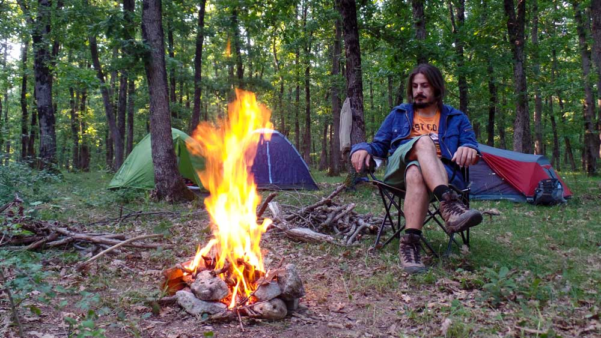
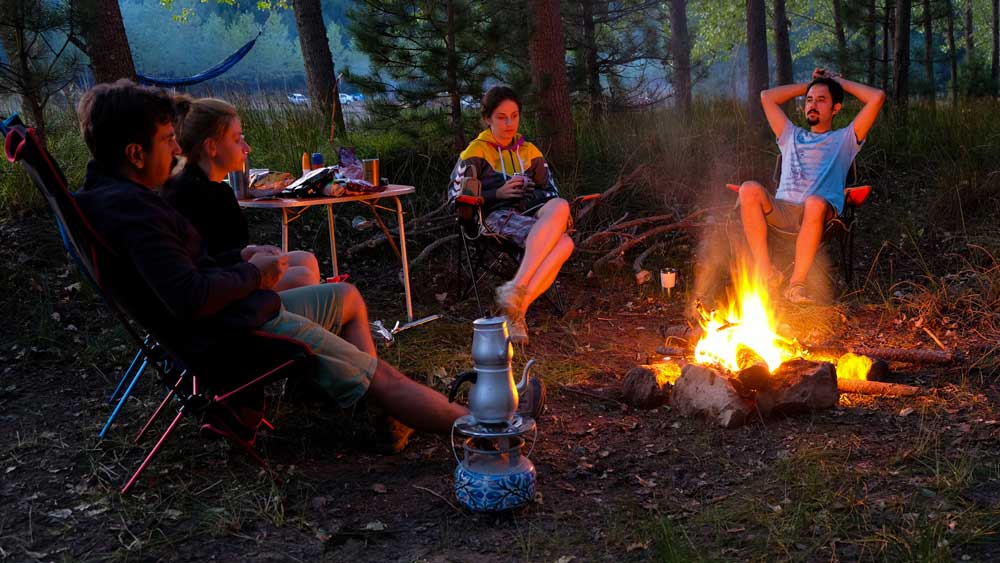
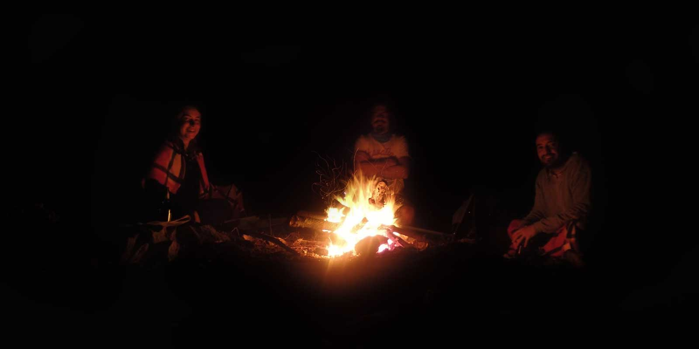

One of the things we love most about camping is a beautiful campfire that keeps us warm and crackles enticingly. We all try to build our campfires in a way that is both beautiful and causes as little harm as possible to nature. However, we sometimes make mistakes – unintentionally, sometimes through forgetfulness, and sometimes through carelessness – which can result in harm to nature or ourselves.

If you would like to read the text, continue reading it, or listen to my explanation on YouTube.

`youtube: https://www.youtube.com/watch?v=HuMmBjTpc0k`

## Top 10 tips for a safe campfire

Okay, so I’m going to share this secret with you, and we can eliminate these risks.

### 1\. Find a safe spot for the fire

Keep your fire in a place where you feel safe, at least 5 meters away from camping tents, and as far as possible from trees and the forest.

### 2\. Don’t light a fire directly on the ground

So, where will this group build a fire? When you light a fire on the ground, you will destroy a significant amount of the grass and plants, and also many living creatures that live within them. You can simply bend down and look. You will easily see the creatures living within the grass. You can use fire pits that don't touch the ground. If you don't have such equipment, look around and build a fire in an area of soil, or in a place where a fire has already been lit. This way, you minimize harm to nature. The best option is to use a fire pit that doesn't touch the ground.

### 3- Protect the edges of the fire.

You can create a small pit in the ground and surround it with stones to make it safer for a fire. If you don’t have the chance to dig a pit, simply surround the area where you want to build your fire with stones. This will allow you to better control your fire.

### 4- Keep water or sand with you.

You won’t be able to predict what will happen. You might think the precautions you’re taking are enough, but a sudden gust of wind could cause the fire to change direction and grow. It would be beneficial to have water with you in case you can respond immediately.

### 5- Do not use flammable substances such as gasoline or gas.

Light the fire with a match and drop the used match into the fire instead of tossing it left or right. Flammable liquids such as petrol are very dangerous. Just when you think you’re getting the fire going quickly and easily, the liquid can flare up and burn you.

### 6- Don't let him/her have a fever.

You can think of the fire as a mischievous child. A sudden gust of wind could scatter the embers, causing the fire to spread rapidly. There should always be someone watching the fire closely. Do not leave the fire unattended.

### 7- Use dry wood and trees.

If there’s a forest around you, you’re very lucky. Please, do not cut down the living trees. If there’s a forest, it means there are plenty of dry branches everywhere. The entire camping group can collect enough dry firewood to last the whole night by spreading out into the forest within half an hour. If you don’t have a chance to find dry branches and firewood, you can buy firewood from a vendor before heading to the campsite.

### 8- Hold your temperature.

So, don’t unnecessarily increase the fire. If you’re struggling to maintain a large, dangerous campfire just because you want to build a huge, monstrous fire, that can lead to very bad things.

### 9 - Be careful with children and your pets.

Two dangerous creatures. You don’t know what they will do at any moment. Teach your children how to protect themselves from fever and ensure their safety. At the same time, don’t leave them alone with fever. Keep a watchful eye on them.

### 10 – Make sure the fire is completely extinguished.

Do not sleep in your tents until your campfire is completely extinguished. Make sure the fire is completely out. A wind that arises at night could rekindle the embers and cause everything to burn, even though your tents are made of materials designed to withstand fire. Therefore, you should never neglect to take precautions.
