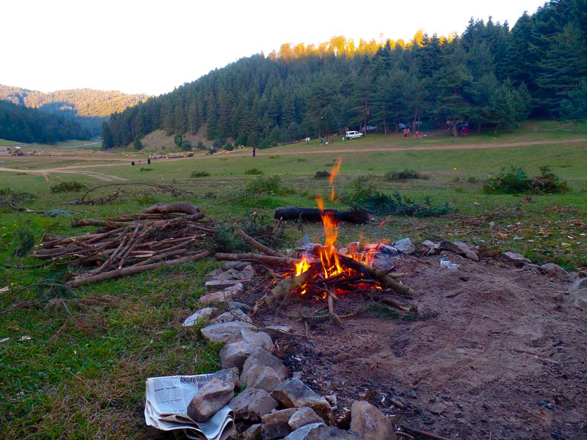
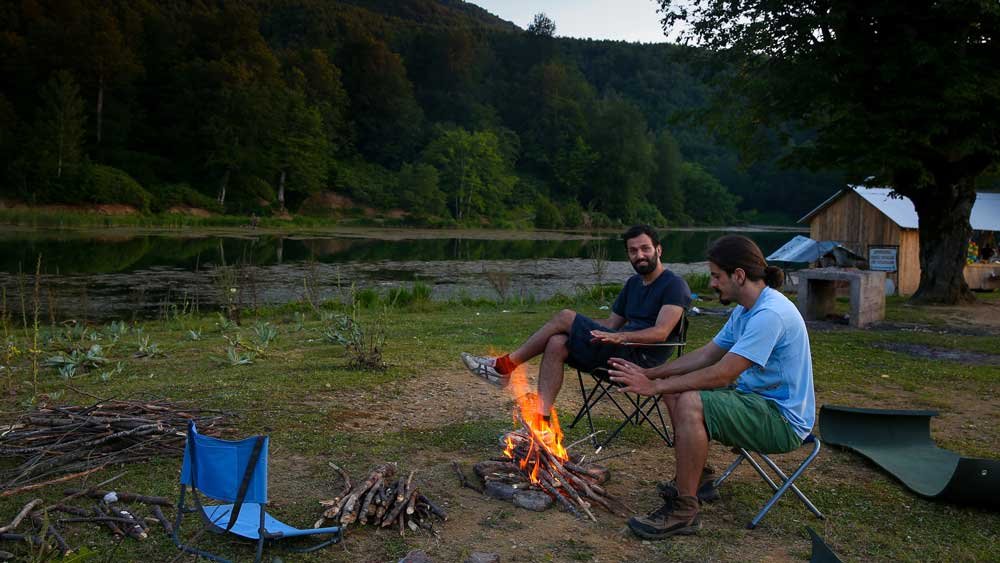
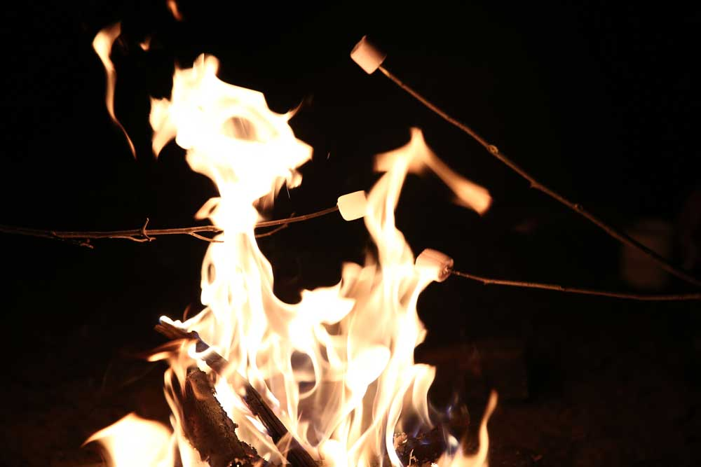

A fire crackling away and warming our toes is one of my favourite things about camp. We try to leave as little trace as we can, but it’s easy to overlook something and end up hurting ourselves or the place we came to enjoy.

You can read on or watch me talk through these tips on YouTube.

`youtube: https://www.youtube.com/watch?v=HuMmBjTpc0k`

## Top 10 tips for a safe campfire

Here’s what I pay attention to when we have a fire at camp.

### 1. Find a safe spot for the fire

Choose a safe spot at least 5 metres from the tents and as far as you can from trees and woodland.

### 2. Don’t light a fire directly on the ground

So where are we supposed to light it? Crouch down and take a look at what lives in the grass. A fire there burns the plants and all the little creatures among them. I prefer a fire bowl raised off the ground. Without one, look for bare earth or a spot where there’s already been a fire to keep the damage down.

### 3. Protect the edges of the fire

You can create a small pit in the ground and surround it with stones to make it safer for a fire. If you don’t have the chance to dig a pit, simply surround the area where you want to build your fire with stones. This will allow you to better control your fire.

### 4. Keep water or sand with you

A sudden gust can change a fire’s direction and make it flare up, even when you think you’ve taken every precaution. Keep water handy so you can act straight away.

### 5. Do not use flammable substances such as gasoline or gas

Light the fire with a match and drop the used match into the fire instead of tossing it left or right. Flammable liquids such as petrol are very dangerous. Just when you think you’re getting the fire going quickly and easily, the liquid can flare up and burn you.

### 6. Never leave the fire unattended

You can think of the fire as a mischievous child. A sudden gust of wind could scatter the embers, causing the fire to spread rapidly. There should always be someone watching the fire closely. Do not leave the fire unattended.

### 7. Use dry wood and trees

If there’s a forest around you, you’re very lucky. Don’t you dare cut down living trees. If there’s a forest, it means there are plenty of dry branches everywhere. The entire camping group can spread out into the forest and collect enough dry firewood to last the whole night within half an hour. If you can’t find dry branches or firewood, you can buy them from a vendor before heading to the campsite.

### 8. Keep the fire under control

Keep it small enough to manage. Try to build a monster of a fire and you may find you’ve got a monster on your hands.

### 9. Be careful with children and your pets

Children and pets are two great sources of surprises. Teach children how to light a fire safely and how to look after it. Keep an eye on them, and never leave them alone with the fire.

### 10. Make sure the fire is completely extinguished

Make sure the fire is right out before you turn in. A gust in the night can breathe life into even the tiniest ember. A tent made from flame-resistant fabric can still burn, with you asleep inside it.
