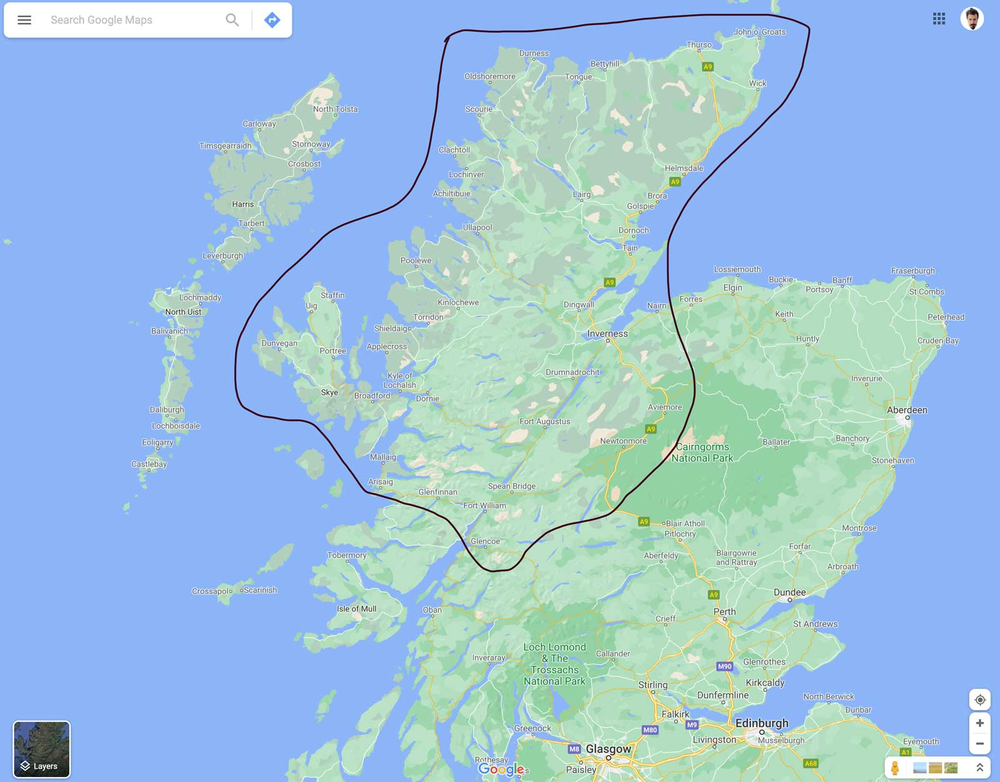
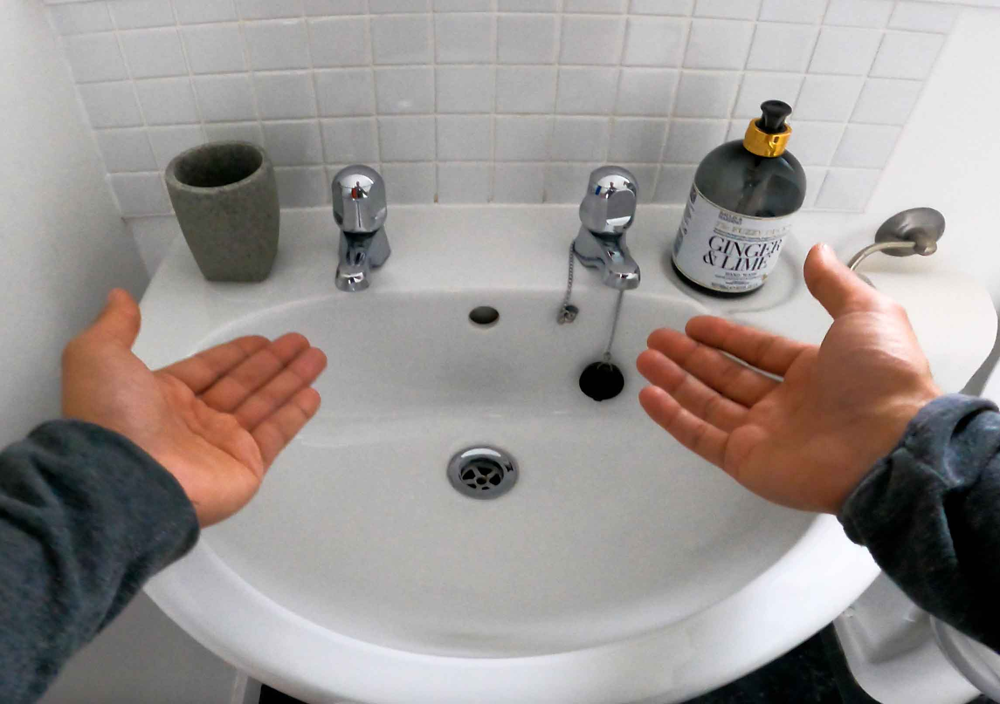

My other solo trip, specifically to the Highlands of Western Scotland, and even further into the Scottish plains, has come to an end. Now, let’s put the hat down and have a discussion and a quick recap. Let’s do this in a question-and-answer format.

## What I wrote before setting off, and what I wrote while on the road.

These sections appeared while writing on the road. They changed, you know.

* [A Trip I’d Dreamed Of: The Isle of Skye](/bir-hayale-yolculuk-isle-of-skye/)
* [Part 1: Inverness](/iskoc-yaylalari-inverness-1.-bolum/)
* [Ben Nevis, Part 2](/iskoc-yaylalari-ben-nevis-2.-bolum/)
* [Part 3: The Isle of Skye](/iskoc-yaylalari-isle-of-skye-3.-bolum/)
* [NC500 Route, Episode 4](/iskoc-yaylalari-nc500-rotasi-4.-bolum/)

## How many days did it take, and how much distance did I cover?

I rode 5,500 km on the motorcycle in 29 days: 2,000 km there and back from London and 3,500 km in the Highlands. I also walked about 85 km.

## How did I travel?

I enjoyed the trip thoroughly, wandering about as if I were an animal, and at times, I took my time and moved slowly. However, I did ride the motorcycle excessively. I rode it so much that I needed to rest at home for 1–2 days without making any progress on the route. Since I had to work from home using my computer, I found myself tied up with work for 5 days a week, working 8 to 5. I also went on excursions in the evenings and on weekends. This journey served as a simulation of my dream, blending both work and travel.

## The places I’ve visited

I heard the same thing from 2 or 3 Scots: “Live in the east and come west on holiday.” I explored the western Highlands, apart from their far southern end. I went to some of the best-known places: the Isle of Skye, Ben Nevis, Fort William, Inverness, the northern Highlands, Glencoe, Applecross, Loch Ness, Glenfinnan with its Harry Potter train, Aviemore and the Cairngorms. I rode almost every road within the area outlined on the map below. I ran out of time for the islands.

## Where was I?

My original plan was to camp for 4–5 days, then stay in a house for 4–5 days. Changing jobs threw out my annual leave plans. I managed 3 nights at a campsite and 1 night camped near the summit of Ben Nevis. Otherwise I stayed in rooms I found through Airbnb. When looking for a room, I kept weighing up value for money, a table and chair, and Wi-Fi. Those were the deciding factors, since I’d be working from home.

## How much did it cost?

It’s been a while, according to some, a long time according to others. If I hadn’t been working, I would have definitely reduced the costs even further – at least by half. Because I’m working, finding a suitable place to stay has become important, and therefore, I’ve ended up paying the most for accommodation. As of July 2021, my average expenses for this 29-day trip were as follows:

* 29 night stay: approximately 1250 pounds, which is roughly 15,000 Turkish Lira.
* Gasoline: 18-19 tank units. Around 400 pounds, approximately 5,000 Turkish Lira.
* Food and drink: around 400 pounds, approximately 5,000 TL

Before the trip, I’m taking care of my car and buying a few electronic items. These were already part of my regular expenses. Besides these, there weren’t any other expenses. Approximately 2 thousand pounds – which is around 25,000 Turkish Lira – but I’ve always preferred to travel with less money. However, this time I didn’t have that goal; I was working from home, and my comfort was much more important. I spent a good portion of the money I earned that month on this trip, and frankly, I didn’t care. After all, what are we earning money for?

## What were the songs I listened to the most while traveling?

Music is one of the most important things on the road. It sets your rhythm and can even pick it up. I listened to different kinds of music over 5,500 km, but I kept coming back to Daft Punk and The Avener. If I went again, I’d spend 80 percent of the time listening to those two. Their music made those beautiful roads even more enjoyable.

## The most dangerous event I experienced

5500km is not a short distance, especially when riding a motorcycle. Thankfully, I haven’t experienced a serious accident or problem. While driving from London to Scotland on the motorway, a truck in the left lane had a flat tire and suddenly veered into the middle lane. Luckily, I was in the right lane and just watched the event unfold. The caravan traveling in the middle lane didn’t do anything; it simply passed by. The way the event happened and its speed were incredibly sudden. If I had been in the caravan, traveling at 120km, there wouldn’t have been much I could have done. Thank God, the tire didn’t come to me. For those who don’t know, traffic in the United Kingdom (England, Scotland, Wales, Northern Ireland) flows from left to right.

## What challenges me the most

These bathrooms in this country. I don’t understand why they separate the hot and cold sides, and I’ve constantly asked why they are so small. Actually, foreigners separate the faucet, fill it with water at the temperature they want, and then wash their hands and faces. This doesn’t seem very hygienic to me, and these small bathrooms have been a real problem for me.

## The thing I fear the most

My gasoline is running out. Seriously, it is. I don’t ever fear getting lost in the fog at the top of the mountain. That’s why sudden changes in the weather don’t really affect me. I think I’m comfortable because I know what to do when I’m in a difficult situation, but seeing that burning gasoline light while I’m going up the mountain – that always worried me. Because there have been times when, when I thought about going to the nearest town to buy gasoline, I couldn’t find any. So, that burning light was the thing that worried me the most :).

## The misfortune I wish hadn’t happened to me.

Driving with a car, I was at risk of having an accident. I had driven a lot, and I was also looking around while driving. Therefore, the biggest problem I would face was having an accident.

## The most beautiful memory I can’t forget.

After witnessing a breathtaking sunset on Ben Nevis, and then observing an even more incredible sunrise the following morning – a sunrise multiplied by 100 – I was overcome with emotion and burst into tears as I descended, feeling completely overwhelmed. Those interested can read “[Ben Nevis 2. Bölüm](/iskoc-yaylalari-ben-nevis-2.-bolum/)”.

## What I said, what happened as a result.

I wished I could walk and camp more, but in my working conditions, I couldn’t do any more. I was getting incredibly tired. Also, I wished I had reorganized the whale watching tour from the beginning. Well, we’ll do it differently next time.

## Did I experience an injury?

Partially yes. I set off from London and drove for 12 hours in a single day, covering 1000km, and reached Inverness. Because I drove such a long distance in one day, my shoulders locked and became stiff. I experienced a serious shoulder pain. After using muscle relaxants and bandages for 3-4 days, I felt better. Perhaps because I was accustomed to driving a motor vehicle, the same problem didn't occur on the return trip, but the weather was warm on the return, and my hands were very sweaty, which is something I usually experience – the gloves really stuck to my hands. Also, constantly holding the handlebars caused swelling in my muscles and numbness in my hands. Despite it being a week, the pain continues. I started by reducing my PC and phone usage and applying ice treatment. It’s great that I haven’t experienced any serious problems besides these negative effects.

## The thing that wears me out the most.

When I go somewhere, I always put on and take off those motorcycle gear. Because with those clothes and boots, I can’t walk. Therefore, I had to put them on and take them off 3-4 times during the day, which was exhausting. But the views I saw and the enjoyment I got from the road made me forget the exhaustion.

## The thing that gets to me the most is…

A 24-year-old woman disappeared while hiking alone in Ben Nevis, after witnessing the sunrise, and her lifeless body was later found. May she rest in peace.

## The unnecessary items that I received.

Tripod. I haven’t used it at all, and it took up a huge amount of space. I was also a little disappointed that I didn’t get an octopus-style tripod instead. It was just sitting in another bag, so I never even saw it. It would have been light and taken up very little space, though. In addition to that, there was a whole pile of miscellaneous items. But those could have been useful at any time. Anyway, let’s hope for the best. Ultimately, my son carried it on his back.

## If I could go back, what would I do?

Right now, I’m currently making plans. I’ll be doing lots of walking and camping in nature. And also, a tour to see whales.

During this trip, I created wonderful memories and gained invaluable experiences. It was almost like a simulation of the life I plan to live in the future. Of course, we won’t know what time will reveal, but I will continue to pursue my dreams. And I will, ;)