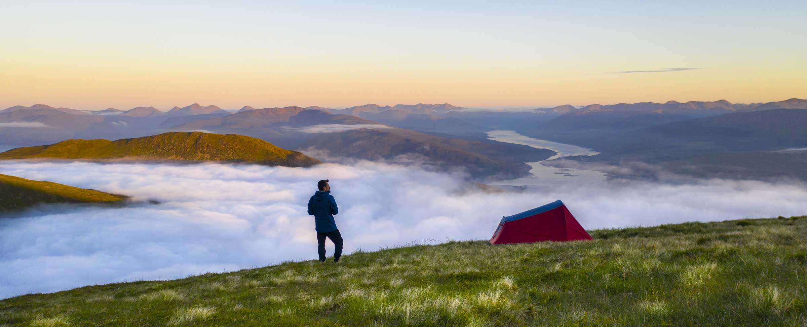

My other solo trip, specifically to the Highlands of Western Scotland, and even further into the Scottish plains, has come to an end. Now, let’s put the hat down and have a discussion and a quick recap. Let’s do this in a question-and-answer format.

## What I wrote before setting off, and what I wrote while on the road.

These sections appeared while writing on the road. They changed, you know.

* [A Trip I’d Dreamed Of: The Isle of Skye](/bir-hayale-yolculuk-isle-of-skye/)
* [Part 1: Inverness](/iskoc-yaylalari-inverness-1.-bolum/)
* [Ben Nevis, Part 2](/iskoc-yaylalari-ben-nevis-2.-bolum/)
* [Part 3: The Isle of Skye](/iskoc-yaylalari-isle-of-skye-3.-bolum/)
* [NC500 Route, Part 4](/iskoc-yaylalari-nc500-rotasi-4.-bolum/)

## How many days did it take, and how much distance did I cover?

I rode 5,500 km on the motorcycle in 29 days: 2,000 km there and back from London and 3,500 km in the Highlands. I also walked about 85 km.

## How did I travel?

I travelled well, I travelled like an animal, and sometimes I travelled calmly. But I rode the motorbike a lot. I rode it so much that I needed to rest at home for 1–2 days without making any progress. Since I had to work from home at my computer, I got tied to work for 5 days a week, 8 to 5. I also travelled in the evenings after work and on weekends. This trip became a simulation of my dream to both work and travel.

## Where I've been

I heard the same thing from 2 or 3 Scots: “Live in the east and come west on holiday.” I explored the western Highlands, apart from their far southern end. I went to some of the best-known places: the Isle of Skye, Ben Nevis, Fort William, Inverness, the northern Highlands, Glencoe, Applecross, Loch Ness, Glenfinnan with its Harry Potter train, Aviemore and the Cairngorms. I rode almost every road within the area outlined on the map below. I ran out of time for the islands.

## Where was I?

My original plan was to camp for 4–5 days, then stay in a house for 4–5 days. Changing jobs threw out my annual leave plans. I managed 3 nights at a campsite and 1 night camped near the summit of Ben Nevis. Otherwise I stayed in rooms I found through Airbnb. When looking for a room, I kept weighing up value for money, a table and chair, and Wi-Fi. Those were the deciding factors, since I’d be working from home.

## How much did it cost?

It was a long time, some say, and others say it was short. If I hadn’t been working, I would have definitely cut the costs even further – at least by half. Because I was working, where I stayed mattered, so I ended up spending the most on accommodation. As of July 2021, my average expenses for this 29-day trip, line by line, were as follows:

* 29 night stay: approximately 1250 pounds, which is roughly 15,000 Turkish Lira.
* Fuel: 18–19 tanks. Around £400, roughly 5,000 Turkish Lira.
* Food and drink: around 400 pounds, approximately 5,000 TL

I’m leaving out the pre-trip service on the bike and a few bits of electronics I needed. I’d have paid for those anyway. Beyond that, the figures above cover everything: roughly £2,000, or about 25,000 TL at the time I’m writing. I usually like to spend less so I can travel more. This time I was working remotely and comfort mattered more. A fair chunk of what I earned that month went on the trip. Do I care? Not a bit. What else do we earn money for!

## What were the songs I listened to the most while traveling?

Music is one of the most important things on the road. It sets your rhythm and can even pick it up. I listened to different kinds of music over 5,500 km, but I kept coming back to Daft Punk and The Avener. If I went again, I’d spend 80 percent of the time listening to those two. Their music made those beautiful roads even more enjoyable.

## The most dangerous event I experienced

5,500 km is a fair old distance, especially on a motorbike. Thankfully I had no serious accidents or problems. On the motorway from London to Scotland, a lorry in the far left lane blew a tyre and the tyre flew into the middle lane. I was in the far right lane, thank goodness, and just watched it happen. The campervan in the middle lane had no time to react and drove straight over it. It all happened so fast. Had that been me doing 120 km/h, there wouldn’t have been much I could do. Thank goodness that tyre didn’t come my way. In case you’re wondering about the lanes, traffic keeps left in the UK: England, Scotland, Wales and Northern Ireland.

## What challenged me the most

These bathrooms in this country. I still don’t understand why they separate the hot and cold taps, and I kept asking why they’re so tiny. Actually, these foreigners just plug the sink, fill it with water at whatever temperature they like, and then wash their hands and faces. This doesn’t seem very hygienic to me, and these bathrooms really threw me.

## The thing I fear the most

Running out of petrol. Seriously, it is. I never fear getting lost in the fog at the mountain's summit. That's why sudden weather changes don't really affect me. I suppose I was at ease on that front because I knew what to do when in a difficult situation, but that burning petrol light while I was climbing the mountain – it never stopped worrying me. Because there were times when, just as I thought I'd get petrol at the nearest town, I couldn't find any. So, that burning light was the thing that worried me the most :).

## The misfortune I wish hadn’t happened to me.

Coming off the bike. I was covering a lot of ground and looking around as I rode, so a crash was the biggest thing I worried about.

## The most beautiful memory I can’t forget.

On Ben Nevis I saw a magnificent sunset. The next morning I saw a sunrise a hundred times better. By the time I was walking back down, I was such a bundle of emotions I was sobbing. I wrote about it in [Part 2: Ben Nevis](/iskoc-yaylalari-ben-nevis-2.-bolum/).

## What do I wish had gone differently?

I wished I could walk and camp more, but under the conditions I was working in, I couldn’t do any more. I was getting incredibly tired. And I also wished I’d arranged that whale-watching tour differently from the start. Oh well, next time.

## Did I get injured?

To a point. I rode the 1,000 km from London to Inverness in a single day, twelve hours on the bike. My shoulders seized up and really hurt. It took three or four days of muscle relaxants and heat patches before they eased. Maybe I’d got used to riding by the time I came home, because my shoulders were fine on the return. My hands were another story. It was hot, my hands sweat plenty at the best of times, and my gloves stuck to them. Holding the handlebars for so long left my hands swollen and numb. A week on, they still hurt. I’ve cut back on the computer and phone and started icing them. Apart from that, I’m glad I got through the trip without a serious problem.

## What wore me out most?

When I go somewhere, I have to keep putting on and taking off that motorcycling gear. Because with those clothes and boots, I can’t walk. So, having to put them on and take them off three or four times a day was exhausting. But the views I saw and the enjoyment I got from the road made me forget the ordeal.

## The thing that gets to me the most is…

A 24-year-old woman disappeared while hiking alone in Ben Nevis, after witnessing the sunrise, and her lifeless body was later found. May she rest in peace.

## The unnecessary items I took with me

The tripod. Damn thing took up half the luggage and I didn’t use it once. I wish I’d brought the little flexible tripod instead. It was in the other bag, so I’d missed it. Lighter and much smaller, too. I also had a whole little bag of odds and ends, although any of those might have come in handy. Ah well. At least it wasn’t my back carrying it all. My trusty lad did that for me.

## If I could go back, what would I do?

Right now, I’m currently making plans. I’ll be doing lots of walking and camping in nature. And also, a tour to see whales.

On this trip, I gathered wonderful memories and gained some truly great experiences. It was almost like a simulation of the life I plan to live in the future. Of course, who knows what time will bring or what will happen, but as long as we keep breathing, we’ll keep chasing our dreams. Well, I certainly will. ;)