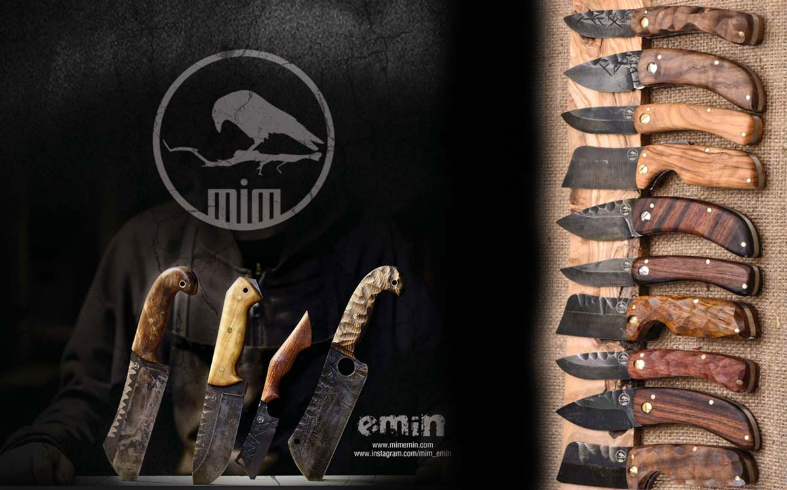

If you’re looking for a handcrafted, expertly made **kamp bıçağı**, you’ve come to the right place. I won’t explain the details of the knives themselves; instead, I’ll just offer some advice and recommendations. I don’t actually know a huge amount about knives – they’re a whole separate world, so I haven’t delved too deeply into them. Despite my limited knowledge and being just an average knife enthusiast, my knife is the most special item among my camping equipment. I have one knife that belonged to my father, and also knives and tools made by my neighbor, Emin, who is very skilled with knives. And, of course, I have a Opinel knife – I should include that too. I don’t consider the Opinel to be a particularly special knife for me, but it’s very effective. It helps to keep the other knives from getting involved in unpleasant tasks, so I really appreciate it. As a knife enthusiast, I believe my knives hold a certain significance, creating a special bond between us, which is why it’s the most prized item in my camping equipment.

Let’s talk about quality, durability, and the craftsmanship. Personally, when I’m looking for a knife, I’m primarily seeking sharpness and durability. After that, I examine the design – if I like it, I truly cherish it. If I don’t like it, it simply doesn’t enter my life – and I’m saying this like anyone else, as if I’ve discovered something new. The knives that Emin has made for me certainly meet my expectations. He makes them using very robust and high-quality materials. Honestly, there’s really no need to praise Emin or his knives – I don’t think they even *need* to be praised. You’ll see the difference, the quality, and the beauty of the craftsmanship just by looking at the knives.

If you’re looking for a handmade and unique **camping knife** or would like to see different knife models, you can contact Emin abi through [instagram account](http://www.instagram.com/mim_emin)(mim_emin) or via the website ([mimemin.com](http://mimemin.com/bicak_sanati.php)).

If he could also make axes, I would be his first customer. I really need a good axe :)

