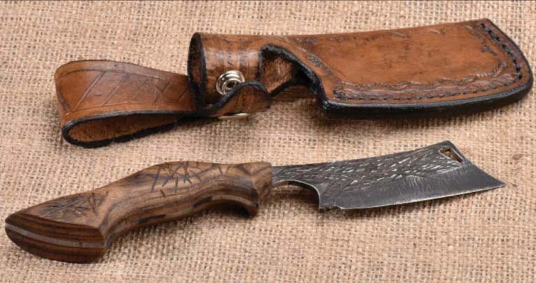
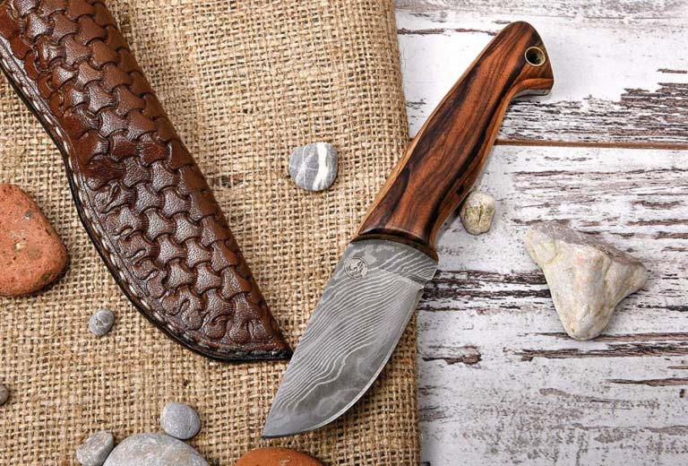

If you’re after a handmade **camping knife**, you’re in the right place. I’ll leave the finer points to someone who knows more about them. Knives are a whole world of their own and I’ve barely scratched the surface. Even so, of all my camping gear, my knives mean the most to me. There’s the one my father left me, and the knife and pocketknife Emin made especially for me. Oh, and I’d better count the Opinel. That’s the one I put to work on all the grubby jobs. It spares the others, so I’m fond of it too. I suppose it’s those connections that make them special.

Let’s talk about quality, durability, and the craftsmanship. Personally, when I’m looking for a knife, I’m primarily seeking sharpness and durability. After that, I examine the design – if I like it, I truly cherish it. If I don’t like it, it simply doesn’t enter my life – and I’m saying this like anyone else, as if I’ve discovered something new. The knives that Emin has made for me certainly meet my expectations. He makes them using very robust and high-quality materials. Honestly, there’s really no need to praise Emin or his knives – I don’t think they even *need* to be praised. You’ll see the difference, the quality, and the beauty of the craftsmanship just by looking at the knives.

If you’re looking for a handmade and unique **camping knife** or would like to see different knife models, you can contact Emin abi through [instagram account](http://www.instagram.com/mim_emin)(mim_emin) or via the website ([mimemin.com](http://mimemin.com/bicak_sanati.php)).

If he could also make axes, I would be his first customer. I really need a good axe :)

