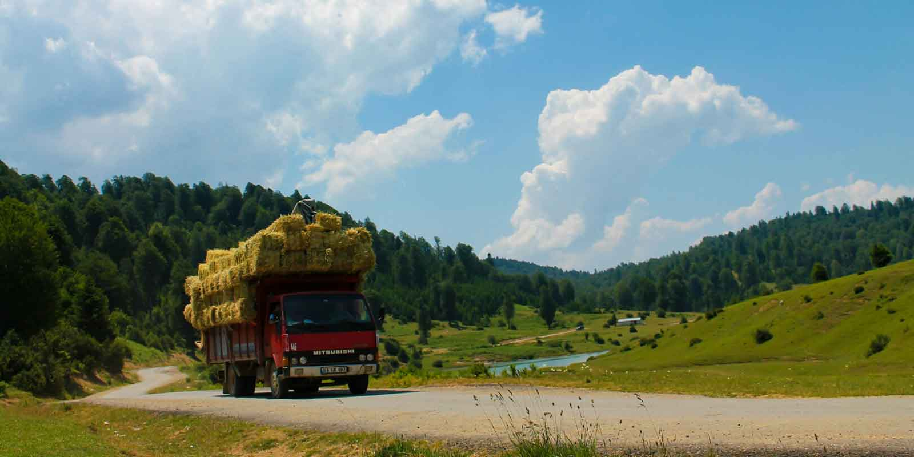
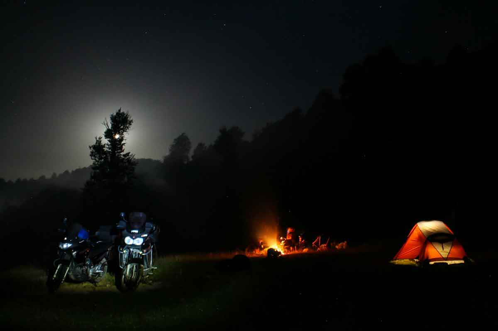
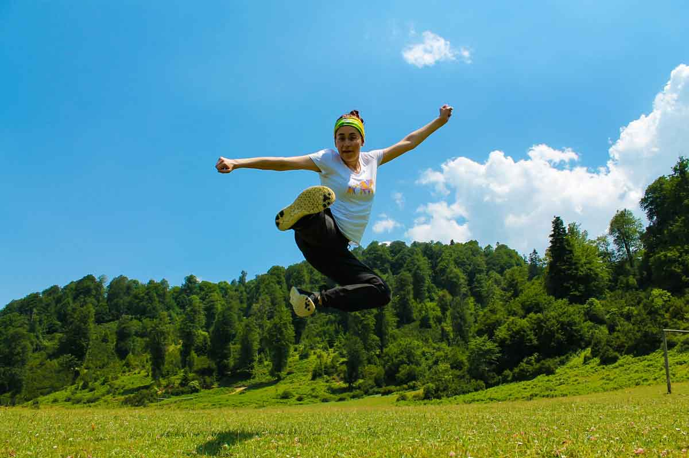

You can find information on how to reach Acelle Highland, camping area facilities, and various hiking routes in this guide. The field information is based on my observations from 2016.

## Quick summary

- **Region:** Sakarya, Taraklı–Akyazı area
- **Camping:** No managed campsite. Look for suitable level ground around the lake and highland.
- Routes: 13 km, 24 km, and 28 km options
- Field observation: July 2016

> Update note: The path, facilities, toilet, fountain, and camping rules may have changed. Before moving, please verify the weather, road conditions, and local restrictions.

Located in the Taraklı region of Sakarya, but more easily accessible via Akyazı, is Acelle forest, which may be Turkey’s largest forest. I don’t have definite information, but I can say that it’s a very popular forest. Don’t see this as a negative – it has a truly beautiful natural environment. The fact that there are many forests surrounding it has led to the creation of trekking routes. 

## Where is Acelle Highland, and how do you get there?

While traveling on the Tem Highway from İstanbul, after passing Adapazarı, you will continue towards Akyazı. After passing İhlas Kuzuluk Kaplıca Evleri in Kuzuluk, you will arrive in Beldibi village. Following the asphalt road, you will reach Acelle village via Hanyatak.

<iframe
  class='mappingFrame'
  src='https://www.google.com/maps/embed?pb=!1m24!1m12!1m3!1d170952.7828453397!2d30.391486681922625!3d40.58173205227702!2m3!1f0!2f0!3f0!3m2!1i1024!2i768!4f13.1!4m9!3e0!4m3!3m2!1d40.719545499999995!2d30.471758899999998!4m3!3m2!1d40.5182643!2d30.625968099999998!5e1!3m2!1str!2str!4v1468354089111'
  width='300'
  height='150'
  allowfullscreen='allowfullscreen'
></iframe>

 

## Acelle Highland campsite information

### Available facilities

- You can pitch your tent on the level ground around the lake. If it’s too crowded there, try the highland pasture.
- You can leave your car in the wide areas along the lake, or on the roadside.
- There isn’t a specific, dedicated camping facility available. It’s difficult to find a flat, shaded area. Because the areas with trees are usually on a slope, it’s hard to set up a tent.
- There’s a fountain and a toilet. Since it’s not a private business, don’t expect the toilet to be exceptionally clean.
- You can pick up any camping supplies you still need at the shops in Akyazı.
- There’s a grocery store in the village of Yaylada. You can find all your basic necessities there. However, because it’s located in a village, it may not always be open. So, the owner might have gone out to pick berries :)
- If you come between the end of June and the first week of July, you can also pick wild strawberries on the slopes.
- There is a mosque in the village.

### Facilities that are unavailable

- Grocery shop
- Restaurant
- Hotel, Guesthouse

Note: This information dates back to July 2016.

## Acelle Highland hiking routes

### Seven highlands and five ponds (28 km)

<iframe
  frameBorder='0'
  scrolling='no'
  src='https://tr.wikiloc.com/wikiloc/spatialArtifacts.do?event=view&id=7242837&measures=on&title=on&near=off&images=on&maptype=H'
  width='100%'
  height='600'
  style={{ borderRadius: '10px 10px' }}
></iframe>

- A relatively easy and beautiful course, full of wonderful scenery.
- Because the parkur traversed the highlands, there was no water shortage.
- Walking 28 km in one day can be tiring. You could split it over two days and camp along the way.
- A section of the park route follows a portion of the roads, while another part continues through the forest.

### From Karagöl Highland to Acelle Highland and return (24 km)

<iframe
  frameBorder='0'
  scrolling='no'
  src='https://tr.wikiloc.com/wikiloc/spatialArtifacts.do?event=view&id=695734&measures=on&title=on&near=off&images=on&maptype=H'
  width='100%'
  height='600'
  style={{ borderRadius: '10px 10px' }}
></iframe>

- A relatively easy and beautiful course, full of wonderful scenery.
- Because the parkur traversed the highlands, there was no water shortage.
- You can camp along the way.
- A trail that can be walked in winter.
- A section of the park route follows a portion of the roads, while another part continues through the forest.

### Karagöl, Çardacık and Acelle Highlands (13 km)

<iframe
  frameBorder='0'
  scrolling='no'
  src='https://tr.wikiloc.com/wikiloc/spatialArtifacts.do?event=view&id=12569075&measures=on&title=on&near=off&images=on&maptype=H'
  width='100%'
  height='600'
  style={{ borderRadius: '10px 10px' }}
></iframe>

- A relatively easy and beautiful course, full of wonderful scenery.
- Because the parkur traversed the highlands, there was no water shortage.
- The pools that form on Karagöl Highland after winter or a spell of rain are quite a sight.
- A section of the park route follows a portion of the roads, while another part continues through the forest.

## Nearby camping and preparation guides

- For a route around a lake in İstanbul, consult the guide for [Karacaköy Göleti](/karacakoy-goleti/).
- For walking options in the Kocaeli area, see the [Gebze Denizli Göleti](/gebze-denizli-goleti/) guide.
- Move to the article “[Buff what is it and how is it used?](/buff-nedir-ne-ise-yarar/)”.
