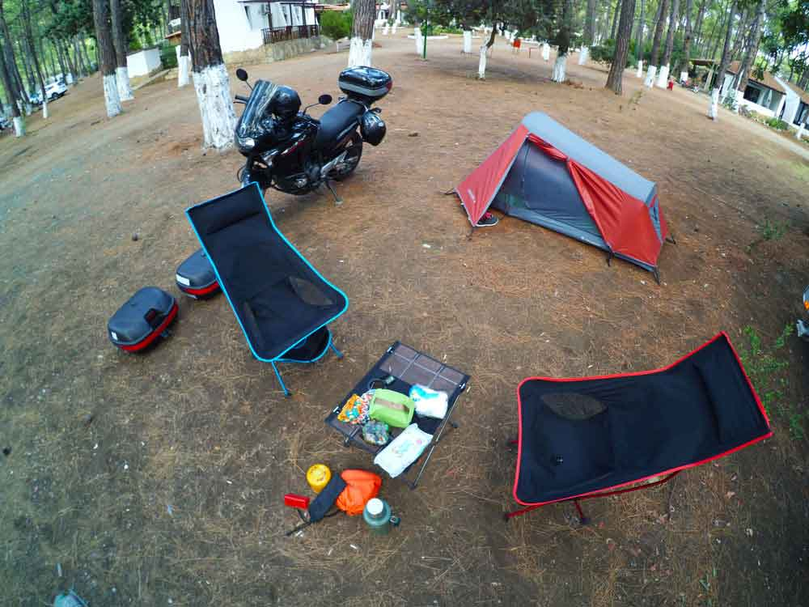
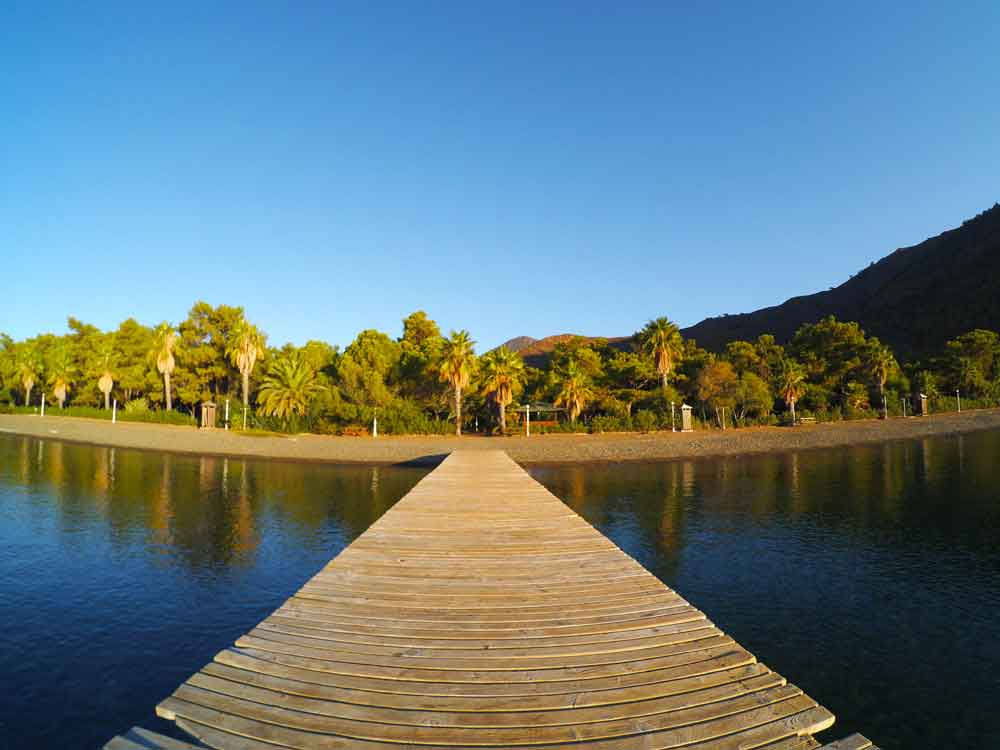

I generally don't enjoy camping areas because they are usually noisy and unpleasant. However, Aktur is an exception. It feels like a carefully prepared camping area – the cleanliness and the space allocated to each person are excellent. Moreover, it’s a quite large place. The likelihood of it being crowded will change your level of satisfaction depending on the time of year you visit. However, I don't think the friendly service and the way the management operates will significantly impact my experience. If the management changes, that would be a different matter. Aktur is, in fact, a holiday village, and a portion of it is operated as a camping area. It’s a popular destination for people who want to set up a tent or stay in a caravan. When I went there in September – at the end of the season – it was very peaceful. There’s no “pitch right next to your neighbors” type of setup. You have a very spacious area allocated to you, and I left feeling very satisfied and having found a sense of peace.

### Aktur Camping: Where is it and how do you get there?

If you arrive with your own vehicle, things will be as easy as always. From Marmaris to Datça, the journey is provided via paved road. While traveling in the direction of Datça, approximately 46km after leaving Marmaris, you will see the Aktur sign on your left. Do not confuse this with the place that says “Aktur Kurucabük”. It’s located a little further ahead of Kurucabük, on your left. Upon entering, inform security that you are arriving at the camping area, and after completing the registration process (including ID and license plate, etc.), you can reach the camping area by following the road on the left. Once you arrive at the camping area, you will see the reception building. Afterwards, you can choose the spot where you will set up your tent, together with a member of staff.

There are local buses (dolmuşlar) operating in Datça, going to Aktur. After arriving in Datça, you can use these dolmuşlar to get to Aktur. Or, you can get off the dolmuş in Aktur using the buses that come to Datça from Marmaris. Aktur is located very close to the road, making it an easily accessible place. While the sound of the vehicles on the road can be heard, it doesn’t really bother anyone. There’s a considerable distance between the road and the camping area.

<iframe
  class='mappingFrame'
  src='https://www.google.com/maps/embed?pb=!1m24!1m12!1m3!1d165044.298433335!2d27.940496060657544!3d36.810134670220705!2m3!1f0!2f0!3f0!3m2!1i1024!2i768!4f13.1!4m9!3e0!4m3!3m2!1d36.8598393!2d28.275387799999997!4m3!3m2!1d36.755805699999996!2d27.889651999999998!5e0!3m2!1str!2str!4v1477475207024'
  width='300'
  height='150'
  allowfullscreen='allowfullscreen'
></iframe>

 

### Aktur Camping Bus Schedules

The timetable below is for the S.S. 134 minibuses between Datça and Aktur. I think the times may change between summer and winter. For information, call 0252-724-66-24 or 0532-591-60-99.

| From Aktur                                                                                                               | From Datça                                                                                                                           |
| ----------------------------------------------------------------------------------------------------------------------- | ----------------------------------------------------------------------------------------------------------------------------------- |
| 07:45 08:45 09:15 09:45 10:15 10:45 11:45 12:45 13:45 14:45 15:15 15:45 16:15 16:45 17:15 17:45 18:15 18:45 19:15 19:45 | 07:55 09:00 10:00 10:30 11:00 11:30 12:00 13:00 14:00 15:00 16:00 16:30 17:00 17:30 18:00 18:30 19:00 19:30 20:00 22:00 24:00 01:00 |

### Aktur Camping area information

##### Available facilities

- Toilet, shower, kitchen, refrigerator, electricity, water, laundry room – everything you could need.
- I can say that it’s quite good in terms of cleanliness, and you’ll notice a difference during busier periods.
- At Aktur, initially a usage fee is collected, followed by a per-person fee. We paid 19 TL for the usage fee – for the area where we set up our tent – and then 19 TL per person. A price list varies by month. [To access Aktur camping prices, click here.](http://www.datcakamping.com/fiyatlarimiz.html)
- There are two different coves. One side is choppy, while the other is calm. You won’t be able to get enough of the sea with its blue flag – you’ll be delighted by it.
- Having a MigrosJet within the Aktur site is a significant advantage.
- There are also a few small businesses such as a pharmacy, a barber shop, and a cafe.
- There were beach chairs and umbrellas on the beach. You might not always be able to find them available, especially during busy times. People often bring their own umbrellas and chairs, so it’s a good idea to bring your own as well.

Note: This information dates back to September 2016.

### Aktur Camping Hiking Routes

There are trails along the Karia route in the area. I haven’t yet walked along the Karia route. If you are looking for routes along the Karia route, you can consult Google or find routes on wikiloc. I’ve been taking a morning walk along the coast at Aktur camping every day. The route is as follows. It’s a great pleasure to walk and then go into the sea.

#### Aktur seaside walk (2.3 km)

<iframe
  frameBorder='0'
  scrolling='no'
  src='https://tr.wikiloc.com/wikiloc/spatialArtifacts.do?event=view&id=15259551&measures=on&title=on&near=off&images=on&maptype=H'
  width='100%'
  height='600'
  style={{ borderRadius: '10px 10px' }}
></iframe>

- The coastline is an easy route.
- If you are staying at Aktur holiday resort, you will need to speak with the security at the entrance in order to access the beach. Ultimately, the entire area belongs to them. According to coastal law, the coast is public.
- It’s a short course. If your water runs out, you can obtain it from the road.
