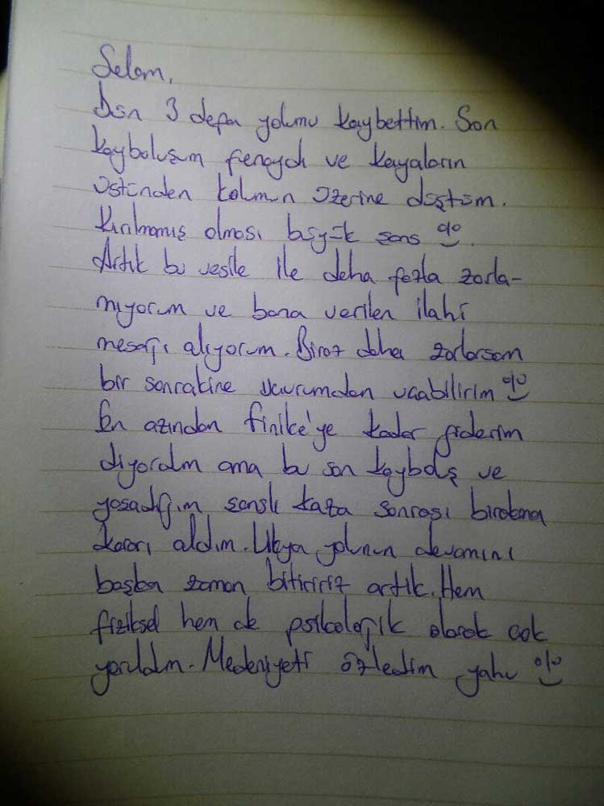

This page displays a 230 km Lycian Way route, from Ölüdeniz to Kaleüçağız, which was walked in 11 days between 20 and 30 September 2014, with a detailed day-by-day itinerary and daily connections.

I had done a lot of planning regarding the Lycian route. [Route Planning: Lycian Route](/likya-yolu-rotasi/) You can see the actual route I followed.

## 2014 hike video summary

`youtube: https://www.youtube.com/watch?v=k2G3v7FS7gw`

Event 1 began with one man, 21 days, and 509 km, and ended with one man, 11 days, and 230 km. That’s all Bünye could handle, you know? :). You can see a summary of the route between Ölüdeniz and Üçağız in the image above.

I wrote about how I prepared and what motivated me in [This Must Be Love](/bunun-adi-ask-likya-yolu/), [Why Go Alone?](/likya-yoluna-neden-tek-gidiyorsun/), [Preparing for the Lycian Way](/likya-yolu-hazirliklari/) and [My Backpack](/likya-parkuru-sirt-cantam/). For what happened each day, see the route list on this page and the journals I wrote along the way.

The plans and the reality were definitely different. Despite months of preparation, I felt physically exhausted. Because I couldn’t find much food on the road, I ate in an irregular way – usually just one meal and 1-2 packs of biscuits. When I had my second meal, I felt faint. I obtained water/electricity from the places where I stopped for prayer and food. My biggest problem was my phone breaking, which left me without a map and unable to communicate. And I conceded a goal from a place I never expected. I was very worn psychologically. For the last three days, I walked without a phone, without a map, and constantly lost. On the last day, I got lost three times. While trying to find my way on my last lost excursion, my arm fell on top of me. While I was thinking my arm was broken, there was only a slight pain, and this became the peak of my psychological breakdown. And at that moment, I stopped walking. I couldn’t, of course, because I was in a ridiculous place at the top of the mountain, but I ended my walk at the place where I first exited onto the asphalt. It lasted 11 days, 230km. The goal was to finish the route, and the purpose was to return home safely. If I had rested for 1-2 days, I could have continued for a bit, but I was very worn psychologically and didn’t want to push myself any further. I will walk the rest of the route another time, can be done. So, how did I actually walk the route? Like this;

Likya Route – The Route I Followed

**Day 1 (20 September 2014)**

Ölüdeniz → Faralya → Butterfly Valley → Kabak Bay (25 km)

* For details, see the [route from Ölüdeniz to Kabak Bay](/likya-yolu-rotasi-oludenizden-kabak-koyuna/).
* For my memories of the walk, read [Day 1 on the Lycian Way](/likya-yolu-1.-gun/).

**Day 2 (21 September 2014)**

Kabak Koyu -> Alınca -> Sidyma Ancient City (23km)

* For details, see the [route from Kabak Bay to the ancient city of Sidyma](/likya-yolu-rotasi-kabak-koyundan-sidyma-antik-kentine/).
* You can explore [Likya Road, Day 2](/likya-yolu-2.-gun/) to learn about road conditions.

**Day 3 (22 September 2014)**

Sidyma -> Gavurağalı -> Karadere (17km)

* You can find details about the Parkur regarding the route [from Sidyma to Karadere](/likya-yolu-rotasi-sidymadan-karadereye/)
* You can explore [Likya Road, Day 3](/likya-yolu-3.-gun/) to learn about road anomalies.

4th Day (September 23, 2014)

Karadere → Ancient City of Pydnee → Kınık (15 km)

* For details, see the [route from Karadere to Kınık](/likya-yolu-rotasi-karadereden-kinika/).
* For my memories of the walk, read [Day 4 on the Lycian Way](/likya-yolu-4.-gun/).

**Day 5 (24 September 2014)**

Kınık -> Çavdır -> Üzümlü (22km)

* You can access details related to the park via the route [Kınık'tan Üzümlü'ye](/likya-yolu-rotasi-kinikdan-uzumluye/).
* You can explore [Likya Road, 5th Day](/likya-yolu-5.-gun/) to learn about road anomalies.

**Day 6 (25 September 2014)**

Üzümlü -> Akbel -> Delik Kemer -> Kalkan -> Bezirgan (22km)

* You can access details about the route [from Üzümlü to Bezirgan](/likya-yolu-rotasi-uzumluden-bezirgan-koyune/) – the Lycian Way route – via the route from Üzümlü to Bezirgan.
* For my memories of the walk, read [Day 6 on the Lycian Way](/likya-yolu-6.-gun/).

**Day 7 (26 September 2014)**

Bezirgan → Sarıbelen (12km)

* You can find details about the Parkur route [from Bezirgan to Sarıbelen](/likya-yolu-rotasi-bezirgandan-saribelene/) can be accessed via this route.
* For my memories of the walk, read [Day 7 on the Lycian Way](/likya-yolu-7.-gun/).

8th Day (September 27, 2014)

Sarıbelen -> Gökçeören (12km)

* For details, see the [route from Sarıbelen to Gökçeören](/likya-yolu-rotasi-saribelenden-gokceorene/).
* For my memories of the walk, read [Day 8 on the Lycian Way](/likya-yolu-8.-gun/).

9th Day (September 28, 2014)

Gökçeören -> Phellos -> Çukurbağ -> Kaş (28km)

* For details, see the [route from Gökçeören to Kaş](/likya-yolu-rotasi-gokceorenden-kasa/).
* For my memories of the walk, read [Day 9 on the Lycian Way](/likya-yolu-9.-gun/).

10th Day (September 29, 2014)

Kaş -> Limanağzı -> Körmen Adası (13km)

* For details, see the [route from Kaş to Körmen Island](/likya-yolu-rotasi-kasdan-kormen-adasina/).
* You can take a look at [Likya Road, 10th Day](/likya-yolu-10.-gun/) to learn how to read road signs.

11th Day (September 30, 2014)

Körmen Island → Boğazcık → Aperlai → Kaleüçağız (23 km)

* For details, see the [route from Körmen Island to Kaleüçağız](/likya-yolu-rotasi-kormen-adasindan-kaleucagiza/).
* You can take a look at [Likya Road, 11th Day](/likya-yolu-11.-gun/) to learn how to read road signs.

 

I completed 230km of the Lycian road in 11 days. So, it’s as if I’ve halved it. The remaining section of the road is now for another time :)

## My plan after the walk

I covered 230 km in 11 days. At that time, I had approximately 200 km remaining to complete the course, and I planned to walk the remaining stretch when the opportunity arose. This was a historical goal written after the 2014 hike – not the current route length or completion status.
