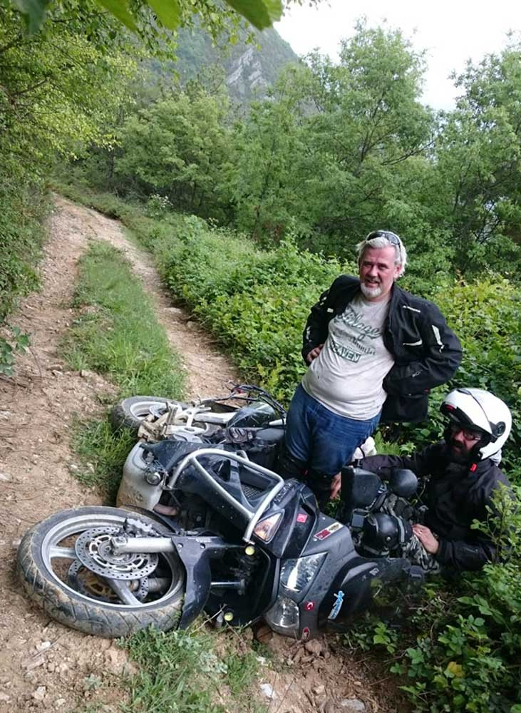
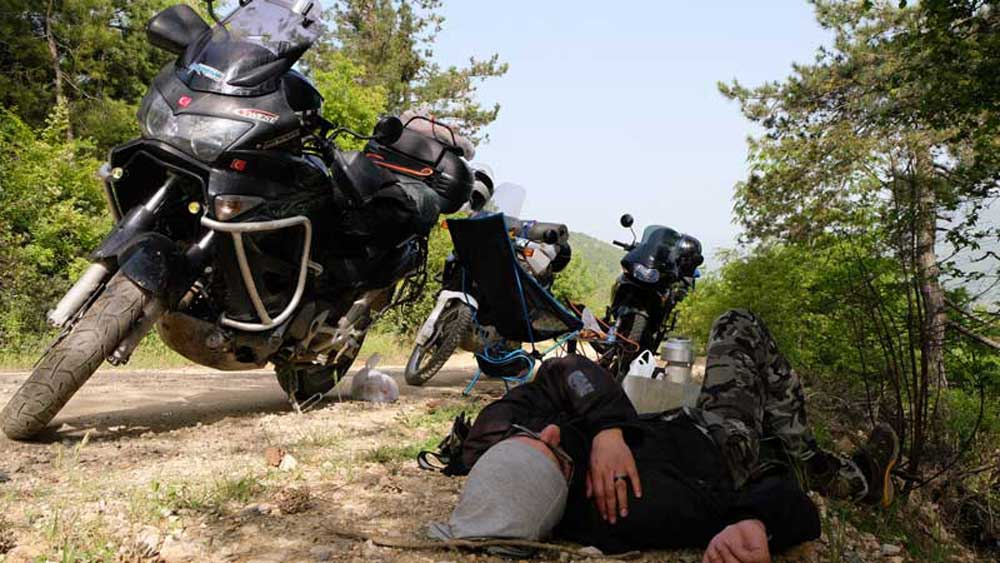

May 13, 2017. As the weather warmed up and we entered summer, we were constantly thinking about motor and camping plans. Our goal was to go to **Turnalık Plateau**, and we set off at 7 am with three motorcycles. Left to right -> 1 Transalp (Ben), 1 Africa Twin (Emin abi), and 1 Varedero (Emre abisi). There was also 1 Tenere (Murat abi), but he would join us later in the afternoon.

### Smoke is coming from the furnace.

While I was intending to have a leisurely breakfast and set off, we ended up running a bit behind. When we went to Tem, and continued on our way, we entered the Adapazarı flat area, and started around 150-160, trying to get it going, overtaking the vehicle in front, and then slowing down. It wasn’t about constantly pushing it. While enjoying the ride, Emre suddenly stopped me, and when I asked what was wrong, he said the exhaust was emitting smoke. When we stopped, I realized the engine was actually burning. I immediately turned off the engine and got off the motorcycle to see what was happening. Everything was covered in oil. It looked like the entire motorcycle was covered in oil, including my clothes. I started to think, “Is the motorcycle bearing again?” I called some experts and had a mechanic come and take a look. They said there was no problem, it was because too much oil had been added to the motorcycle. Apparently, the excess oil had sprayed out from the oil supply hose. Once we learned this, we continued on our way with a sense of relief. Then, suddenly, I felt a panic, “Is the motorcycle bearing again?” Luckily, it wasn’t. If not, I would have taken the motorcycle and left it there.

### Do not enter a path you do not know.

We cleaned the oil in the motor, checked it again to see if there were any leaks. When we didn’t see any, we went to Akyazı, bought some things to eat, and washed the motors. I’m saying “motors” because there was so much oil that Emre’s motor was completely covered in it. It was two o’clock. We set off again and arrived at the fork in the road in Dokurcun. I’m looking at the map; it’s suggesting a shortcut. But the actual road feels different. The shortcut was mostly just dirt and a rough surface, and we said, “Well, we’re enduro riders, so let’s go.” I was thinking these things as we went. The road got even worse as we went. No one in the group was warning us that this road shouldn’t be used. The road had become so awful that it was no longer even a road for a tractor. Then we started to put the motors down. The road was so bad, in some places it was mud, and in others, it was full of cracks. Probably because my motor was overheating, and also, I think the air filter was covered in oil, so it stopped taking gas. After a little rest and the motor cooled down, I jumped back on the motor and it started moving. I was trying to keep moving, driven by the fear that if I stopped, I couldn’t get going. We went up to the main road, looking back at nothing. I don’t even know how I got there. I pulled the motor over and started walking down. But no one was coming to help. The motor sounds weren’t there either. It didn’t feel like I was in a familiar place, and there were tracks of a wildcat. I almost stepped on a snake on the ground. I stopped one step away. It didn’t even notice me. If I had stepped on it, that’s when it would have been a problem. I took out my phone and looked at the map, and realized we were going to a completely random place. I had already gone down a long way. We turned back and found our way back to where the group was.

### Hot and unending torture

They kept revving the engines over and over again. When I arrived, there was a furious and resentful expression on their faces, with each of them conveying a feeling of contempt towards me. The heat was incredibly exhausting and tiring. People, in moments like these, tend to believe this torment will never end. But I was offering them hope – “when we turn here, when we curl up here, we’ll get out.” Let’s try one last effort, let’s get the engines up to a straight, good path. Afterwards, everyone was exhausted, trying to get back to themselves.

I’m making tea and preparing some snacks to try and forgive myself and improve my mood. “You don’t need to go down that road you don’t know,” my friend said. “I learned that it shouldn’t be done by car, but I didn’t really grasp it when it comes to motorbikes, apparently.”

### We are at the campsite at 7.

Around 5, Murat abi arrived and managed to join us. We had set off at 7 in the morning, and he left at 1. But we were at the same spot. It was really strange, though. We moved together, and we finally reached the meadow around 6-7 in the evening. We accomplished a great success, covering a total distance of approximately 4 hours in about 12 hours. As a result, we were all in good spirits, with only some scratches on the motor’s protective bars. But it’s certain that he gave me a lot of abuse. We set up camp, prepared the fire, food, and tea. Everything was perfect. And, there was also something else about the campsite – we spotted a Karaca. Yes, after all these years of doing this and traveling so much, venturing into these forests and being so careful, we were able to see a Karaca sign. Finally, we managed to break the devil’s leg – we actually saw a Karaca crossing.

### RESULT

It’s probably true that these guys won’t be coming camping with me again. If they eventually forget, maybe they’ll come back :). One of the lessons I’ve learned for myself is that if there’s a risky path, I shouldn’t go, especially if there are others in the group. But, we wouldn’t have been able to experience something like this otherwise. And that’s another reality – the most important thing is to return home safely and without incident.