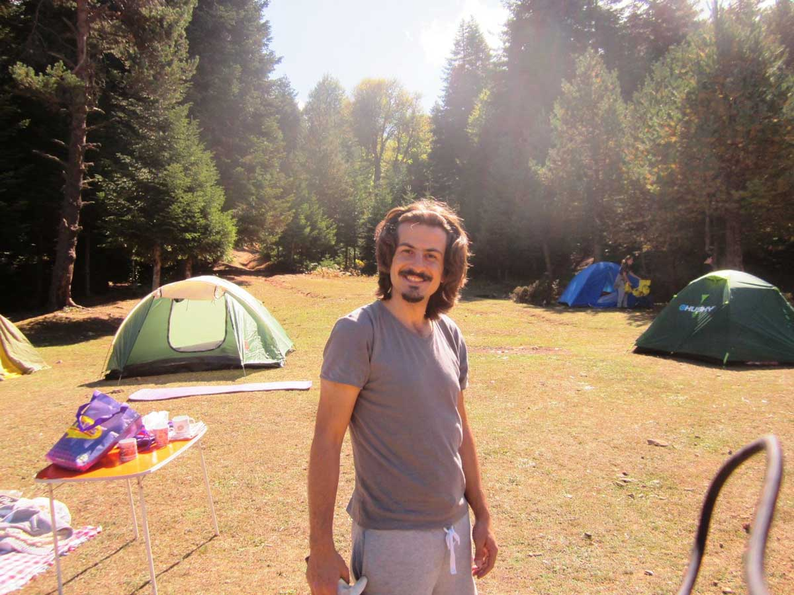
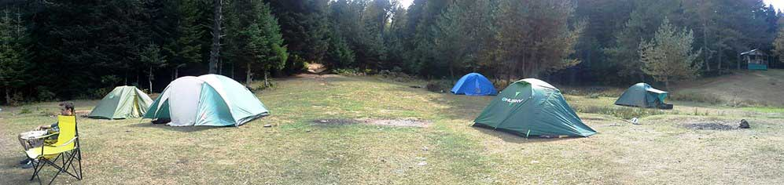
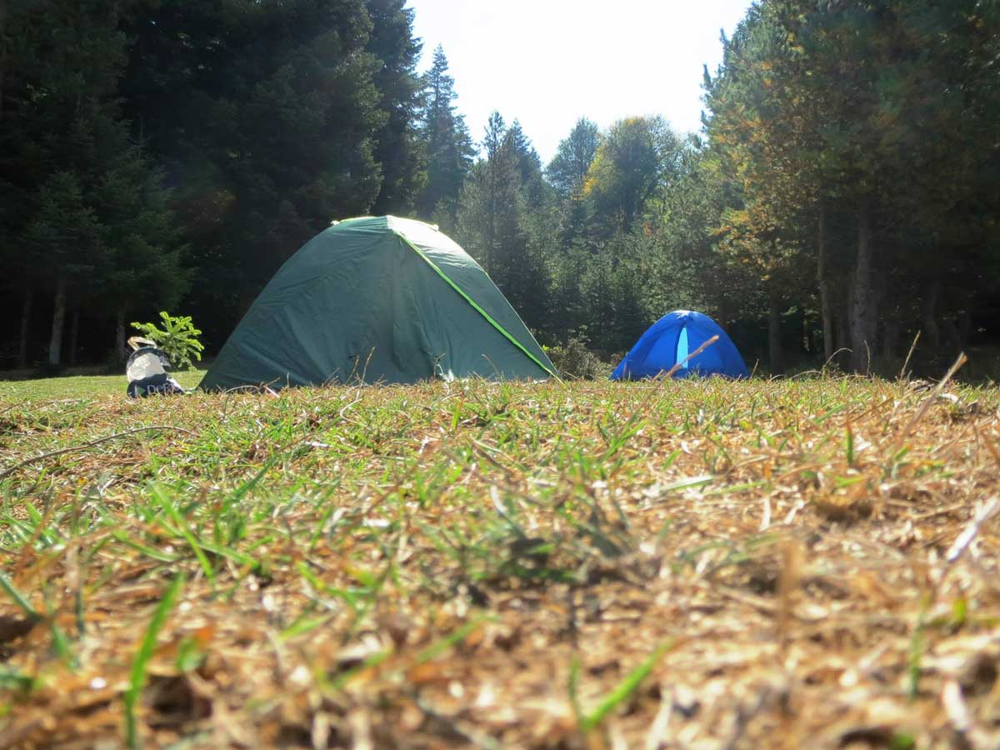
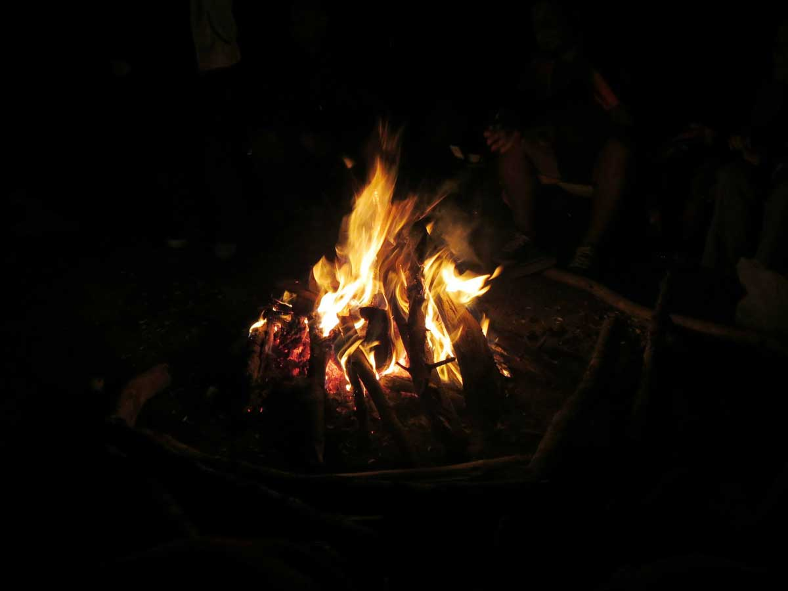
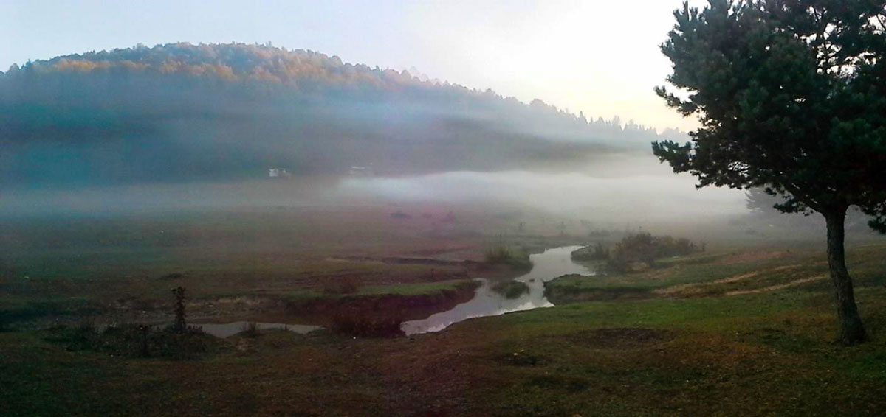
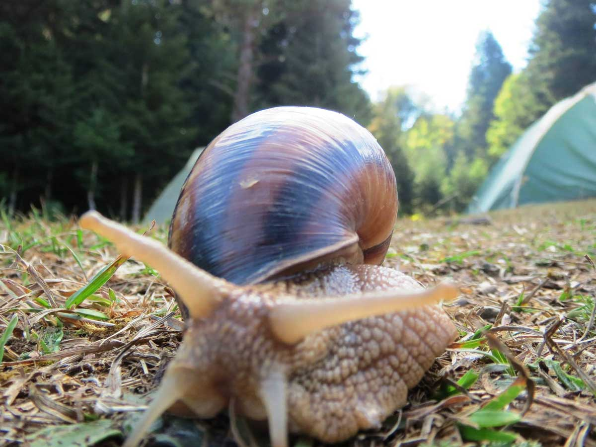
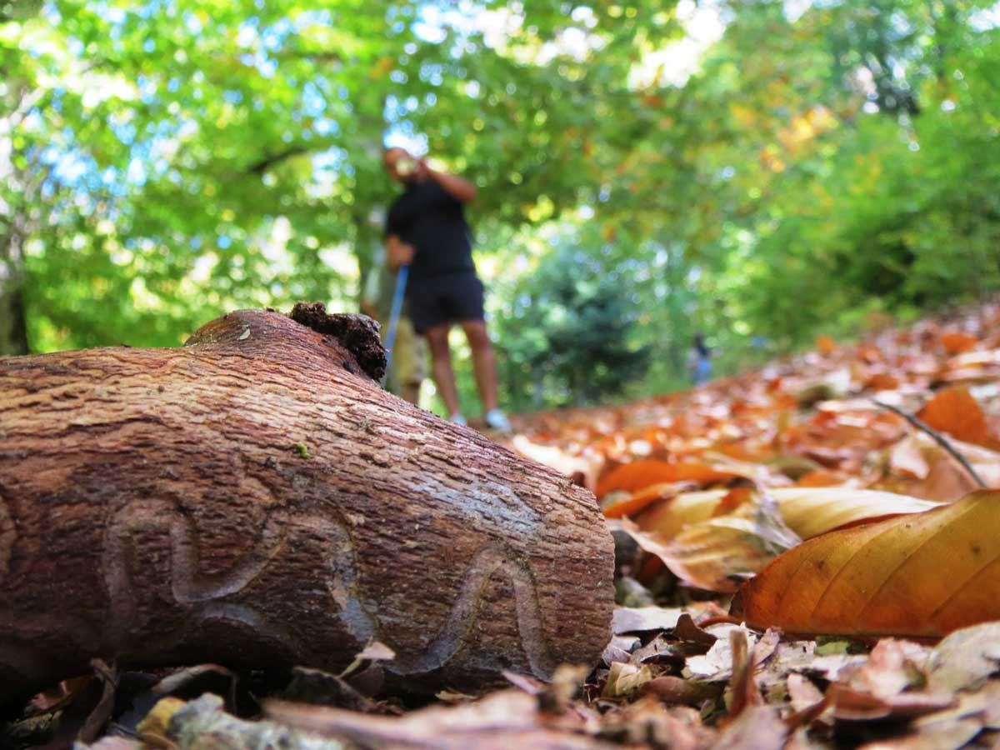
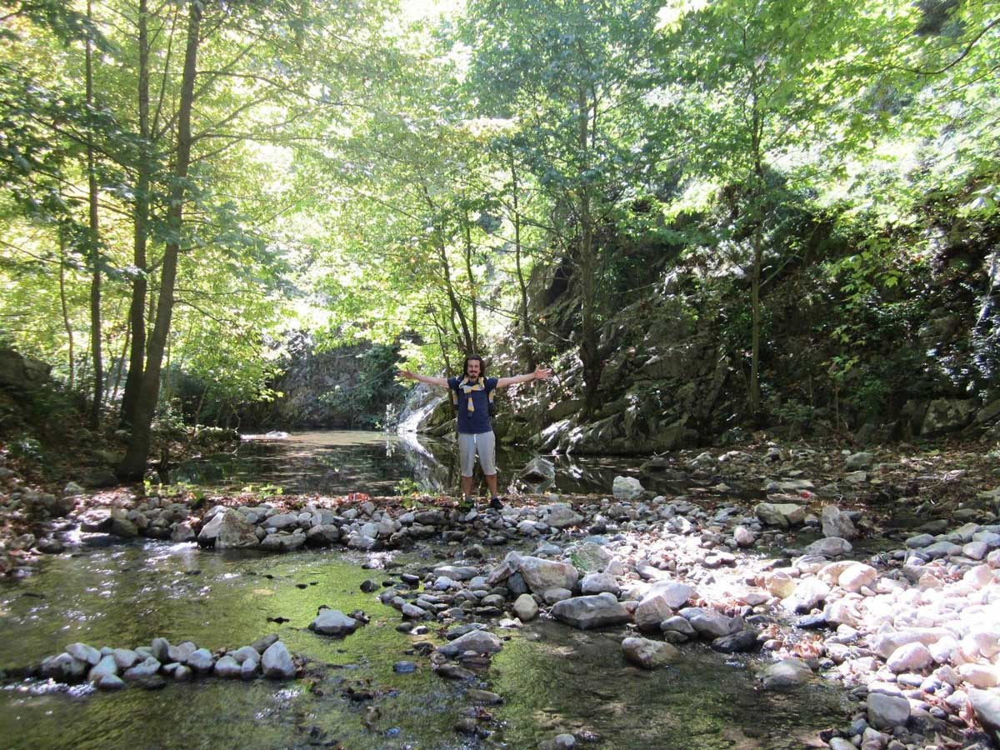
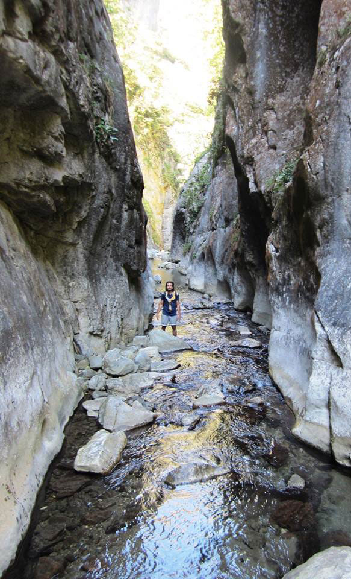
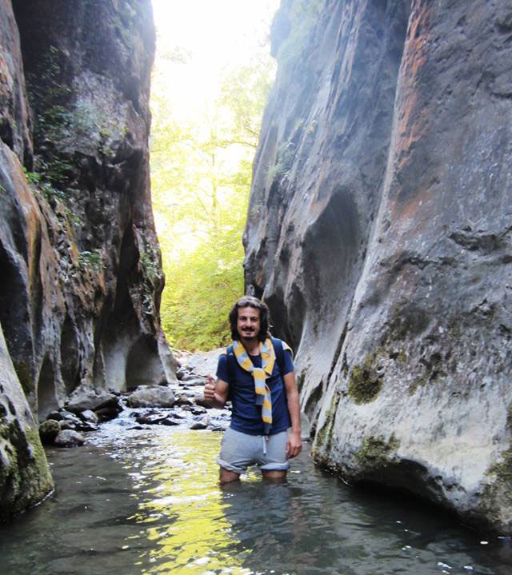

We are now entering October. The date is September 28-29, 2013, and we are in autumn. We’ve decided to go camping with colleagues from work and their families. Since there will be families involved, we need to choose a place that is relatively secluded, with water and toilets. We’re setting off to İnönü yaylası, which is our preferred choice. With a group of approximately 12 people, we arrive at İnönü yaylası on Saturday. People say that this place is particularly beautiful in autumn – you always find something to enjoy every time you come here.

After setting up at the campsite, we’re going for walks in the forest, and when returning, we collect wood for the evening campfire. The evening air gets quite cold, down to around 2 degrees Celsius. We sing songs and chat around the campfire. Then, everyone goes to their tents to sleep. I remember waking up several times during the night because of the cold, and going to the car. Around 6 in the morning, the cold is finally getting to me, and I get up to light the fire. The warmth of the fire helps us to warm up and fall asleep. For many of us, it’s a welcome relief after a cold and sleepless night, with the fire and tea.

On Sunday, we wake up early and have breakfast, then we play games. Afterwards, we’re going to Serpent Canyon (Serindere Kanyonu). The waters have decreased significantly; I think it would be more enjoyable to visit it in the spring. Of course, the canyon is beautiful as always. After a smooth hike, we arrive at the campsite. After lunch, we begin our return journey.

This was a great camping trip for relaxing and enjoying some good time. Because everyone in this group gets along so well, the camping trip has been very cheerful. And, since everyone’s friends also have their spouses, there’s never a chance of going hungry :)

## Inönü Plateau Photos

