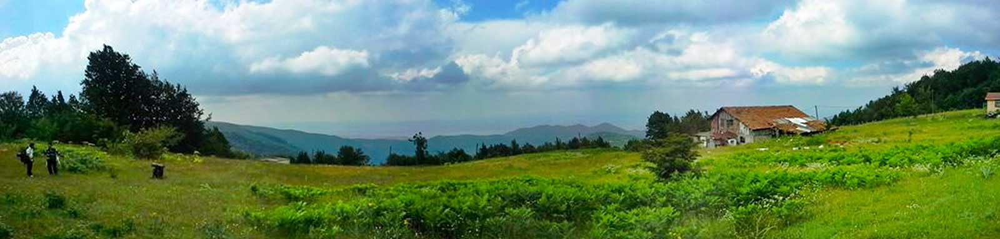

### Where is Aytepe and how do I get there?

From Kocaeli, go via Yuvacık and follow the signs for Aytepe. You’ll reach Kazandere village first and then Aytepe. The paved road climbs to a hilltop with a lovely view.

<iframe
  class='mappingFrame'
  style={{ border: 0 }}
  src='https://www.google.com/maps/embed?pb=!1m25!1m12!1m3!1d6381.788194345407!2d29.941961144238352!3d40.60385082346899!2m3!1f0!2f0!3f0!3m2!1i1024!2i768!4f13.1!4m10!1i0!3e0!4m3!3m2!1d40.7860541!2d29.968986599999997!4m3!3m2!1d40.6038156!2d29.947017199999998!5e1!3m2!1str!2s!4v1405758024950'
  width='300'
  height='150'
></iframe>

 

### Aytepe camp area information

##### Available facilities

- Camping Area (You can set up your tent in the flat areas you find. There are camping spots belonging to Veysel Dayı and Sinan, which are operated as private businesses. You can also stay there.)
- Clean water
- Toilets

##### Facilities that are unavailable

- At the café overlooking Körfez, owned by Şaban amca, there were a few chocolates. Besides those, you couldn’t find anything else.
- Restaurant
- Café

Note: This information dates back to August 2013.

### Aytepe Walking Routes

#### From the Yuvacık dam, via Aytepe and Soğukpınar, to İznik Lake (62 km).

<iframe
  frameBorder='0'
  scrolling='no'
  src='https://tr.wikiloc.com/wikiloc/spatialArtifacts.do?event=view&id=7088465&measures=on&title=on&near=off&images=on&maptype=H'
  width='100%'
  height='600'
  style={{ borderRadius: '10px 10px' }}
></iframe>

- There are numerous water points along the trail.
- Starting from the Yuvacık junction, you walk along the side of the road to reach Karaaslan camping. Afterwards, you continue along the same path to Servetiye Village, and then to Soğukpınar in Aytepe, via an old forest path. From there, you proceed uphill to Papaz meadow and then to Sansarak village. After passing through Sansarak village, you will reach İznik.
- This is a medium-difficulty course. The length of the route may be challenging. You may prefer to complete it in sections, rather than all at once.

#### From Aytepe, then on to Soğukpınar, and finally via Papaz Çayırı to Menekşe Valley (11.5 km).

<iframe
  frameBorder='0'
  scrolling='no'
  src='https://tr.wikiloc.com/wikiloc/spatialArtifacts.do?event=view&id=4027124&measures=on&title=on&near=off&images=on&maptype=H'
  width='100%'
  height='600'
  style={{ borderRadius: '10px 10px' }}
></iframe>

- The route begins in Aytepe, and first you descend to Soğukpınar. From there, you then follow a steep, forest trail to Papaz Çayır and then on to Menekşe Valley. Afterwards, you follow the same path back to your starting point.
- There is water in Soğukpınar, Papaz Çayırı, and Menekşe yaylası.
- The forest trail between Soğukpınar and Kayaklıklar might be a bit tiring for you. However, it’s generally a moderate route for beginners and an easy one for experienced hikers.

#### Aytepe to Servetiye Karşı village via Soğukpınar, Papaz Çayırı and Menekşe Highland (22 km).

<iframe
  frameBorder='0'
  scrolling='no'
  src='https://tr.wikiloc.com/wikiloc/spatialArtifacts.do?event=view&id=4037382&measures=on&title=on&near=off&images=on&maptype=H'
  width='100%'
  height='600'
  style={{ borderRadius: '10px 10px' }}
></iframe>

- Starting on the route from Aytepe, you first descend to Soğukpınar. From there, you then follow a steep, forest trail to Papaz Çayır and then on to Menekşe Valley. Finally, you descend via a forest path to Servetiye Karşı village.
- There is water in Soğukpınar, Papaz Çayırı, and Menekşe yaylası.
- The forest trail between Soğukpınar and Kayaklıklar might be a bit tiring, as it’s a medium-level route and quite long.

#### From Kırıntı Köy, to Soğukpınar (9 km)

<iframe
  frameBorder='0'
  scrolling='no'
  src='https://tr.wikiloc.com/wikiloc/spatialArtifacts.do?event=view&id=2854173&measures=on&title=on&near=off&images=on&maptype=H'
  width='100%'
  height='600'
  style={{ borderRadius: '10px 10px' }}
></iframe>

- Start in Kırıntı village and follow the dirt road to Menekşe Highland, then continue to Papaz Çayırı. From there a forest trail leads to Soğukpınar.
- In the villages of Kırıntı, Soğukpınar, Papaz Çayırı, and Menekşe yaylası, there is water.
- Overall, it’s a relatively easy course.
- You can also start this route at Soğukpınar in Aytepe.

#### From Aytepe to the Karaaslan campsite (20 km)

<iframe
  frameBorder='0'
  scrolling='no'
  src='https://tr.wikiloc.com/wikiloc/spatialArtifacts.do?event=view&id=7267447&measures=on&title=on&near=off&images=on&maptype=H'
  width='100%'
  height='600'
  style={{ borderRadius: '10px 10px' }}
></iframe>

- You begin the route at Aytepe, following a steep, forest trail to Menekşe Valley. Then, you retrace the same path, reaching Servetiye Village, descending from Soğukpınar, and subsequently arriving at Karaaslan camping area.
- There are water points on the road.
- A moderate course. Its length can be tiring.

#### From Aytepe to İnönü Valley and then to Serindere (35 km).

<iframe
  frameBorder='0'
  scrolling='no'
  src='https://tr.wikiloc.com/wikiloc/spatialArtifacts.do?event=view&id=1761070&measures=on&title=on&near=off&images=on&maptype=H'
  width='100%'
  height='600'
  style={{ borderRadius: '10px 10px' }}
></iframe>

- There’s water available in the key areas. Therefore, you won’t experience water shortages.
- After passing the forest management building in Aytepe, the route begins at the fork leading to Menekşe Valley. First, you reach Ercuva Valley, and then İnönü Valley. There’s potable water in these areas. Afterwards, you continue on a dirt road towards Çilekli, and then reach Sultaniye, followed by a descent towards Serindere.
- A moderately difficult, long course. Its length can be challenging.
- You can reach İnönü Valley by starting from Serindere, using the same route.

#### Hike from Aytepe to Kungul Mountain (16 km)

<iframe
  frameBorder='0'
  scrolling='no'
  src='https://tr.wikiloc.com/wikiloc/spatialArtifacts.do?event=view&id=4965243&measures=on&title=on&near=off&images=on&maptype=H'
  width='100%'
  height='600'
  style={{ borderRadius: '10px 10px' }}
></iframe>

- There is water on the parkour route. Therefore, you won’t experience a water shortage.
- After you pass the forestry office in Aytepe, turn left into the woods. The loop around Mount Kungul brings you back to Aytepe.
- It’s a long and challenging route, suitable for those with both arrival and departure points.

#### Following Aytepe, travel through Kırıntılı village to Mahmuriye village (35 km).

<iframe
  frameBorder='0'
  scrolling='no'
  src='https://tr.wikiloc.com/wikiloc/spatialArtifacts.do?event=view&id=7042912&measures=on&title=on&near=off&images=on&maptype=H'
  width='100%'
  height='600'
  style={{ borderRadius: '10px 10px' }}
></iframe>

- There is water on the parkour route. Therefore, you won’t experience a water shortage.
- After passing the forest management building in Aytepe, you proceed along the road to Menekşe Valley, taking the left fork and entering the forest. From Kırıntı köyü, you descend back into the forest and reach Mahmuriye köyü.
- Overall, this is a long, medium-difficulty course for landing. For beginners, its length makes it a challenging course.

#### From Tepecik village to Aytepe (19 km)

<iframe
  frameBorder='0'
  scrolling='no'
  src='https://tr.wikiloc.com/wikiloc/spatialArtifacts.do?event=view&id=2041078&measures=on&title=on&near=off&images=on&maptype=H'
  width='100%'
  height='600'
  style={{ borderRadius: '10px 10px' }}
></iframe>

- To avoid water shortages, you should collect your water before setting out.
- This route begins in Tepecik village and leads you to Aytepe, travelling through a forest.
- The first 1.5 km will involve an elevation gain of 350 meters, which may be a bit tiring.
- It would be easier if it continues as the last 5km.
- A moderately difficult, long course. For beginners, its length makes the course quite challenging.

#### From Aytepe to Aytepe (16 km)

<iframe
  frameBorder='0'
  scrolling='no'
  src='https://tr.wikiloc.com/wikiloc/spatialArtifacts.do?event=view&id=1371887&measures=on&title=on&near=off&images=on&maptype=H'
  width='100%'
  height='600'
  style={{ borderRadius: '10px 10px' }}
></iframe>

- To avoid water shortages, you should collect your water before setting out.
- Starting from the Aytepe forest management building, this route begins on a forest dirt path and leads you back to your starting point by following a different path, marked with a circle.
- It’s an easy course. Don’t let the fact that it’s 16km seem too long.

#### From Aytepe to Elmalı (25 km)

<iframe
  frameBorder='0'
  scrolling='no'
  src='https://tr.wikiloc.com/wikiloc/spatialArtifacts.do?event=view&id=3293453&measures=on&title=on&near=off&images=on&maptype=H'
  width='100%'
  height='600'
  style={{ borderRadius: '10px 10px' }}
></iframe>

- There are water points along the parkour route.
- The journey begins in Aytepe and extends to both Soğukpınar and Papaz Çayır. From Soğukpınar, you take a steep, forest trail to reach Papaz Çayır. You may find this a bit tiring. Afterwards, you create a loop on a forest dirt path and return to Aytepe via a different route.
- 25km in length, this is a moderately difficult course. It could be challenging for beginners.

#### From Aytepe to Kazandere (17.5 km)

<iframe
  frameBorder='0'
  scrolling='no'
  src='https://tr.wikiloc.com/wikiloc/spatialArtifacts.do?event=view&id=6690011&measures=on&title=on&near=off&images=on&maptype=H'
  width='100%'
  height='600'
  style={{ borderRadius: '10px 10px' }}
></iframe>

- There are water points along the parkour route.
- The trail begins within the forest, starting from Aytepe, and gradually ascends. You will descend towards Kazandere. After approaching Kazandere, you will continue along the road and complete the route near the Yuvacık dam.
- This is a medium-difficulty course. It’s a pleasant route that takes you deep into the forest.

#### From Aytepe to Nüzhetiye (18 km)

<iframe
  frameBorder='0'
  scrolling='no'
  src='https://tr.wikiloc.com/wikiloc/spatialArtifacts.do?event=view&id=557748&measures=on&title=on&near=off&images=on&maptype=H'
  width='100%'
  height='600'
  style={{ borderRadius: '10px 10px' }}
></iframe>

- There are water points along the parkour route.
- The journey begins in Aytepe and extends to Soğukpınar, and then to Papaz Çayırı. From Soğukpınar, you take a steep, forest trail, which can be tiring. Afterwards, you will proceed through a forest dirt path, passing by the Menekşe Subatımı plateau, and then descend into the forest towards Nüzhetiye.
- A moderately difficult course. It could challenge beginners.
