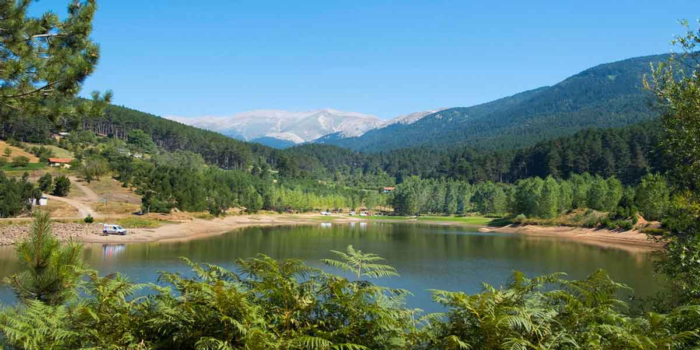
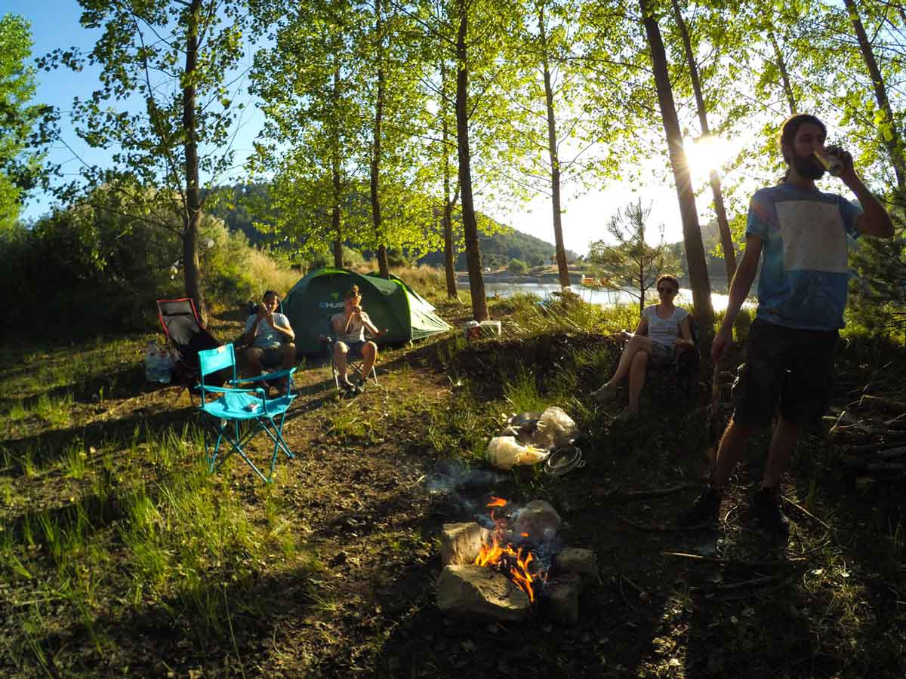

Baraklı Göleti, located near Keles district in Bursa, offers a scenic view of Uludağ. You can reach the lake by following approximately 8 km of dirt road, starting from Baraklı, after a journey of around 55 km from Bursa city center. The final section of the road became accessible by car in 2017; be sure to check the current road conditions before setting out.

> **Information Date:** The information is based on my experience in September 2017: road, camping area, fees, and facility details. Please verify the current status with local sources in Baraklı or Keles.

## Where is Baraklı Göleti, and how do you get there?

This lake is located approximately 55km from Bursa city center. To get to it, you should follow the Keles road. You’ll be traveling on a winding, paved road until you reach Baraklı. The 55km journey takes around 1 hour and 15 minutes, but due to the winding road, you can’t go very fast. Despite this, it’s a beautiful road surrounded by greenery. In 2017, there was road work leading to Baraklı. Once you reach Baraklı, you’ll see a sign for Baraklı lake to your left, and you’ll follow approximately 8km of a dirt road to reach the lake. The road to the lake is well-maintained, and you can drive there in your car. I went there in my Polo. However, the road around the lake is very rough, so you need to be very careful not to scratch your car. You can also easily reach the lake using the following Google Maps directions.

<iframe class="mappingFrame" src="https://www.google.com/maps/embed?pb=!1m26!1m12!1m3!1d183921.1436981452!2d29.035037538533075!3d40.06520547136568!2m3!1f0!2f0!3f0!3m2!1i1024!2i768!4f13.1!4m11!3e0!4m3!3m2!1d40.2711057!2d28.961151299999997!4m5!1s0x14ca2ecd5810493d%3A0x6acddb34a91041ec!2zQmFyYWtsxLEgTWFoYWxsZXNpLCBCYXJha2zEsSBHw7ZsZXRpLCBCYXJha2zEsSBLw7Z5w7wgxLDDpyBZb2x1LCAxNjc0MCBLZWxlcy9CdXJzYSwgVMO8cmtpeWU!3m2!1d39.9748714!2d29.290235!5e0!3m2!1str!2suk!4v1522006887359" width="300" height="150" data-mce-fragment="1"></iframe>

  

## Baraklı Göleti camping area information

### Available facilities

* You can park your car in a suitable spot near the lake.
* There is currently no entrance fee being collected.
* There isn’t a specific, dedicated camping facility available. You can set up your tent on a flat area, either visible in the first photo, or on a flat area around the lake.
* There are no fountains or toilets. In fact, there is a fountain, but it’s not flowing. There’s a hut that looks like a toilet, but you wouldn’t want to go inside. So, take plenty of water from Baraklı.
* You can pick up camping supplies in Baraklı or a little further on in Keles. Keles is the bigger town, and you can get everything you need there.

