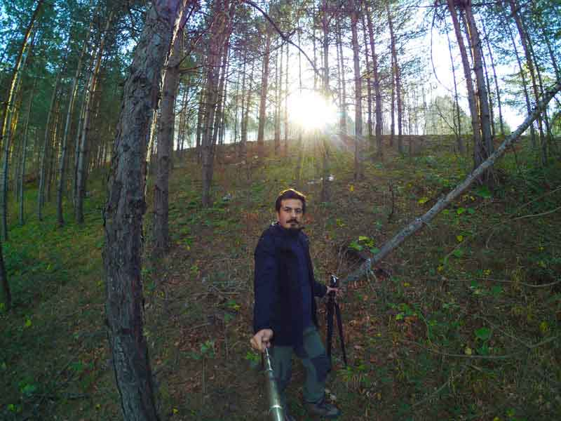
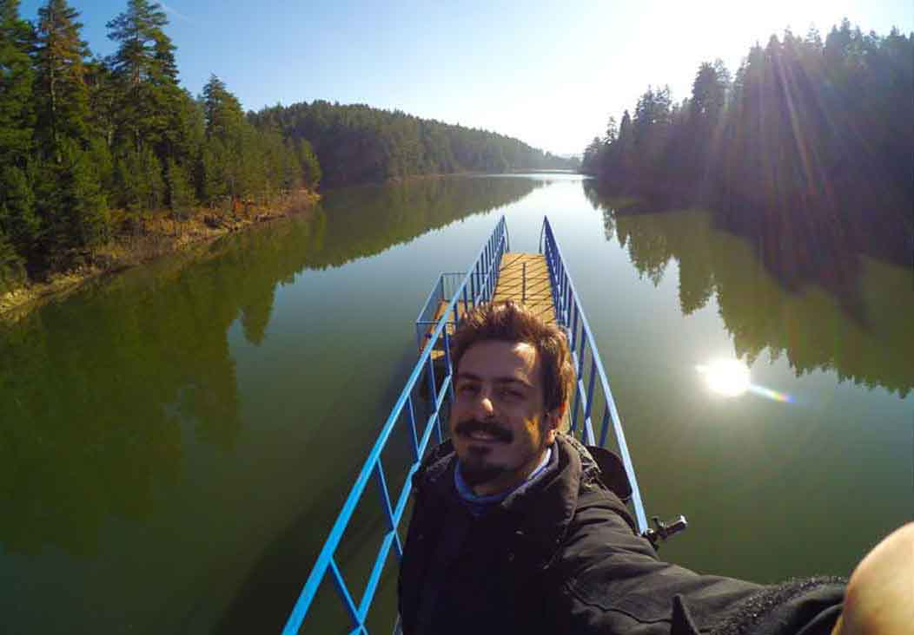

Bozcaarmut Göleti is located approximately 3 km from Pazaryeri district of Bilecik, within the village of Bozcaarmut. It can be reached from Bozüyük via Pazaryeri, Küçükelmalı, and the Bozcaarmut village; during our visit in 2016, almost the entire road was paved. There are camping areas around the lake, and walking options ranging from 1.7 km to 20 km.

Following the mountains and open hills, there was suddenly a view of forest and lake, which reminded me of [Artvin Şavşat Karagöl](/savsat-karagol/). This area is more peaceful outside of summer, and it’s teeming with wildlife; we saw bear tracks and bear droppings, and then we heard the sound of a bear.

> **Information date:** The information is based on my experience in November 2016, including road, fees, facility, and camping conditions. Please verify the current status with local sources before you go.

## Where is Bozcaarmut Göleti and how do you get there?

While driving on the Tem Highway, you should exit at Adapazarı and continue towards Bilecik. Before entering Bilecik, you will go to Bozüyük on the right, following the road that branches off towards Pazaryeri. After passing Pazaryeri, you will arrive at Küçükelmalı and then Bozcaarmut village. The lake is approximately 3km after Bozcaarmut village. Although some parts of the road are uneven due to roadwork, most of the road is paved. The access is very convenient.

<iframe
  class='mappingFrame'
  src='https://www.google.com/maps/embed?pb=!1m26!1m12!1m3!1d82247.78409783286!2d29.78198098821853!3d39.99612568586359!2m3!1f0!2f0!3f0!3m2!1i1024!2i768!4f13.1!4m11!3e0!4m5!1s0x14cbe9d87f167d9f%3A0x6d43d27fa55c5cb4!2sBozcaarmut+G%C3%B6leti%2C+11800+Bozcaarmut%2FPazaryeri%2FBilecik!3m2!1d39.959462699999996!2d29.788563!4m3!3m2!1d39.995623599999995!2d29.902976199999998!5e0!3m2!1str!2str!4v1484041814602'
  width='300'
  height='150'
  allowfullscreen='allowfullscreen'
></iframe>

 

## Bozcaarmut Göleti camping area information

### Available facilities

- You can leave your car in the wide areas along the lake, or on the roadside.
- The forest management office charges 5 TL for entry, and they also charge an additional 5 TL from those planning to camp.
- There isn’t a specific, dedicated facility for camping. The limited number of flat areas along the lake restricts the availability of camping spots.

  - As you move towards the back of the lake, there’s a larger flat area. You can also set up a tent in these areas; it will be quieter there.

- There’s a fountain and toilets. However, the toilets are so dirty that they shouldn’t be used.
- Because the road is paved, this is a very accessible place, and as a result, the number of visitors increases on market days.
- Pazaryeri is a sizeable town where you can pick up any camping supplies you need.
- There are a few picnic tables located in certain spots.

### Facilities that are unavailable

- Grocery shop
- Restaurant
- Hotel, Guesthouse

## Bozcaarmut Göleti hiking routes

### Round trip from Bozcaarmut Pond to Elmalı Pond (20 km)

<iframe
  frameBorder='0'
  scrolling='no'
  src='https://tr.wikiloc.com/wikiloc/spatialArtifacts.do?event=view&id=15628313&measures=on&title=on&near=off&images=on&maptype=H'
  width='100%'
  height='600'
  style={{ borderRadius: '10px 10px' }}
></iframe>

- A passage within the forest may prove difficult to navigate.
- Walk through the forest to Elmalı Lake, then follow the road back to Bozcaarmut Lake.
- For beginners, 20km can be quite demanding. It’s a pleasant route for those who regularly walk.
- Because there are fountains along the road, there is no water shortage.
- Watch out for bears. This is no joke :)

### Bozcaarmut Pond hike (1.7 km)

<iframe
  frameBorder='0'
  scrolling='no'
  src='https://tr.wikiloc.com/wikiloc/spatialArtifacts.do?event=view&id=16073928&measures=on&title=on&near=off&images=on&maptype=H'
  width='100%'
  height='600'
  style={{ borderRadius: '10px 10px' }}
></iframe>

- A pleasant route, easy to follow and circling around the lake.

### From Bozcaarmut village to Bozcaarmut Pond (6.7 km)

<iframe
  frameBorder='0'
  scrolling='no'
  src='https://tr.wikiloc.com/wikiloc/spatialArtifacts.do?event=view&id=4802614&measures=on&title=on&near=off&images=on&maptype=H'
  width='100%'
  height='600'
  style={{ borderRadius: '10px 10px' }}
></iframe>

- This is a beautiful trail that begins in Bozcaarmut village and continues for the most part along an interior forest path, leading to a lake at the back.
- A suitable route for those who want to take a short walk.

### Bozcaarmut village and a 13 km forest walk.

<iframe
  frameBorder='0'
  scrolling='no'
  src='https://tr.wikiloc.com/wikiloc/spatialArtifacts.do?event=view&id=4801601&measures=on&title=on&near=off&images=on&maptype=H'
  width='100%'
  height='600'
  style={{ borderRadius: '10px 10px' }}
></iframe>

- A trail starting in Bozcaarmut village, mostly following a forest path along the back of the lake, and then returning to the village via the same forest path.
- An easy workout for someone who walks regularly.
- You should take some water with you before you set off. There are a few places where you can find water.
