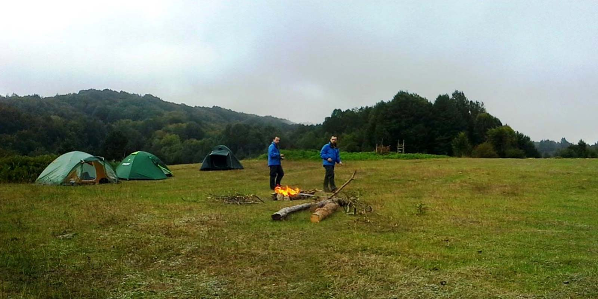
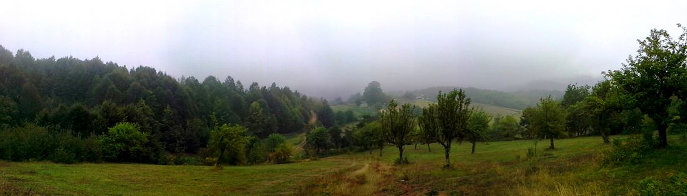

It’s a wonderful time for me again. It falls on Friday, August 30th, and I’m going on a lovely three-day vacation. While I was thinking about what to do and where to go, I’ve decided to go to Menekşe Subatımı yaylası, which is located on the borders of Kocaeli. We plan to camp in Subatımı yaylası, go for walks around the area, and explore Sıcakdere Kanyonu. Sıdakdere Kanyon is one of Kocaeli’s most challenging hiking trails.

Let's embark on this with an enthusiastic team.

The 4 of us met up on Saturday morning and set off. The group was lively and excited. It was Ramazan and Emre’s first camp, Sinan had camped a few times, and everyone was keen. It makes the trip more enjoyable when people are like that. We got to our camp at about 10 on Saturday. We set up our tents on the flattest ground we could find near the water and settled in.

Laz Ali

After breakfast, we begin a walk to explore the area. First, we go to Papazçayırı, and then we walk to Menekşe yaylası. The weather is closed off, with light rain. Because we have raincoats, it’s not a problem for us. I really enjoy this kind of weather – getting wet and staying dry. While walking through Menekşe yaylası, we meet a gentleman in his 70s who introduces himself as Laz Ali. He enjoys teasing us, especially when he notices our long hair and beards. Back in the day, having long hair or a beard was considered a major faux pas. Actually, it’s entirely a matter of perception. Imagine if people living in the 1950s had been surprised by people with short hair and no beards – today, we would consider people with long hair and beards perfectly normal. It’s a completely perceptual and cultural phenomenon. Therefore, Ali amca’s teasing doesn’t bother me, but rather makes me laugh. Ali amca is an interesting and unique person. He cultivates his land just like people in every region. He’s also very concerned about the villages – he says that they constantly damage his crops. Because of this, he nearly burns a fire at the edge of his fields almost every evening. When I ask him if he has ever encountered people like us, he responds with a sad “Oh, if I could just meet someone like that!” Finally, he offers us apples he collected from the trees, and then invites us to his home. His house is slightly higher than the other houses in the valley, and because of this, the rain falls more there. So, we decide to stop climbing any further and instead continue chatting with Ali amca.

Laz Ali – Do you know anyone in Ankara?

Ben – No (I was completely stunned by this sudden question, and I answered without knowing where the conversation would go.)

Laz Ali – Me too, but they have them.

Ben – Who is Uncle Ali?

Laz Ali – About the bears. There are far more of them in Ankara, and I can’t catch them. There’s a severe penalty for harming a bear, but I want to hit one.

He is showing us how the bear has damaged his beans. In fact, it has seriously damaged his field – breaking the bean stems and leaving no leaves. We could clearly see that this was a great source of sadness for him, who puts so much effort and perhaps a significant income into his work. We thanked Ali amca and said goodbye. We went a little into the forest and returned to our camping spot. Since the rain hadn't yet completely covered everything, we strengthened our campfire, followed by a pleasant conversation and falling asleep after a good evening meal. Our goal for tomorrow is Sıcakdere canyon.

Sinan Kayıp

After breakfast on the second day, we begin walking along a dirt road towards Sıcakdere canyon. After an approximately 2.5-3 hour hike, we enter the stream and proceed for about 1.5km within the stream. We try to descend into the canyon, and when we reach the base of the large waterfall, we don’t feel the need to go down further, and we decide to return to our campsite before nightfall. Although we haven’t reached the canyon yet, it’s a pleasant hike. When we arrive at the campsite around 17:00, everyone sets up their tents and rests. Around 18:15, Sinan notices that the sounds are increasing. Sinan: “Where is he!!!”

To access the section regarding Sinan’s disappearance and discovery, click here: (link to be added)

The Last Day

Yesterday was a very busy and frightening night, so we decided this morning to recover and go to Maşukiye for breakfast. We are traveling back following the route: Kocaeli -> Yuvacık -> Aytepe -> Menekşe yaylası, and then back along Menekşe Yaylası -> Ferhatiye -> Gölcük -> Kocaeli. After a pleasant breakfast in Maşukiye, we will begin our journey to İstanbul.

During this camping trip, we had the opportunity to explore a portion of Sıcakdere canyon and Menekşe and Subatımı valley. Although our friend’s disappearance worried us, the joy of finding him was even greater. 😉 Please avoid individual movements during the camping trip.