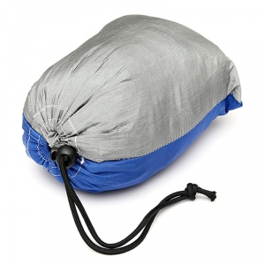

One day, while camping, I had thought that if I had a hammock, I would hang it between these trees, listen to the water and bird sounds by the stream, and just relax while reading my book. However, I gave up buying one because I thought it would be very difficult to fit in my car and would be a complete waste of effort when trekking, and then I came across it underneath the product.

[https://tr.aliexpress.com/item/Best-Promotion-Blue-Gray-Portable-Parachute-Nylon-Fabric-Hammock-Travel-Camping-Outdoor-For-Two-Persons-Lowest/32308066457.html](https://tr.aliexpress.com/item/Best-Promotion-Blue-Gray-Portable-Parachute-Nylon-Fabric-Hammock-Travel-Camping-Outdoor-For-Two-Persons-Lowest/32308066457.html)

## Parachute Hammock

This product, which I bought from China for $16, is so small that it’s perfect for a hammock – I can take it with me wherever I go, even with two people on it (approximately 190kg), and it felt very stable. When you think of hammocks, you usually picture ones with wooden frames and woven ropes. This one is nice because it’s made of a flat fabric, so you don’t have to worry about the ropes getting in the way when you’re lying down.

For this product, $16 is a very reasonable price. The only thing missing is that the ropes used to attach the hammock to the tree are too short. This isn't a major problem at all. You can go to Bauhausa or a hardware store and buy 2-3 meters of rope and extend them.

I highly recommend it to anyone who wants to get a hamak.
