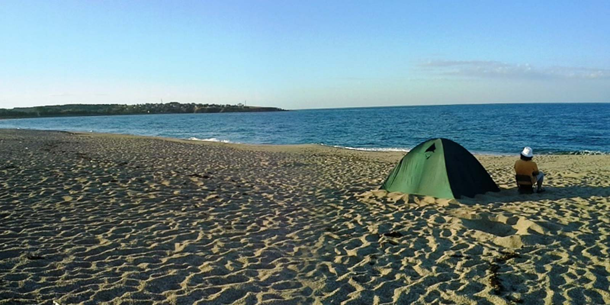
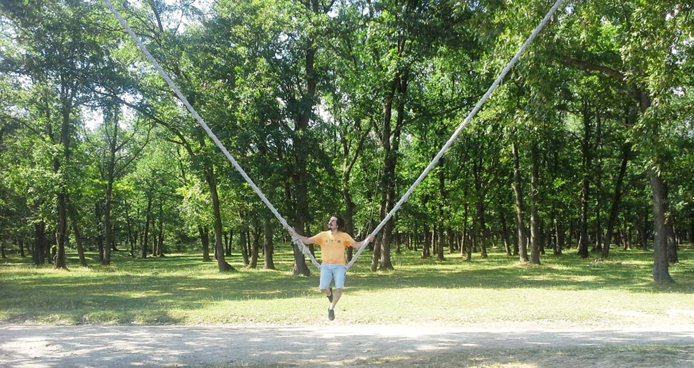
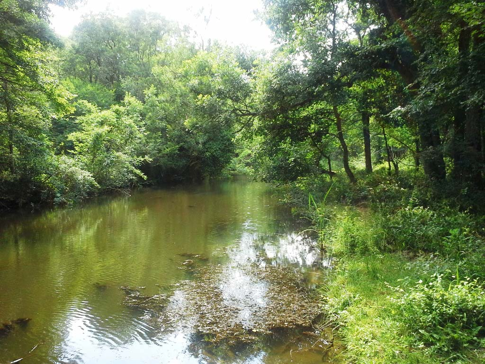

After [Kerpe Kampı](/kerpe-kampi/ "Kerpe Kampı"), we started planning a camp for 1-2 June. We were looking for a place where we could swim and that also had a large forest. Then, on a friend's advice, I began researching İğneada. Learning that İğneada has beautiful **longoz forests** and that we could swim at **Beğendik Koyu**, I immediately started planning. Our goal was to go to İğneada, camp at **Beğendik Koyu** right next to the Bulgarian border, and explore the **longoz forests** and **Dupnisa Mağarası**.

June 1st – Saturday – The Route is Longer Than Expected

We set off early on Saturday morning, meeting up with colleagues and their families. [As for the route](https://www.google.com/maps/dir/41.0246793,29.0574145/41.9679199,28.0331687/@41.5333895,27.8580852,10z/data=!4m9!4m8!1m5!3m4!1m2!1d27.6089803!2d41.6590462!3s0x40a0a2fa32e50c11:0x353070889f5a3015!1m0!3e0) – a distance of approximately 250km via İstanbul – we were dreaming of covering it in about 2.5 hours. After leaving the E80, things didn't go as planned, and after about 4.5 hours due to roadworks, we arrived at Beğendik bay. We initially wanted to choose the green slope a little further up the coast for breakfast and our campsite. However, due to the sheer number of insects there, we decided to pitch our tents right in front of the business on the beach, so we wouldn't have to worry about toilets and water, and we'd be right on the water's edge.

In the photo, we set up our tent on the right-hand side of the beach and began collecting wood for a campfire. You can find hearty meals like chicken cooked in pots, and warm drinks at this establishment. There’s no charge to set up your tent or use the beach. After our campsite was prepared, we went to İğneada and took a roughly 4-5km walk through the pine forest, returning to the campsite, swimming in the sea, and then enjoying our evening meal and starting to fully appreciate the wonderful moments of our camping trip. We had thought that the sea would be warm starting on June 1st, but we were wrong, and despite that, we still went swimming in the sea. At this point, you are very close to Bulgaria – you can even see a Bulgarian village in the distance. As you move a little further from the shore, the guards at the observation tower are warning you to return.

If the police arrive.

Around 10 or 11 that night, as usual, the jandarma arrived. Initially, we were worried, because in these jandarma areas it is necessary to obtain permission from the relevant jandarma müdürlük before setting up camp. When we told them we had arrived to camp with our families, the komutan, having noticed the family atmosphere, came over to check on us. He explained that young people living in this area often come to the sea shore to drink and cause trouble, and that if anything like that happened, we should inform the jandarma. With that, our anxiety dissipated and we felt a little more secure.

Have you ever watched the full moon rise?

Around 01:30, everyone was tired and went to their tents. Only Gürkan and I stayed up chatting, enjoying the sounds of the sea, the fire and the water, and the countless stars. At about 2 we watched the full moon rise from the horizon out at sea. It was enormous. We took it in quietly for about half an hour and thought about what the others had missed by going to bed early. We went to our tents around 3. Then the young people the commander had mentioned arrived next to us. Luckily they weren’t noisy. I watched a little longer and, once I was sure they wouldn’t cause trouble, decided to turn in at about 4.

Day 2 – Floodplain forests and Dupnisa Cave

We woke up early as the sun reached the tents. After breakfast, we packed up our tents and gathered the embers at the spot where we had lit a fire on the beach (a beach should be left clean). Just as the weather turned quite overcast and a light drizzle began, we hurried into our cars. Our first destination was **Dupnisa Cave**. After the junction in Demirköy, we turned onto the road to Dupnisa. This somewhat rough road was quite pleasant and wound through the forest, occasionally blocking the view of the sky with the greenery. Along the way, we came across people camping in the forest. I made a mental note to come camp here one day.

Is it worth extending the path for a cave?

That question had also crossed our minds. But what’s the point in the end? It’s just a cave. Yet, after paying a fee of around 3TL per person at the entrance, you walk through a 5-minute forest trail. Then, you enter a very large and long cave with a stream flowing through it. Being inside a cave like the ones we’re used to seeing in films is thrilling, and you can’t help but think, “Glad we came!” The cave interior is well-lit, but because it’s dark in places, most of our photos suffer from clarity issues. Still, these beautiful places remain vivid in our memories. Then, the arduous journey back to İstanbul began again. After a 5-hour trip, which included some traffic jams, we finally made it home.

It’s a rushed plan for two days. The distance is long, and the roadworks wear you out. Once the work is finished, this distance can be covered in three hours, so it makes more sense to go on Friday evening, or to go when you have a three-day break. I didn’t get to fully enjoy the floodplain forests. Our walk was short. I believe I’ll go back one day, to resolve this lingering feeling.