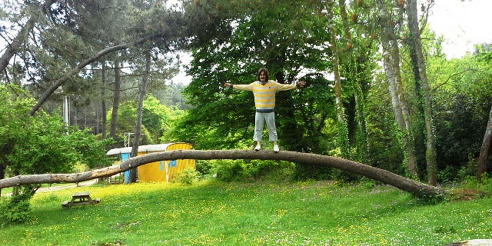
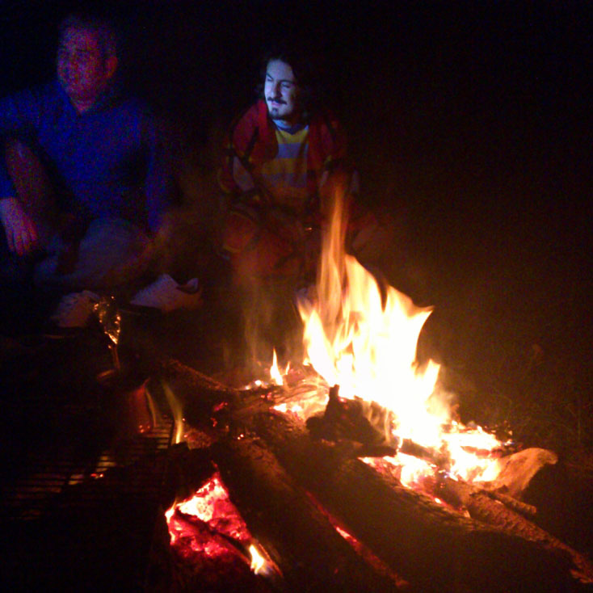
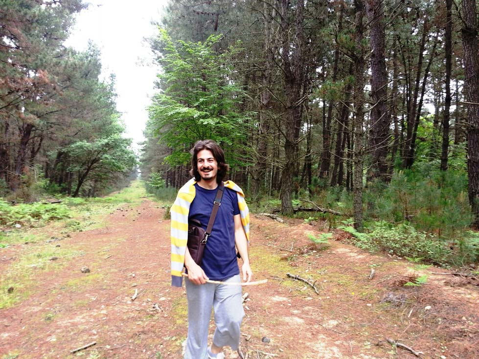

For some reason I was incredibly busy in 2012. I kept meaning to go camping, but we never seemed to make it. Even then, it was clear I’d be making up for it in 2013 :)

Plan

I’m starting to plan and research for a camping trip in March. I really want the weather to warm up and to begin camping as soon as possible. So, I’m making my research more enjoyable. After researching a place I’ve never been to, but heard about from a few people who have gone there, I thought it would be ideal for starting in 2013. It’s both close to İstanbul, has a coastline, has rocky areas where we can fish, and also a forest where we can go for walks. Yes, the target is [KERPE](http://goo.gl/maps/Sreqv)…

4 May, Saturday

We were incredibly excited for our first camping trip, and we really wanted to set off as soon as possible, fueled by the enthusiasm of those of us who were camping for the first time. We left early from İstanbul and aimed to arrive at the campsite in about two hours. We hadn’t yet secured a specific campsite in Kerpe. After researching online, I learned that there were campsites available in Kerpe, and that if those were full or closed, we could set up camp somewhere within the forest. This information was already enough for us. Following the route [İstanbul-Kocaeli-Kandıra-Babaköy-Kerpe](http://goo.gl/maps/7PR4j), we reached Kerpe. There was road construction between Babaköy and Kerpe. Therefore, we arrived in Kerpe by following the road that runs alongside Sarısu stream, heading left from Babaköy. If we hadn’t used this road, we might not have seen our beautiful [campsite](http://goo.gl/maps/b0hgn) at all, nor the starting point of the [Babadağ Yürüyüş Parkuru](http://goo.gl/maps/M2uGY).

Before arriving at Kerpe, we negotiated for a campsite. We paid 90 TL for one night of camping and a one-day picnic for three cars. This place, which offered both camping and a picnic area, had clean water and toilets (though don't expect excessive cleanliness). It was an acceptable price for about 10 people. After exploring Kerpe, we decided to come back and settle in. When we arrived in Kerpe, we saw the campsite we had spoken about on the phone – it was closed. We hadn't told them we were coming, but they hadn't opened the season yet. Besides us, there were no other campers around. Kerpe is a small, charming place with a beautiful bay on the Black Sea. There are places where you can meet all your needs. The sea didn't look like the Black Sea at all. Because it's a bay, there were no waves. We're going back to our campsite to get what we're missing. First, we'll set up, and then, thinking the evening air would be cool, we'll start collecting firewood. Thanks be to the forest behind us, it doesn't make us suffer for firewood :).

Tonight, we’re really getting our fire going. It’s May 4th, but the weather is cold. And, on top of that, there’s fog. We’re having a good time, everything’s going well, when the police arrive. There’s nothing to be afraid of – they’re just doing routine checks. We decided to go to bed around 1 a.m. We had planned to go fishing, but we’re too tired to catch anything. At that moment, we hear the sound of foxes around. I’m keeping this information to myself to prevent anyone from panicking, and I tell the dogs, “It won’t be a problem :),” and it really wasn’t.

May 5th Sunday

We’re up early. After breakfast we set out for the Babadağ hiking trail. With no water or food with us on the forest trail, we turn back partway and keep the walk to about 5–6 km. We don’t see any drinking water along the way. There might have been some we missed. You climb towards Babadağ through beautiful woodland. It’s a peaceful, enjoyable walk. Afterwards we wander around the rocks by the shore, then go back to the campsite where we left our tents. We’d asked the attendant to keep an eye on them before we left. Everything was fine on our return. Only a few day visitors had arrived. We’re heading back to İstanbul, so we leave at about 15:00 and follow the same road home.

We had a wonderful, enjoyable, and energetic start in 2013. Even before this camp ended, we were already dreaming about new campsites on the way back. We had gone to Kerpe at the perfect time, as it gets very crowded in summer and attracts many day-trippers.