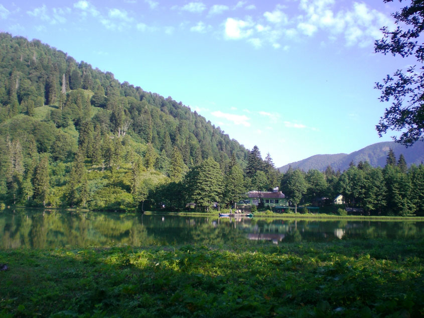
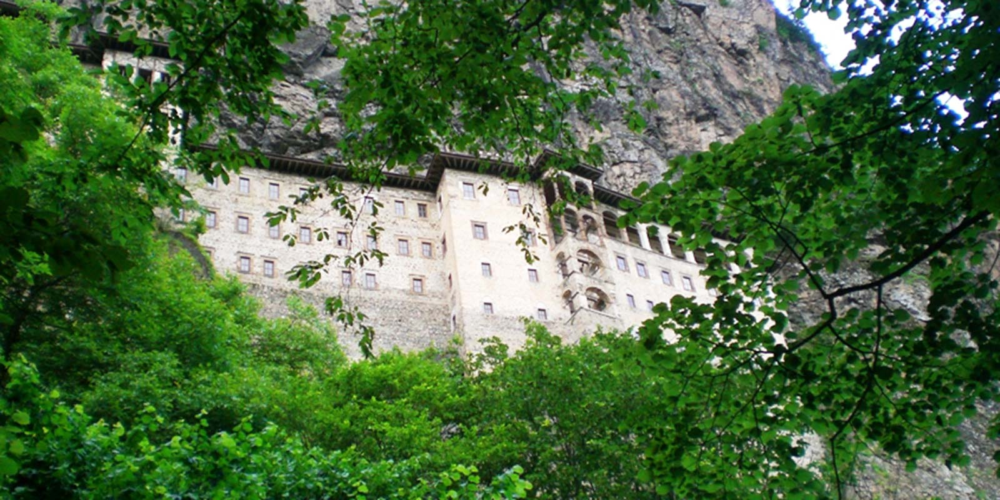

Setting up a tent, camping, exploring the mountains, trekking and hiking – these were hidden passions I had long suppressed. I was very unfamiliar with all of them. But I knew that I needed to start somewhere. My close friend, Hüsnü Şen, who is a nature lover and also works in civil defense, stepped in to help. We went together and bought all the necessary equipment. I advise you to get your equipment from someone who first understands what is suitable for you, otherwise you might end up buying things that won’t be very useful or that could leave you stranded in the middle of nowhere.

## Plan

In July 2011, I needed to plan my camping trip around my journey from Erzurum to Istanbul. Having seen photos and always been curious, I decided to explore the Eastern Black Sea region. While I planned to go on this trip alone, my siblings Furkan and Zeynep joined in. With a woman in tow, I had to adjust my plans accordingly. If it were up to me, I could have stayed alone anywhere in the mountains. It was my first camp, and I was that brave – call it ignorant bravery. But when you have a woman with you, it’s not like that :). After extensive research, I had targeted Karagöl in Artin, the Yukarı Kavrun Highland on the Kaçkar ridges, and the Sümela Monastery. Simply being able to pitch a tent there was enough for me.

## The time has come, our target is Borçka Karagöl.

On Friday morning, we finished the remaining work and set off from Erzurum at noon. The first day, we passed by Tortum Lake. Afterwards, we explored the Tortum Waterfall – the water wasn't flowing very strongly this season; I know that in the spring, it flowed very strongly and we couldn't get all the way to the bottom. There are no social facilities around the Tortum Waterfall, but there are picnic tables, and access to drinking water and toilets. After exploring the area around the waterfall, we continued our journey, with the aim of reaching Karagöl before dark. We managed to get as far as Yusufeli, but afterwards, due to construction work on the dam, the road became very bad, and sometimes we had to wait for the work to finish. We continued like this until we reached Artvin.

We felt relieved when the road was resurfaced again. We continued towards Borçka without wasting any time. When we arrived in Borçka, we had 27km left to go. 20km of this was asphalt, and the remaining 7km was a narrow, unpaved road – it was incredibly beautiful and enjoyable. Even though we were trying to avoid the darkness, this section of the road was truly wonderful. We began to feel that we were in Eastern Black Sea. Just as the sky was starting to darken, we arrived at Karagöl. We paid 7tl for parking, and 8tl for a tent. There’s also a guesthouse at Karagöl, but I don’t know the details. You’ll need to provide your own food, or you might go hungry :). While it wasn’t perfectly clean, it was nice to have a toilet. We set up our tent in a flat area right in front of the guesthouse, with flashlights. “Oh my God, there are so many mosquitoes!” They were all competing to bite us. We quickly set up the tent and went inside. We didn’t want to go outside. When I bravely stepped outside, I saw that there weren’t any mosquitoes left. Then we went outside. Behind us was the forest, in front of us the lake, and the sky was filled with stars :). There were other tents set up besides ours. In fact, it was a large group. However, since they were by the guesthouse, we were alone. Suddenly, we noticed lights – like embers from a cigarette – deep in the forest. We saw hundreds, even thousands, of fireflies. One even flew right in front of us. We were just standing there, amazed to see so many fireflies together :)

The next morning, mosquitoes were present everywhere again. We quickly recovered, walked around the lake for a bit, and set off towards Ayder. Because the plants around the lake were very tall, we didn't venture too far into them, as we couldn't see what was coming our way. So, it was just “yusuf yusuf” :).

Should we go to Borçka-Karagöl? Is it worth going?

\- Yes, absolutely worth it. A truly beautiful lake that’s worth seeing. I’d really like to go again.

## Our second stop, Yukarı Kavrun Highland

After a long journey, we first arrived in Ayder. Since we had come this far, it would not be right not to try *muhlama* (a traditional Turkish dish). Then, we set off towards Yukarı Kavrun Highland. Actually, there are minibuses running between Ayder and Yukarı Kavrun, departing every half hour or when full, costing 10TL. Ayder is a tourist spot, so it was quite crowded. It still retains its natural beauty. There are many guesthouses and places to pitch tents in Ayder. While these guesthouses are not expensive at normal times, their prices become as precious as fire during busy periods like holidays. After passing Ayder by a few kilometres, the road began to deteriorate significantly. We thought we could drive all the way to Yukarı Kavrun Highland in our car. We had heard the road was in very poor condition, but we trusted that our car (Megane Scenic) had a high enough undercarriage, at least compared to sedans. But it wasn't so. The people we met on the road, who told us not to drive in that car, were right. If we had pushed it, we could have scraped the undercarriage and been stuck there. So, we decided to park our car in a suitable spot and walk up, carrying our bags. On the way, we met someone struggling with a Linea. There was no part of their car's undercarriage that hadn't been hit. The man was already regretting it. So, if you don't have a 4×4 vehicle, don't enter this road. (When I went again in 2013, there were rumours that the road would be paved, and even a cable car would be built between Ayder and Kavrun. Will it really happen? We'll see).

After walking 4-5 km, we learned there was space on a passing Kavrun minibus and immediately boarded it. Well, 4-5 km is actually a good walk for our first camp. Of course, we followed the vehicle track. Otherwise, we wouldn't know the way, wouldn't know the trail, and would get lost and wander off :). And now we were at Y.Kavrun Highland. Our aim was to take a short walk towards the summit and then set up camp near the yayla. However, the rain arrived early and didn't allow it. When we quickly set up our tent and got inside, we realized we had escaped being soaked by just a few minutes. We had nothing to withstand the rain. We used to say there's no rain in the middle of summer. But whenever you come here, come, of course, but come prepared for the rain :). In Y.Kavrun Highland, there are 2 or 3 pensions and cafes belonging to these establishments. We were pleased that the prices weren't too high. After all, there's nowhere else on the mountain top to find food. The people in the highland settlement are friendly and warm-hearted. When we asked for 1 or 2 logs to heat our canned food, they didn't refuse and gave them to us. Wood is very valuable here because there isn't even a scrap of wood around.

The next morning, after a hike towards the summit, we had planned to spend the night back on the highland pasture and return the following day. After a very restful sleep, we woke up to find the weather was again overcast, and, since we had no protection against the rain, we were forced to turn back. Yes, this was demoralising; we didn't want to be stuck inside the tent for hours. So, we made the decision to return. It had been lingering in my mind :), but I knew I would come back and reach the summit again. We quickly packed up, and as soon as we threw ourselves into the coffee at the yayla, the rain began. Seeing the rain, we realised how right our decision had been. If you don't have enough equipment, there's no point in pushing yourself; otherwise, you can end the day with losses.

## And our final destination is Sümela Monastery 

To get to Sümela, we had to stop in Trabzon. Since we were coming into contact with civilisation, we enjoyed a bath break, and then we ate to fill our stomachs. After such a long journey, that felt good. We arrived at Sümela in the afternoon. There were camping areas before reaching Sümela, but we wanted to pitch our tent somewhere near the monastery. First, we took the path starting from the restaurants and climbed up to the monastery. This climb, which took about 45 minutes, was quite enjoyable, though also tiring. Those who don't want to walk here can follow the road up to the top. But if you've come this far, I recommend walking. We were amazed by this place where people have built it among the rocks to continue their faith. A magnificent structure. We set up our tent in the wooded area behind the pensions opposite the restaurants, where people usually have picnics, and we spent our last night there with Furkan playing the violin.

We hadn’t really explored the Eastern Black Sea region, so our trip ended early. But it was a wonderful start, both for getting to know the Eastern Black Sea and for beginning our camping experience.