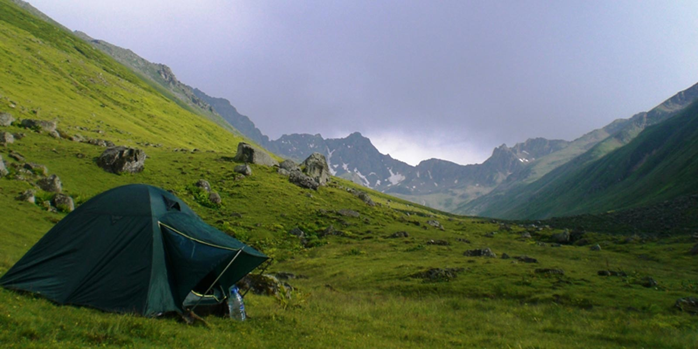

Setting up a tent, camping, exploring the mountains, trekking and hiking – these were hidden passions I had long suppressed. I was very unfamiliar with all of them. But I knew that I needed to start somewhere. My close friend, Hüsnü Şen, who is a nature lover and also works in civil defense, stepped in to help. We went together and bought all the necessary equipment. I advise you to get your equipment from someone who first understands what is suitable for you, otherwise you might end up buying things that won’t be very useful or that could leave you stranded in the middle of nowhere.

## Plan

In July 2011, I needed to create my camping plan because I was traveling from Erzurum to Istanbul. Having seen photos and always been curious, I decided to explore the Eastern Black Sea region. While I planned to go on this trip alone, my siblings, Furkan and Zeynep, decided to join me. Since I would be traveling with a woman, I naturally had to adjust my plans accordingly. If I were alone, I could have camped anywhere in the mountains. I’m certainly brave enough, though – a kind of foolish bravery. But when traveling with a woman, it’s different :). As a result of my extensive research, I had targeted Karagöl in Artin, the Yukarı Kavrun plateau in the Kaçkar mountains, and the Sümela Monastery. Simply being able to set up a tent in those places would be enough for me.

## The time has come, our target is Borçka Karagöl.

On Friday morning, we finished the remaining work and set off from Erzurum at noon. The first day, we passed by Tortum Lake. Afterwards, we explored the Tortum Waterfall – the water wasn't flowing very strongly this season; I know that in the spring, it flowed very strongly and we couldn't get all the way to the bottom. There are no social facilities around the Tortum Waterfall, but there are picnic tables, and access to drinking water and toilets. After exploring the area around the waterfall, we continued our journey, with the aim of reaching Karagöl before dark. We managed to get as far as Yusufeli, but afterwards, due to construction work on the dam, the road became very bad, and sometimes we had to wait for the work to finish. We continued like this until we reached Artvin.

We felt relieved when the road was resurfaced again. We continued towards Borçka without wasting any time. When we arrived in Borçka, we had 27km left to go. 20km of this was asphalt, and the remaining 7km was a narrow, unpaved road – it was incredibly beautiful and enjoyable. Even though we were trying to avoid the darkness, this section of the road was truly wonderful. We began to feel that we were in Eastern Black Sea. Just as the sky was starting to darken, we arrived at Karagöl. We paid 7tl for parking, and 8tl for a tent. There’s also a guesthouse at Karagöl, but I don’t know the details. You’ll need to provide your own food, or you might go hungry :). While it wasn’t perfectly clean, it was nice to have a toilet. We set up our tent in a flat area right in front of the guesthouse, with flashlights. “Oh my God, there are so many mosquitoes!” They were all competing to bite us. We quickly set up the tent and went inside. We didn’t want to go outside. When I bravely stepped outside, I saw that there weren’t any mosquitoes left. Then we went outside. Behind us was the forest, in front of us the lake, and the sky was filled with stars :). There were other tents set up besides ours. In fact, it was a large group. However, since they were by the guesthouse, we were alone. Suddenly, we noticed lights – like embers from a cigarette – deep in the forest. We saw hundreds, even thousands, of fireflies. One even flew right in front of us. We were just standing there, amazed to see so many fireflies together :)

The next morning, mosquitoes were present everywhere again. We quickly recovered, walked around the lake for a bit, and set off towards Ayder. Because the plants around the lake were very tall, we didn't venture too far into them, as we couldn't see what was coming our way. So, it was just “yusuf yusuf” :).

Should we go to Borçka-Karagöl? Is it worth going?

\- Yes, absolutely worth it. A truly beautiful lake that’s worth seeing. I’d really like to go again.

## Our second objective is Yukarı Kavrun Valley.

After a long journey, we first arrived in Ayder. Since we had come this far, it would not be right not to try the *muhlama* (a traditional Turkish food). Then, we set off towards Yukarı Kavrun meadow. Actually, there are minibuses that travel between Ayder and Yukarı Kavrun, running every half hour or when there is a high volume of passengers, costing 10TL. Ayder is a popular tourist destination, so it was quite crowded. Despite being crowded, it still retains its natural beauty. There are many guesthouses and camping areas in Ayder. While the prices are generally reasonable during normal times, they become very expensive during busy periods like holidays. After driving a few kilometres past Ayder, the road began to deteriorate significantly. We thought we could drive all the way to Yukarı Kavrun meadow, but we had learned that the road was in very poor condition. However, we trusted that our car's (Megane Scenic) undercarriage was high enough, at least compared to regular sedans. But, it did not work out – the people we met on the road, who advised us not to drive in our car, were right. We could have stopped the car and stayed there if we had managed to hit the undercarriage. Therefore, we decided to park our car in a suitable location and walk, carrying our bags. We encountered someone who was struggling to drive along the road with a Linea. There was no part of their car's undercarriage that remained undamaged. The person was already regretting it. Therefore, if you do not have a 4×4 vehicle, do not enter this road. (When I went again in 2013, there were rumours that the road would be paved, and even a cable car would be built between Ayder and Kavrun. Will it really happen? We will see).

After walking for 4-5 km, we found a Kavrun minibus passing by and immediately boarded it. It was a really good walk, just 4-5 km. Of course, following the route of the vehicle. Otherwise, if we didn't know the way, we would get lost and wander. And now we were in Y.Kavrun meadow. Our aim was to take a short walk towards the summit and then set up camp in the meadow. However, the rain, which came early, didn't allow it, and when we quickly set up our tent and got inside, we realized we had just managed to escape being drenched by just a few minutes. We had nothing to protect us from the rain. We used to say that rain wouldn't happen in the middle of summer. But, whenever we come here, we should come, but we should come prepared for the rain. In Y.Kavrun meadow, there are 2-3 pensions and cafes belonging to these businesses. We were pleased that the prices weren't too high. After all, there isn't anywhere else to find food on the top of the mountain. The people in the meadow are friendly and warm-hearted. When we asked for 1-2 logs to heat our canned goods, they didn't hesitate and gave them to us. The wood is very valuable here because there isn't even a pile of wood around.

The next morning, we had planned to spend the night back at the meadow after a hike to the summit. After a very restful sleep, we woke up to find that the weather was again closed off, and, because we had no preparation for the rain, we were forced to return. “Yes, this was a demoralizing experience,” and we really didn’t want to stay inside the tent for hours. So, we decided to return. It had been lingering in my mind –), but I knew I would come back and reach the summit again. We quickly recovered and, as soon as we started drinking coffee at the meadow, the rain began. Seeing the rain, we realized how right our decision was. If you don't have enough equipment, there's no point in pushing yourself; otherwise, you can end the day with losses.

## And our final destination is Sümela Monastery 

To get to Sümela, we had to stop in Trabzon. Since we were encountering this ancient civilization, we enjoyed a traditional bath, and then we ate to satisfy our hunger. It was really refreshing after such a long journey. We arrived in Sümela in the afternoon. There were camping areas near Sümela before approaching it, but we wanted to set up our tent near the monastery. We started by taking a path beginning from the restaurants and headed to the monastery. This climb, which lasted approximately 45 minutes, was really enjoyable, although it was tiring. Those who don't want to walk here can reach as far as possible by following the road, but if you've come this far, we recommend walking. We were amazed by this place where people have built it among the rocks to continue their religion. A magnificent structure. We set up our tent in the wooded area behind the pensions located across from the restaurants, where people usually have picnics, and we spent our last night with Furkan’s playing of his violin.

We hadn’t really explored the Eastern Black Sea region, so our trip ended early. But it was a wonderful start, both for getting to know the Eastern Black Sea and for beginning our camping experience.