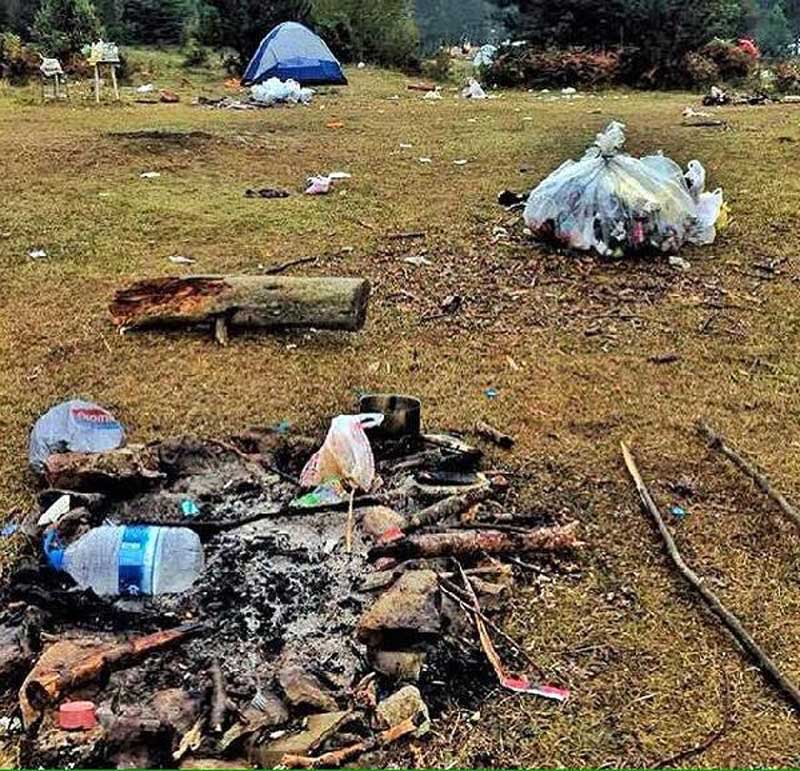

**A camp for 8,000 people. Hats off!**

You're brilliant, Interrail Türkiye. On 7–8 October 2017, you organised a superb camp at Şirinyazı Gölet in Bolu Mengen. It was a super camp event, gathering 8,000 people. I don't know if anyone has pulled off a bigger crowd, but you've etched your name into history. Everyone knows you, everyone talks about you. 8,000 people camping. Wow, that's monstrous. 8,000 people forming an army and joining a war. Seriously, 8,000. And then there were those false accusations thrown at you in the media: you polluted the campsite, you damaged the forest, and so on. Fortunately, you cleared your name with a very nice press statement. The photos and videos circulating on social media are definitely staged. They'll come out tomorrow or the next day. The operator in charge of the area also issued a statement: "We were expecting 2,000 people, but 8,000 arrived. We couldn't keep up with collecting the trash; the bins weren't enough. No problem, we're handling it. The rain has stopped, the weather is nice, we're cleaning up the place, so relax." Anyway, you're fine, dear operator. If only 2,000 people had come, everything would have been perfect. What happened was with those extra 6,000 people. They might have done everything. Our hearts are at ease. May God be pleased with you all. Yes, from Interrail Türkiye, the 8,000 campers, and the operator. Eyvallah, thank you all, live long. You're not at fault; the fault lies with us who spread this, objected, and talked about it on social media. There's no need for you to apologise. In any case, why would you apologise?

**Interrail Türkiye** – here are the details for you;

- If you are organizing a camp for 8,000 people, you are responsible for it. You could create posts/announcements informing the 8,000 attendees that camping is more than just setting up tents – that there’s an entire concept of “camping,” and that they have responsibilities. If you had many staff members to warn/monitor/control the people at the campsite, you would avoid this situation.
- Following this event, the press statement you issued was a complete failure. You would have needed to apologize due to your incompetence.

This **camp, attended by 8,000 people**, is also for you.

- I'm sure there are some of you who, having nowhere to throw your trash, take it with you in your car and dump it at the first place you reach that counts as "civilization." Stop reading this and close it. Because we have nothing to say to you. Out of respect for nature, nature itself, I, other nature lovers, and the generations to come are grateful to you.
- As for the rest of you: buying a tent at Decathlon doesn’t make you a camper. Aren’t you ashamed to leave your food wrappers and empty bottles all over the place? How would you like it if I came and took a shit in the middle of your living room?
- Is the designated waste area full, or is there nowhere to dispose of your trash? The solution is quite simple. If you put your trash inside two or three bags, it won’t leak or spill. You’ll just put it in your car, nice and clean, and take it away. Then you can toss it in the first bin you find.
- Maybe you dropped it because you thought someone would pick it up after you. But why should they have to? And who’s going to do it at the next place you camp?
- Stop for a minute and look down from up there. Ask yourselves, “What the hell have we done? Why did we have to damage this place?”

Dear business owner, the following are for you;

- I don’t think you’re hosting 8,000 people out of your father’s goodwill. You must have made a good profit. May it be blessed. But you’re the owner, and 8,000 people are coming – what should I do? How should I manage this so that I can protect this place and prevent any problems or mishaps, and make sure you’re getting your money’s worth.
- Or just say, “Look, we’ve only got room for this many people.” Once you’re full, stop taking bookings. Saves you making a fool of yourself afterwards.

When the subject is trash, I get incredibly angry. This is a rebellion from a nature lover. I want you to know that I’m thinking of saying five times as much as you’re all thinking. And, when you’re thinking about it, say it to my face. Today, the man who considers it normal to just throw trash on the ground and leave will tomorrow pass on someone else’s rights, the next day defend himself by saying “he did it, so I did it”, then ignore all rules and walk away as a corrupted society. If we don’t fix ourselves as individuals, we won’t be able to look to the future with hope. What can I say, let’s just close this topic without linking it to other issues.

The news, statements, and photographs are below.

News;

[Birgün](https://www.birgun.net/haber-detay/interrail-ve-camprail-bolu-da-doga-kampi-yapti-2-kamyon-cop-184109.html) – [Onedio](https://onedio.com/haber/dersimiz-cevreyi-koruma-bolu-da-8-bin-kisilik-doga-kampindan-geriye-cop-yiginlari-kaldi-790403) – [Hürriyet](http://www.hurriyet.com.tr/bu-goruntuye-sosyal-medyada-tepki-yagiyor-40607779)

Interrail Turkey: An explanation;

[http://interrailturkiye.com.tr/kamuoyu-aciklamasi/](http://interrailturkiye.com.tr/kamuoyu-aciklamasi/)

Business description;

[http://www.hurriyet.com.tr/buyuk-tepki-cekmisti-o-kamp-yerinin-sorumlulari-aciklama-yapti-40608253](http://www.hurriyet.com.tr/buyuk-tepki-cekmisti-o-kamp-yerinin-sorumlulari-aciklama-yapti-40608253)

8,000 people, with no explanation provided.

