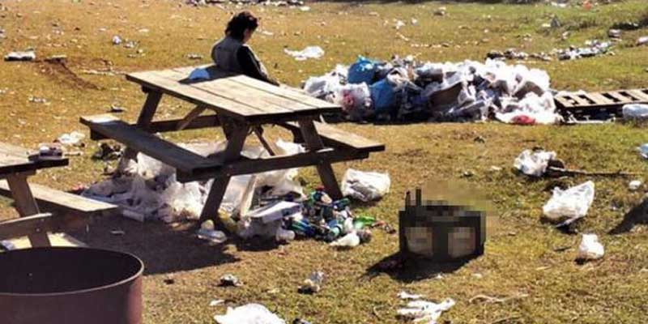

8,000-person camp, approved.

You've done a fantastic job with Interrail Türkiye. On 7–8 October 2017, you organised a superb camping event at Şirinyazı Gölet in Bolu Mengen. It was an incredible event, bringing together 8,000 people. I don't know if there have been larger events, but you've certainly made a name for yourselves. 8,000 people camping – amazing. It's as if 8,000 people have formed a military and joined a war. Seriously, 8,000. And, of course, there have been false accusations circulating in the media – claims that you polluted the campsite or harmed the forest, and so on. Fortunately, you successfully cleared your name with a very good press statement. The photos and videos circulating on social media are undoubtedly staged. They will be revealed soon. The person in charge of the area also issued a statement: "We were expecting 2,000 people, but 8,000 arrived. We couldn't manage to collect all the trash; the bins weren't enough. There are no problems; we're handling it. The rain has stopped, the weather is good, and we're cleaning up." You're doing a great job – it would have been perfect with just 2,000 people. But it was the 6,000 people who did it. It's possible they were responsible. Thank you, Interrail Türkiye, the 8,000 campers and the campsite operator. Clearly we're the ones at fault for spreading this and raising concerns on social media. There's no need to apologise. Why would you apologise when there's no reason to?

**Interrail Türkiye** – here are the details for you;

- If you are organizing a camp for 8,000 people, you are responsible for it. You could create posts/announcements informing the 8,000 attendees that camping is more than just setting up tents – that there’s an entire concept of “camping,” and that they have responsibilities. If you had many staff members to warn/monitor/control the people at the campsite, you would avoid this situation.
- Following this event, the press statement you issued was a complete failure. You would have needed to apologize due to your incompetence.

This **camp, attended by 8,000 people**, is also for you.

- I know that there are people among you who will take their trash with them in their cars and dispose of it at the first place they encounter where it’s considered proper – a place that has reached “civilization.” Please stop reading and close this. Because we have no promises to make to you. Due to your respect for nature, as well as I, nature lovers, and the next generation, we are grateful to you.
- Let's talk about the others; you don't become a camper simply by buying a tent from Decathlon, or you don't. Isn't it wrong to throw the trash of everything you eat and drink all over the place? Wouldn't it be alright if I just jumped into the middle of your house?
- Is the designated waste area full, or is there nowhere to dispose of your trash? The solution is quite simple. If you put your trash inside of two or three bags, whether it’s wet or dry, it won’t leak or spill. You’ll simply put it in your car, and it will go away cleanly. You can also throw it in the garbage can you found first.
- You might have left someone to clean up after you, and you might think you *have* to do it, or that there will be someone to clean up when you set up camp somewhere else tomorrow.
- Just take a moment and look from above. What did we do, why did we cause harm, let's say.

Dear business owner, the following are for you;

- I don’t believe you’re hosting 8,000 people in honor of your father. You must be making a good profit. May it be blessed. But you’re the owner, and 8,000 people are coming – what should I do? How should I manage this so that I can protect this place and prevent any problems or difficulties, and make sure you’re getting a fair return on the money you’re earning.
- Or, my friend, you should tell people not to come here, because the capacity is X people, and if it gets too crowded, you won’t get customers, and you won’t end up in a bad situation.

When the subject is trash, I get incredibly angry. I want you to know that this is a passionate outburst from someone who loves nature. I also want you to understand that I’m thinking of saying five times as much as you’re all thinking. And, when you’re thinking about it, say it to me. Today, people who consider it normal to just throw trash on the ground will tomorrow defend themselves by saying that they did the same as someone else. Then, they ignore any rules and walk around as a corrupted society. If we don’t fix ourselves as individuals, we won’t be able to look to the future with hope. Let’s just close this topic and not bring it into other discussions.

The news, statements, and photographs are below.

News;

[Birgün](https://www.birgun.net/haber-detay/interrail-ve-camprail-bolu-da-doga-kampi-yapti-2-kamyon-cop-184109.html) – [Onedio](https://onedio.com/haber/dersimiz-cevreyi-koruma-bolu-da-8-bin-kisilik-doga-kampindan-geriye-cop-yiginlari-kaldi-790403) – [Hürriyet](http://www.hurriyet.com.tr/bu-goruntuye-sosyal-medyada-tepki-yagiyor-40607779)

Interrail Turkey: An explanation;

[http://interrailturkiye.com.tr/kamuoyu-aciklamasi/](http://interrailturkiye.com.tr/kamuoyu-aciklamasi/)

Business description;

[http://www.hurriyet.com.tr/buyuk-tepki-cekmisti-o-kamp-yerinin-sorumlulari-aciklama-yapti-40608253](http://www.hurriyet.com.tr/buyuk-tepki-cekmisti-o-kamp-yerinin-sorumlulari-aciklama-yapti-40608253)

8,000 people, with no explanation provided.

