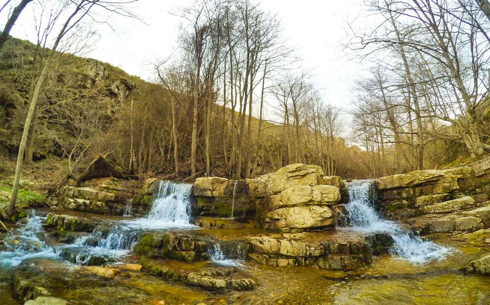
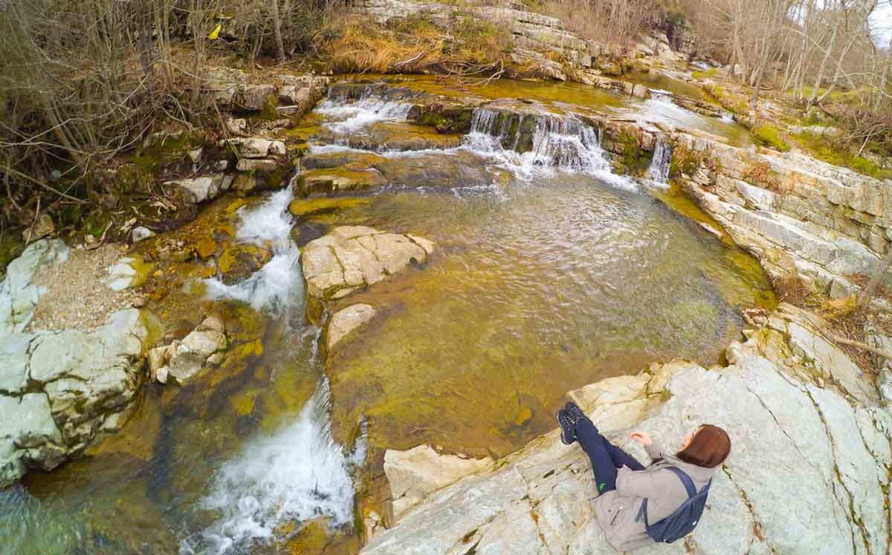

The Cehennem Waterfalls are near Kızılağaç village, between Vize in Kırklareli and Kıyıköy. From İstanbul, go via Çerkezköy, Saray and Vize towards Kıyıköy, then take the turn for Kızılağaç. The last 3 km or so are on a dirt road. Park in the open area above the falls and walk down.

> **Information Date:** The data is based on road and camping area observations in March 2016. Please verify the current condition of the dirt road, signs, and camping conditions before you go.

## Where Are the Cehennem Waterfalls, and How Do You Get There?

From İstanbul, go via Çerkezköy to Saray, then to Vize. In Vize follow the signs for Kıyıköy. After passing Kömürköy, leave that road at the turn for Kızılağaç village. Just beyond the village, a sign points left to the Cehennem Waterfalls. Leave the paved road there and follow the dirt track for about 3 km to the hill above the falls. Leave your car there and walk down. The falls are close. You’ll see them once you get down.

<iframe class="mappingFrame" src="https://www.google.com/maps/embed?pb=!1m24!1m12!1m3!1d104239.98476545895!2d27.75973427789372!3d41.63769602250724!2m3!1f0!2f0!3f0!3m2!1i1024!2i768!4f13.1!4m9!3e0!4m3!3m2!1d41.5704244!2d27.771493699999997!4m3!3m2!1d41.716113899999996!2d27.847666399999998!5e1!3m2!1str!2str!4v1458058890828" width="300" height="150" allowfullscreen="allowfullscreen"></iframe>

  

## Cehennem Waterfalls campsite information

### Available facilities

* There is no campsite here. If all you need is somewhere level, there are a few flat spots around the waterfall. Keep in mind that if you pitch here, day visitors will be coming through.
* You can park your car in the large area where the waterfalls begin.
* If you don't want to be near the waterfalls, there’s a path into the forest just across from the fork on Demirköy road, which leads to the path to the waterfalls. If you go a little further in, you’ll find a wide clearing and tall trees.
* Don’t forget to bring your water with you.
* It is said that wild boars are frequently seen. However, I haven't seen one yet.

### Facilities that are unavailable

* Groceries (stock up in the centre of Vize).
* Restaurant
* Hotel, Guesthouse

