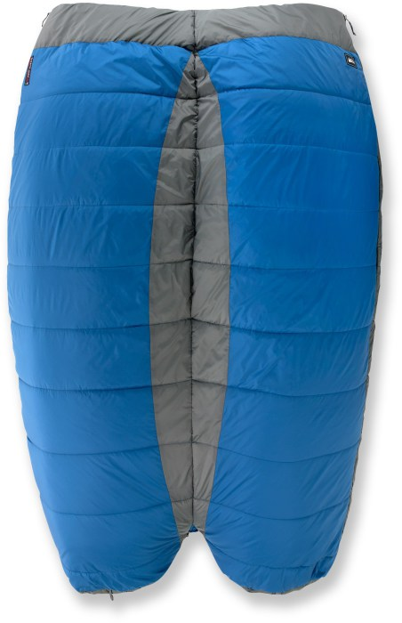

## What about a double sleeping bag?

I think they’re lovely. When you camp with your spouse or partner, a double sleeping bag looks appealing at first. You think, “How nice. That makes perfect sense.” If you feel you never camp separately anyway, it’s easy to decide you should get a bag for 2 people. Don’t get carried away by how nice the product looks. Weigh up the pros and cons and ask people who have used one. Here’s what I think.

## Can you use one on your own?

No, I don’t think it’s suitable. If you’re thinking of buying a bag for 2 people and using it on solo trips as well, there are drawbacks. It will take up space on a solo trip and be too wide for you. A sleeping bag’s job is to hold the air warmed by your body, so it insulates you. A larger interior means more space for you to warm. You might be cold using it alone under the same conditions in which you stayed warm with 2 people inside.

## Is it wider and more comfortable?

Double sleeping bags don’t give you more space or comfort. Each person gets about as much room as in a regular bag. If you’re bigger than your partner, naturally you’ll take up more space. It feels like being under a duvet, so you can encroach on the other person’s space and squeeze them into a corner. In cold weather, cold air can come in through the wider openings on the left and right. There are drawcords around the neck, of course, but gaps can remain with 2 people inside.

## How many different models are there?

Sleeping bags for 2 people come in 2 different designs. The 2 designs are bags that zip together and one-piece bags. The one-piece bags have the features described above. In the zip-together design, the zips of 2 individual bags meet in the middle and can be joined, as in the photo below. The main advantage is that you can use them separately as ordinary sleeping bags when you’ve had an argument or when it’s cold.

### RESULT

If you absolutely love your duvet and are looking for a double-sized duvet for use as a vacation home, you might want to consider a fully integrated, single duvet. If you and your partner often argue, and you want to avoid getting cold during the spring months, I recommend opting for a duvet that can be combined. These combined duvets are actually two separate duvets, which makes them more expensive.

For more information about sleeping bags, please follow the links below.

[How to Choose a Sleeping Bag](/uyku-tulumu-alirken-nelere-dikkat-edilmelidir/)

[What to Do When Your Sleeping Bag Isn’t Warm Enough](/uyku-tulumu-yetersiz-kalirsa-ne-yapilmalidir/)
