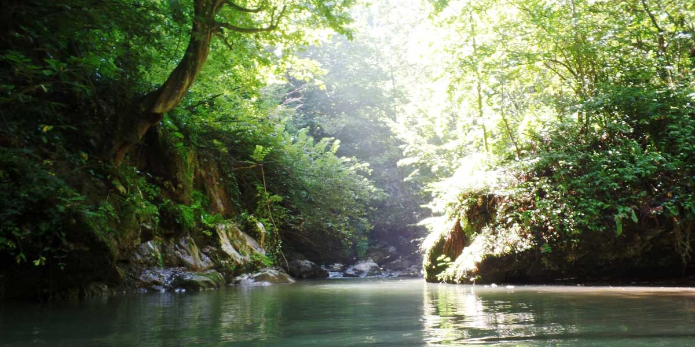
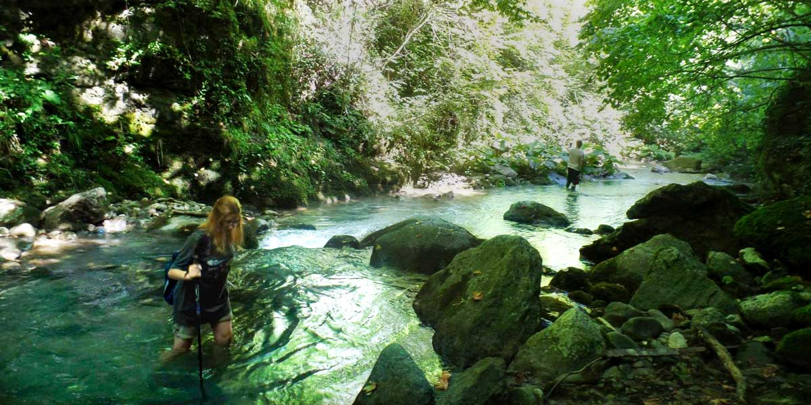

Around the end of August 2014, plans, plans, plans. Lately, I think the thing that occupies my mind the most are plans. I’ve been making plans to go to several places. Çağatay, with whom we’ve been practically driving ourselves crazy, saying “let’s go,” for about six months, and who couldn’t quite find a suitable time, joined us – he’s a nature-loving, enthusiastic person eager to go camping. “I’ll come too,” Simge said. I was going to start asking her things like “do you have a tent?”, “do you have a sleeping bag?”, but she completely threw me. She has everything – all the equipment, even a backpack – and she’s been camping for about three years, but she still doesn’t have a thermos. I was actually a little embarrassed for her. But I didn’t show it, and I continued to play it cool :).

Getting along well with the people you’re going camping with is extremely important for a pleasant experience. Çağatay and Simge and I were going camping for the first time. Surprisingly, we formed a really good and harmonious group. To be honest, I tried to get them involved in so many things, but they didn’t say a word. I guess they thought I knew exactly what I was doing :).

### Hot Creek Canyon

We started the day by having breakfast near the Yuvacık dam, and then we set off towards the Sıcak Dere canyon. The Sıcak Dere canyon is Kocaeli’s most challenging route, featuring places that are deprived of sunlight, often requiring passage through forests and along the stream, and over rocks. You might be wondering why you would bring trekking novices here, but, as I said, we didn’t hear any complaints, even though we presented them with such difficult conditions. We didn’t aim to completely traverse the canyon from start to finish; instead, we intended to enter the canyon and return without encountering any difficulties. After covering approximately 2km, navigating the increasingly difficult rock passages, the team decided to return without pushing themselves further.

Our return was a relief for Simge, but a disappointment for Çağatay. In fact, Simge herself was also saddened, but because the crossings were becoming increasingly difficult, we had to make the decision to return. Çağatay’s sadness stemmed from the fact that he couldn’t enter the waterfall; if he continued at that speed, we would have reached the waterfall the next day:D. We were walking confidently in the canyon, taking firm steps and providing a sense of security. This was very important because, otherwise, I would have constantly felt like I was on the verge of falling. (People have said this to me, and I won’t name them now:)). We did have one problem, though. We needed to collect the waterfall gas from Çağatay. Therefore, we decided to go to the small waterfall located just beyond the Servetiye Mosque village, which was where Çağatay was staying. Yes, this calmed Çağatay, and it calmed us too. Otherwise, how would we have kept him for two days?

### Kaya Üstü Yaylası, isn't it? Please, I’m begging you – do not drive there in your car.

Please, please, please, we've burned our bridges, friends, don't let this happen. It's a lovely yayla, but driving to that road isn't worth it. Unless you have a 4×4 or are planning to walk, of course. The dirt road leading to Kaya Üstü yaylası was beautiful at first. But then it suddenly began to deteriorate. We were about 2 km from the yayla, so we said, 'let's take this route,' 'let's take this route,' and suddenly those 2 km cost us dearly. Due to rain, ruts have formed in the dirt road. If one wheel goes down, we'll have to cancel. We'll be stuck there. You might ask, 'why did you even go there?' I said, 'it was one of those moments when I didn't know what I was doing :D.' We thought, 'we've come this far, let's see it,' but the last 1–2 km were a real struggle. Upon arriving at the yayla, there were no other people around, and there weren't many flat areas as the map suggested. It was mostly slopes. Apart from a few yayla houses, there was nothing else. Then we encountered a group of three. They were hiking to the yayla for the third time, and this time they had decided to go to the rocks to view the scenery. Our respected Mustafa abim, who owns a 44-year-old Harley that is neither working nor liked by its owner, told us that there were plenty of bear tracks below. For me, it wasn't an issue, because if a bear came, we would sacrifice Simge. However, the safety and security of the rest of the group was important :). Simge accepted this but was a little worried. Çağatay, meanwhile, was waiting with a look of reluctance, hoping to avoid encountering a bear on his first camping trip. I, however, began thinking very quickly: 'Bear, yayla, no one else, just us, very little flat ground, if it has been farmed here, a bear will definitely come, will it attack if it comes? If our tyre blows, what then? Fuel is running low, if we fall into a rut, will we abandon the car? It's 4 o'clock, we need to make a decision…' After this internal debate, we decided to go to İnönü yaylası. Upon arriving at that yayla, we realised we had taken no photos at all.

### İnönü Plateau? Absolutely not, or never come here again.

Oh my goodness, what kind of trouble have you got yourself into? The road there is terrible, and everything else isn't great. But I'll give you credit for one thing, brother. Just as we'd just pitched our tents, settled in, lit our fires, and were about to start cooking, a voice came from across the way: 'Hastasıyız deedeeeee'. A moment later, the same voice echoed back from across the distance. We thought to ourselves, "What the hell is this?" The 'sick' chant continued, sometimes even in a boisterous manner, accompanied by gunfire. The man was shouting, and his child, along with the child's mother, were also shouting. "What kind of family do you have, you guys?" I asked. "No, if one person did this, you'd warn them. But this group of three, who were making a really fancy camp, didn't. We knew we couldn't explain it by talking about the people involved, so we didn't get involved in that process. Not because I was judging or looking down on people, but because we realised they weren't aware that they were disturbing the environment, and we couldn't tell them. Eventually, we stopped hearing it. Meanwhile, we were singing and making our marshmallows over the fire. Thanks to Simge, we were finally able to do the marshmallow thing we'd planned. If I'm honest, we would have eaten biscuits and chocolate instead. As our watches approached 1 a.m., we were saved from a really awful beating when Çağatay, having entered his 'sick' mode, started arguing with the other 'sick' people across the way. At that moment, I realised he was about to say, 'Let's go to sleep,' which saved us from a truly terrible ordeal. It would have been wrong to beat everyone in the meadow, after all (or to receive a beating ourselves)."

### What a wonderful Sunday morning.

By 5, Zort said he was tired and falling asleep. At this hour, the best thing to do was to light a fire, make tea, and doze in a chair. Because it is a yayla, the temperature varies considerably. At 5, the air was quite cold. While I sat in my chair by the fire, sipping my tea, I watched the sun rise over the yayla. Then, I began to doze intermittently. From 7 onwards, the sunlight began to fall on our tents. Activity had started on the yayla, and the man on the other side had stopped shouting, "Oh, it's going to be a wonderful day," before he began shouting, "I'm burning, my insides are burning!" I really wanted to say, "Come into my heart," but I did not want to lose my temper. So, I kept all that I wished to say to myself. After that noise, I said they were now waking up, but they weren't. They were snoring. Finally, around 9.30, the tents that had returned from the bath were emptied by their occupants. Afterwards, we went to Ercuva Yayla, making a walk through the forest. While I was thinking that we should have gone there last night, as it would be quieter, we were greeted by the songs of Ankara. After wandering a bit more within the forest, we returned to the campsite, where I roasted potatoes from the fire I had kept burning for me and made kumpir from them. Despite all this, I am grateful to Simge and Çağatay for not saying they were trying to kill us. And, pray they do not suggest we go again. They must be mad :D

### The car is experiencing its final moments.

We came together really well, we got in the car, and we were going to start it, but – whoops – the battery completely drained. Seriously, you drained so quickly. Luckily, there were a lot of people at the meadow, and we managed to get the car started by helping each other. I don’t know what we would have done if it had drained at Kaya Üstü meadow. The car is really starting to worry me. My father certainly wouldn’t approve, he’d charge me if he heard.

Despite everything, we managed to get home safely without any trouble. I really enjoy going camping with new people, and embarking on trips. Their excitement inspires me, and their happiness adds to my own. It was a really wonderful time, especially with Simge and Çağatay – it was super fun for both of us :)