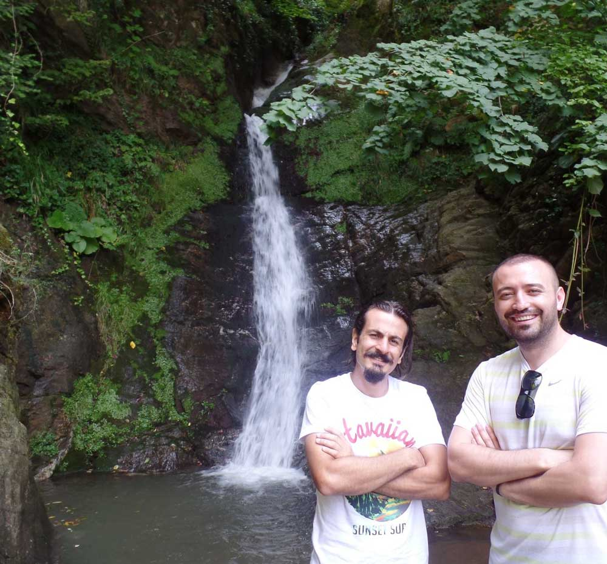
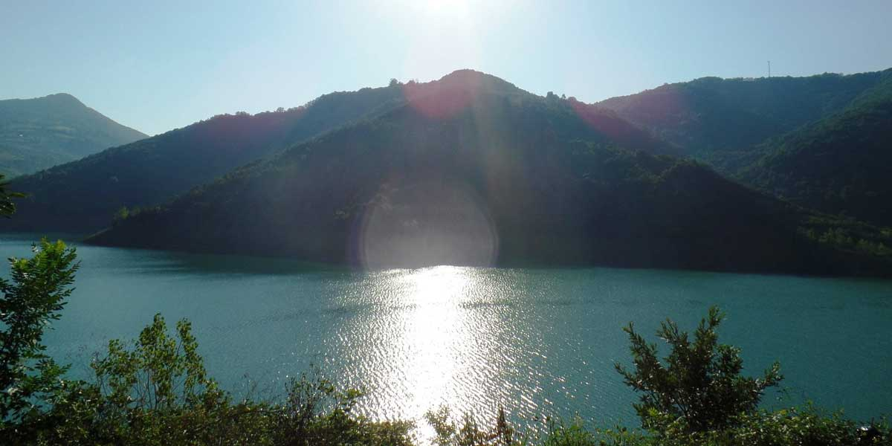

Towards the end of August 2014, it was plans, plans, plans. These days, I think the thing occupying my mind the most is plans. I’m constantly making plans to go somewhere. I finally found a good opportunity to visit the Sıcak Dere canyon and Kayaüstü Highland, which I’ve wanted to go to for a long time. For about six months, I’d been nagging Çağatay to go, driving myself crazy, but we never managed to find the right time. So we decided to go, and then another name joined us: a nature-loving, enthusiastic person, open to the outdoors, and impatient to go camping. Yes, Simge said she’d come. I was about to ask her things like “Do you have a tent?” or “Do you have a sleeping bag?” but she completely threw me off. She has all the gear, even a backpack, and she’s been a camper for about three years (haha, roughly three years), yet she still doesn’t have a thermos. It was a moment when I was truly embarrassed for myself. Of course, I didn’t let on, and I carried on with my artistry :).

Getting along well with the people you’re going camping with is extremely important for a pleasant experience. Çağatay and Simge and I were going camping for the first time. Surprisingly, we formed a really good and harmonious group. To be honest, I tried to get them involved in so many things, but they didn’t say a word. I guess they thought I knew exactly what I was doing :).

### Sıcakdere Canyon

We started the day by having breakfast near the Yuvacık dam, and then we set off towards the Sıcak Dere canyon. The Sıcak Dere canyon is Kocaeli’s most challenging route, featuring places that are deprived of sunlight, often requiring passage through forests and along the stream, and over rocks. You might be wondering why you would bring trekking novices here, but, as I said, we didn’t hear any complaints, even though we presented them with such difficult conditions. We didn’t aim to completely traverse the canyon from start to finish; instead, we intended to enter the canyon and return without encountering any difficulties. After covering approximately 2km, navigating the increasingly difficult rock passages, the team decided to return without pushing themselves further.

Our return was a relief for Simge, but a disappointment for Çağatay. In fact, Simge was also sad, but because the crossings were becoming increasingly difficult and would only get harder, we had to make the decision to turn back. The reason for Çağatay’s sadness was that he hadn’t been able to enter the waterfall. In any case, if he had continued at that pace, we would have reached the waterfall the next day :D. I must admit, they were walking through the canyon with great confidence. They were taking firm steps and moving forward with a reassuring air. This was very important, because otherwise I would have constantly felt like I was on the verge of falling. “He might fall, or he might not” (people have said this to me, and I won’t name them now :)). We did have one problem, though. We needed to get that waterfall gas out of Çağatay. So we decided to go to the small waterfall just beyond the village of Servetiye Camii, which was up ahead of us. Yes, this calmed Çağatay, and it calmed us too. Otherwise, how would we have kept him for two days?

### Kayaüstü Highland, isn't it? Please, I’m begging you – do not drive there in your car.

Take it from those of us who learnt the hard way, folks: spare yourselves the trouble. It’s a lovely highland pasture, but that road isn’t worth tackling in an ordinary car. Unless you have a 4×4 or are planning to walk, of course. The dirt road leading to Kayaüstü Highland was beautiful at first. But then it suddenly began to deteriorate. We were about 2 km from the highland pasture, so we said, 'let's take this route,' 'let's take this route,' and suddenly those 2 km cost us dearly. Due to rain, ruts have formed in the dirt road. If one wheel goes down, we'll have to cancel. We'll be stuck there. You might ask, 'why did you even go there?' I said, 'it was one of those moments when I didn't know what I was doing :D.' We thought, 'we've come this far, let's see it,' but the last 1–2 km were a real struggle. Upon arriving at the yayla, there were no other people around, and there weren't many flat areas as the map suggested. It was mostly slopes. Apart from a few yayla houses, there was nothing else. Then we encountered a group of three. They were hiking to the highland pasture for the third time, and this time they had decided to go to the rocks to view the scenery. Our respected Mustafa abim, who owns a 44-year-old Harley that is neither working nor liked by its owner, told us that there were plenty of bear tracks below. For me, it wasn't an issue, because if a bear came, we would sacrifice Simge. However, the safety and security of the rest of the group was important :). Simge accepted this but was a little worried. Çağatay, meanwhile, was waiting with a look of reluctance, hoping to avoid encountering a bear on his first camping trip. I, however, began thinking very quickly: 'Bear, yayla, no one else, just us, very little flat ground, if it has been farmed here, a bear will definitely come, will it attack if it comes? If our tyre blows, what then? Fuel is running low, if we fall into a rut, will we abandon the car? It's 4 o'clock, we need to make a decision…' After this internal debate, we decided to go to İnönü Highland. Upon arriving at that yayla, we realised we had taken no photos at all.

### İnönü Highland? Absolutely not, or never come here again.

Oh, my friend, you’ve turned out to be such a problematic one. The road there is bad, the road here is bad. Can’t you like anything, brother? But you’ll have to agree with me. Just as we’d pitched our tents, settled in, lit our fire, and were about to get into the cooking business, a voice came from across: “Hastasıyız deedeeeee”. Then, from far away across the other side, the same voice replied. What’s going on, man, we thought to ourselves. Then it went on like this: “Hastasıyız dedeler”, sometimes even with enthusiasm, and occasionally with gunshots. The man was shouting, and the child next to him, and the child’s mother, were shouting too. “What kind of family are you, guys? :)” No, if one person did this, you’d warn them. But this was one of three groups on the whole yayla who were making a decent camp and not doing this. Of course, since we knew we couldn’t explain anything by talking to that kind of person, we never got involved in that process. It wasn’t because I was condemning or looking down on people, of course, but simply because they weren’t aware they were disturbing the surroundings, and we couldn’t tell them. After a while, we just accepted it and stopped hearing it. Meanwhile, we were singing our songs and making and eating our marshmallows over the fire. That marshmallow thing we’d planned to do but couldn’t, thanks to Simge, finally happened. If it were up to me, we’d still be eating biscuits and chocolate. :) As our watches approached 1 a.m., when we sensed Çağatay, having a nice head on his shoulders, slipping into his “Hastasıyız dede” mode and starting an argument with the other “Hastasıyız dedeler” around, the phrase “Let’s go to sleep” saved us from a really nasty beating. It would have been shameful to beat everyone in the highland settlement, after all (or to get beaten by everyone).

### What a wonderful Sunday morning.

By 5, Zort said he was tired and falling asleep. At this hour, the best thing to do was to light a fire, make tea, and doze in a chair. Because it is a yayla, the temperature varies considerably. At 5, the air was quite cold. While I sat in my chair by the fire, sipping my tea, I watched the sun rise over the yayla. Then, I began to doze intermittently. From 7 onwards, the sunlight began to fall on our tents. Activity had started on the highland pasture, and the man on the other side had stopped shouting, "Oh, it's going to be a wonderful day," before he began shouting, "I'm burning, my insides are burning!" I really wanted to say, "Come into my heart," but I did not want to lose my temper. So, I kept all that I wished to say to myself. After that noise, I said they were now waking up, but they weren't. They were snoring. Finally, around 9.30, the tents that had returned from the bath were emptied by their occupants. Afterwards, we went to Ercuva Highland, making a walk through the forest. While I was thinking that we should have gone there last night, as it would be quieter, we were greeted by the songs of Ankara. After wandering a bit more within the forest, we returned to the campsite, where I roasted potatoes from the fire I had kept burning for me and made kumpir from them. Despite all this, I am grateful to Simge and Çağatay for not saying they were trying to kill us. And, pray they do not suggest we go again. They must be mad :D

### The car is on its last legs

We gathered nicely, got into the car, and were about to start it when – whoops – the battery had drained. Seriously, you drained so quickly, you did. Luckily, there were loads of people at the yayla, so we managed to get the car started by jump-starting it. I don’t know what we would have done if it had drained at Kayaüstü Highland. The car is really starting to worry me now. My dad mustn’t hear about this; if he does, he’ll put the bill on me.

Despite everything, we managed to get home safely without any trouble. I really enjoy going camping with new people and setting off on trips. Their excitement excites me, and their happiness increases my own. It was a really wonderful time with Simge and Çağatay – a super enjoyable camp for both of them and me. Super enjoyable? Well, it was just great, you know :)