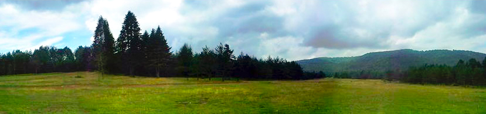

### Where is Ercuva meadow, and how do you get there?

After arriving in Kocaeli, you continue from the Yuvacık fork towards the Yuvacık dam. When you reach the top of the dam on the right, you will see the signs for Tepecik Village and İnönü Valley at the fork in the road. Following this road after reaching Tepecik Village, you will arrive at İnönü Valley. After passing İnönü Valley, approximately 2-3 km later, you will reach Ercuva Valley.

<iframe
  class='mappingFrame'
  src='https://www.google.com/maps?q=40.560805,29.99041&amp;num=1&amp;t=h&amp;hl=tr&amp;ie=UTF8&amp;z=14&amp;ll=40.560267,29.991421&amp;output=embed'
  width='300'
  height='150'
></iframe>

 

### Ercuva forest camp information

##### Available facilities

- Camp Site (There is no specific business/establishment. You can set up a tent anywhere in the meadow.)
- Clean water
- The grocery store/market needs to be handled in Yuvacık.

##### Facilities that are unavailable

- Restaurant or cafeteria
- Guesthouse
- Toilets

Note: This information dates back to 2013.

### Ercuva Valley Hiking Routes

#### From Kazandere village to Ercuva meadow, and then on to Hüseyni village (17 km).

<iframe
  frameBorder='0'
  scrolling='no'
  src='https://tr.wikiloc.com/wikiloc/spatialArtifacts.do?event=view&id=1459783&measures=on&title=on&near=off&images=on&maptype=H'
  width='100%'
  height='600'
  style={{ borderRadius: '10px 10px' }}
></iframe>

- There are water points along the road.
- The route begins within Kazandere village, on a dirt road through the forest, gradually ascending to reach Ercuva Valley. Afterwards, it descends to arrive in Hüseyni village.
- It’s an easy course. The 17km distance might be a bit tiring for you.

#### From Aytepe to İnönü Valley and then to Serindere (35 km).

<iframe
  frameBorder='0'
  scrolling='no'
  src='https://tr.wikiloc.com/wikiloc/spatialArtifacts.do?event=view&id=1761070&measures=on&title=on&near=off&images=on&maptype=H'
  width='100%'
  height='600'
  style={{ borderRadius: '10px 10px' }}
></iframe>

- There’s water available in the key areas. Therefore, you won’t experience water shortages.
- After passing the forest management building in Aytepe, the route begins at the fork leading to Menekşe Valley. First, you reach Ercuva Valley, and then İnönü Valley. There’s potable water in these areas. Afterwards, you continue on a dirt road towards Çilekli, and then reach Sultaniye, followed by a descent towards Serindere.
- A moderately difficult, long course. Its length can be challenging.
- You can reach İnönü Valley by starting from Serindere, using the same route.

#### From the secluded plateau of Saklı yaylası, to İnönü yaylası, and subsequently Ercuva yaylası (11 km).

<iframe
  frameBorder='0'
  scrolling='no'
  src='https://tr.wikiloc.com/wikiloc/spatialArtifacts.do?event=view&id=6153851&measures=on&title=on&near=off&images=on&maptype=H'
  width='100%'
  height='600'
  style={{ borderRadius: '10px 10px' }}
></iframe>

- There are water points along the road.
- Initially, the route leads to Saklı yayla, then via a path through the forest, to İnönü yaylası. The route continues to Ercuva yaylası, and then returns to its starting point.
- A straightforward 11 km trail.
- You can set up camp in these three meadows. However, İnönü meadow is the most beautiful one.
