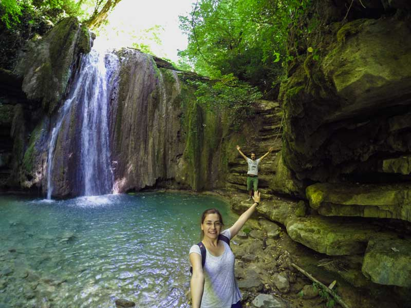
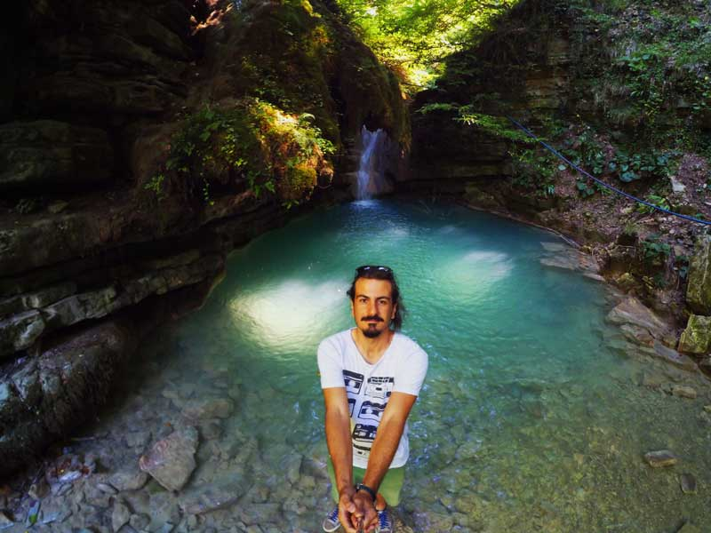
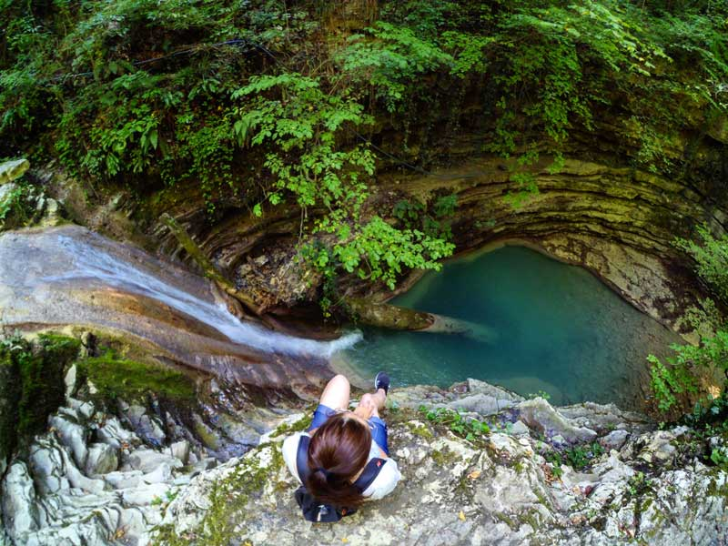
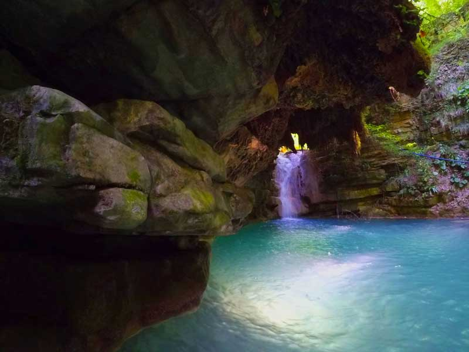
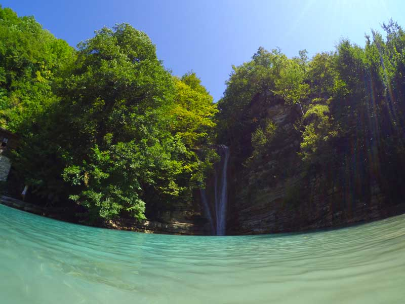

The light filters through the trees, bouncing off the rocks and falling into the water, creating a truly beautiful sight. I can say it's the most beautiful waterfall complex I've ever seen. It consists of 28 waterfalls, big and small. In spring, when the water is abundant, the waterfalls will look even more beautiful. This waterfall, accessed via the Erfelek district of Sinop, is one of the most beautiful waterfalls you should see. It's a natural wonder where you can see plastic bottles everywhere, which can get on your nerves. It's been taken under protection by national parks – supposedly. In reality, the only thing they do is charge an extra fee. We paid 12 TL for vehicle entry. Seeing all the litter around these beautiful waterfalls also got on our nerves.

### Where are the Erfelek Tatlıca Waterfalls and how do you get there?

The route is taken via Sinop Erfelek district. Although a short section of the road is unpaved due to roadwork, most of it is asphalt. After reaching the Erfelek district, you can easily reach the waterfall by following the signs.

<iframe
  class='mappingFrame'
  style={{ border: 0 }}
  src='https://www.google.com/maps/embed?pb=!1m28!1m12!1m3!1d167001.2600496348!2d34.916290494882!3d41.90703603556013!2m3!1f0!2f0!3f0!3m2!1i1024!2i768!4f13.1!4m13!3e6!4m5!1s0x408f12de6b86738d%3A0xcfa12eddefc640fb!2sSinop+Merkez%2C+Sinop%2C+T%C3%BCrkiye!3m2!1d42.027974!2d35.151725!4m5!1s0x408f7d0cd5e69cff%3A0xd237726252d2becf!2zRXJmZWxlayBUYXRsxLFjYSDFnmVsYWxlbGVyaSwgNTc1MDAgQWvDtnJlbi9BeWFuY8Sxay9TaW5vcA!3m2!1d41.84036!2d34.7798002!5e1!3m2!1str!2sde!4v1443197631515'
  width='300'
  height='150'
  allowfullscreen='allowfullscreen'
></iframe>

 

### Erfelek Tatlıca Waterfalls campsite information

##### Available facilities

- Do not search for a specific camping area. You can set up your tent in any empty spot you find within the national park. I didn’t really find a designated camping area.

  - It’s a popular spot frequented by day-trippers. People setting up tents don’t really seem to relax. We recommend a day trip.

- Restaurant
- Merchandise sellers, including those selling gifts.
- Grocery shop
- Toilets
- Trash can
- Children’s Play Park
- Parking
- Picnic area (table, chair, stove, etc.)

Note: This information dates back to September 2015.

### Erfelek Tatlıca Şelaleleri Hiking Routes

#### Erfelek Waterfalls (4.4 km)

<iframe
  frameBorder='0'
  scrolling='no'
  src='https://tr.wikiloc.com/wikiloc/spatialArtifacts.do?event=view&id=7491416&measures=on&title=on&near=off&images=on&maptype=H'
  width='100%'
  height='600'
  style={{ borderRadius: '10px 10px' }}
></iframe>

- Waterfall route. A moderately easy trail.
- You should take your water with you when you set out.
- Pay attention to slippery conditions.

