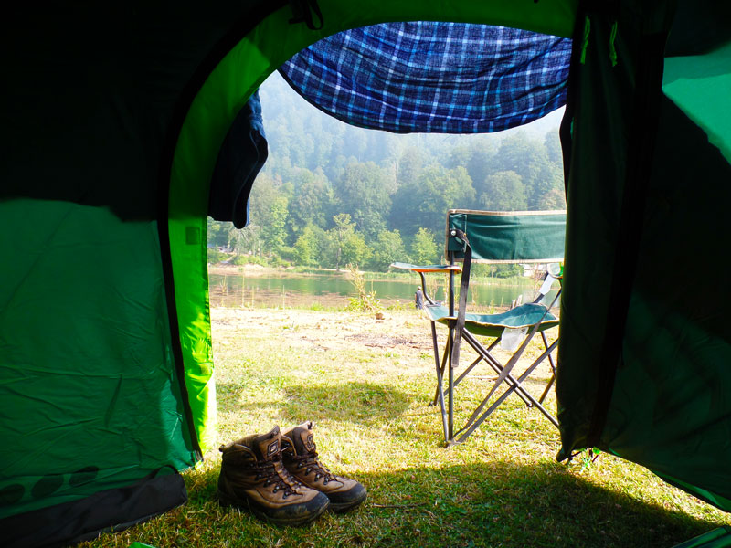
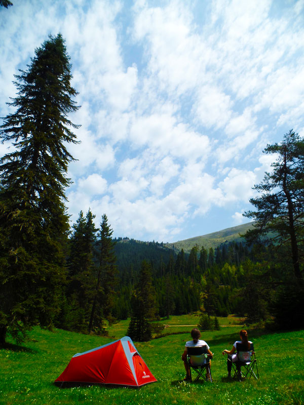
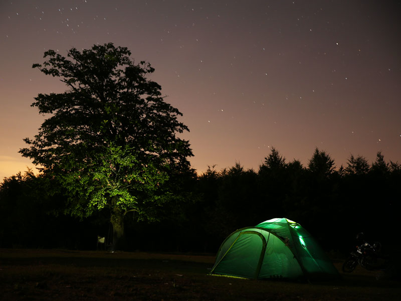

If you haven't spent a night in nature before, sleeping in a tent might be a big surprise. This is perfectly normal. People tend to see what they don't know as a bit mysterious, and also a bit dangerous. However, the key to making a first camping trip easier is to make the first night manageable, not to push yourselves.

For your first camping trip, choose a location that’s easily accessible, where you can monitor the weather, and where you can return if needed. Remember, a one-night camping trip isn’t a survival competition. You’ll set up your tent, prepare your food, spend the night, and then pack up your equipment and return. That’s your primary goal.

## What equipment is needed for the first camping trip?

The basic setup is actually quite simple: a tent, a sleeping bag, and a mat. The tent provides shelter, protecting you from the weather and the surroundings. The sleeping bag helps to retain the heat your body produces. And the mat makes the ground more comfortable and reduces heat loss from the ground.

Fener, January (ocak), water, food, basic clothing, first aid, and a small repair kit should be included in your list, according to the conditions of the camp. Hammocks, chairs, and tables are not essential for the initial camping trip; they are added depending on your method of transport and your comfort expectations.

You can find a detailed and straightforward list for your first camping trip at [ilk kamp için gerekli malzemeler](/ilk-kamp-icin-gerekli-malzemeler/).

## How should you plan your first camping trip?

Choosing a campsite – either a professionally managed one or a place where camping is permitted and offers basic necessities – can make your job easier. Being near a source of water, a toilet, a road for vehicles, and a point where you can request assistance if needed, will reduce the uncertainty of the first night.

When organizing a wilderness camping trip, you would consider the campsite itself, the water source, weather conditions, transportation, and emergency plan. This offers a more free-form experience, but it’s often more challenging, especially when starting out. [“A Guide to Choosing a Campsite for Your First Trip”](/ilk-kamp-nerede-yapilir/) – I’ve broken down this decision step by step.

## What should you pay attention to when camping in nature?

Check the rules and seasonal restrictions of the camping location in advance. Specifically, rules regarding fire and entering the forest may vary depending on the region and season. Do not set up a tent in an area where it is not permitted; and when you are permitted to, only use the designated areas.

Don’t view wild animals as part of a romantic adventure, and don’t create unnecessary fear. Keep food and fragrant items organized, do not feed the animals, avoid approaching them if you encounter them, and pay attention to the area’s official warnings. Maintaining a distance from nature is often the best safety plan.

The initial goal of the first camping trip isn’t to eliminate all risks, but to reduce what you don’t know. Start with a plan where you can return if the weather changes, set up your equipment in the dark, and have a plan where someone close to you knows your location. For more detailed information on safety, you can refer to the article “[Is camping in nature safe?](/dogada-kamp-yapmak-guvenli-midir/)”.

A good first camping trip isn’t necessarily the one where you go the furthest or carry the most gear. It’s the one where, when you wake up in the morning, you think, “I wouldn’t do this again.” The rest comes with experience and increased equipment.

When you’re preparing for your first camping trip, what’s on your mind the most? If you share your thoughts in the comments, we can make the subsequent articles in the series even more helpful based on your input.
