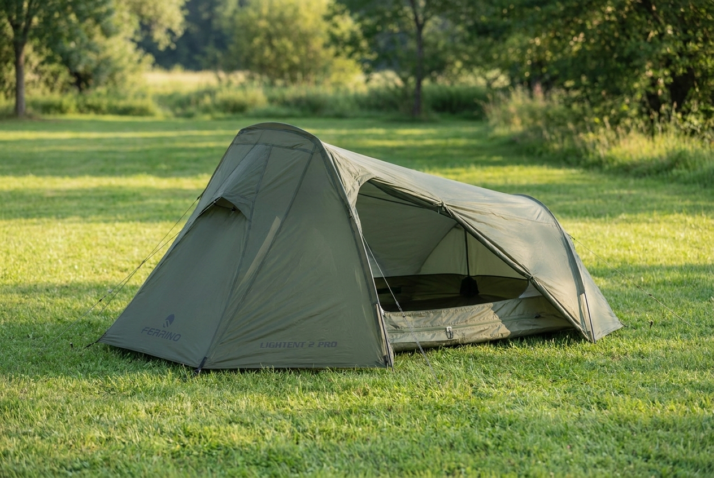
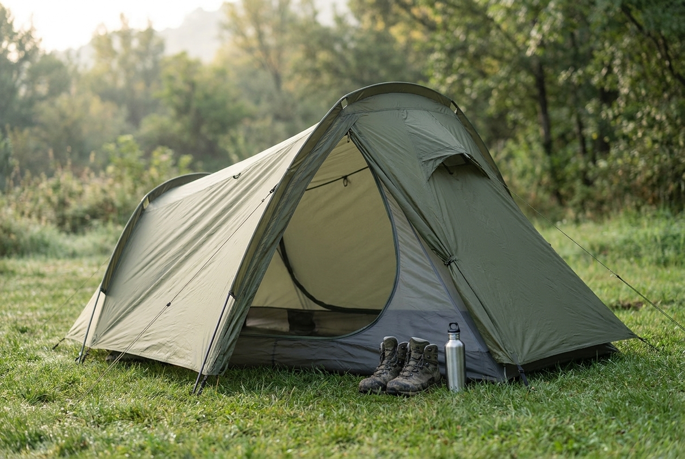
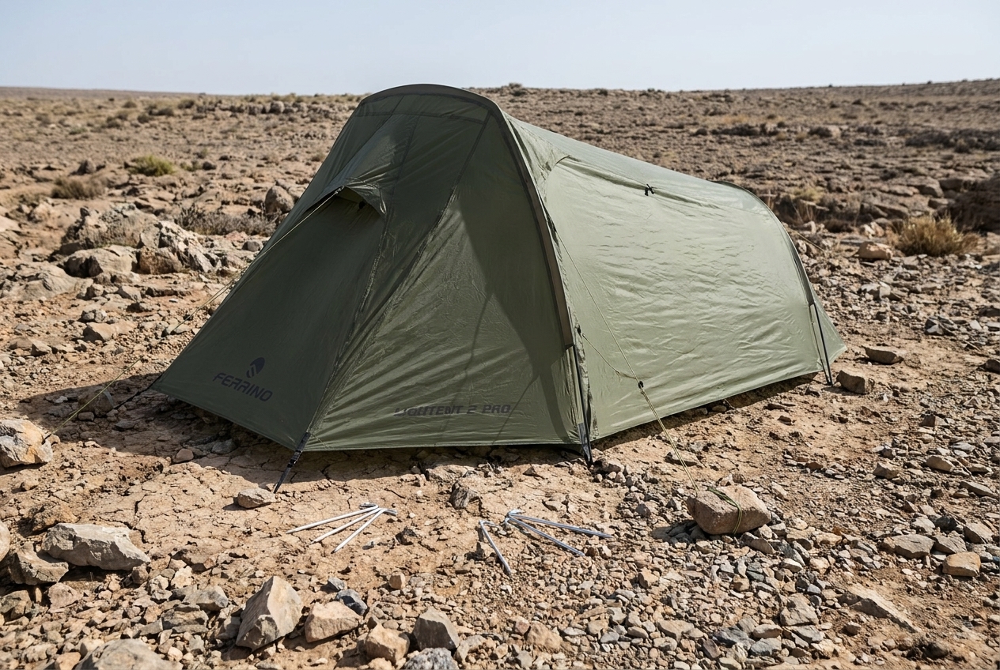

Ferrino Lightent 2; a practical two-person tent suitable for trekking, cycling, and motorcycling camping, where weight and pack size are important. In the model I use, I particularly like its lightweight and the space it leaves for equipment inside. The most difficult thing for me was that it couldn't be set up without hammering stakes on hard ground.

If you’re looking for a lightweight trekking tent that can be set up on soft ground, this is a strong contender. However, if your camping spot is often hard ground – such as stone, compacted earth, or areas where you can’t put in stakes – you should consider the setup method before making a decision.

> A good tent isn't just light; it's one that keeps you from being stranded in the middle of your setup.

## Why did I buy the Ferrino Lightent 2?

Before this tent, I had a three-season model with a flysheet that weighed about 4 kg. For three years the weight didn’t bother me when I went somewhere just to camp. Once I started carrying it in my backpack as part of my trekking kit, I realised that two or three kilograms makes quite a difference.

Initially, I had considered the Lightent’s one-person model. There was approximately 300 grams’ difference between the two models. While I was calculating that “300 grams is 300 grams,” the ordering and waiting process extended, and I ended up purchasing the two-person model. Looking back now, I believe I made the right decision.

When I’m alone, there’s plenty of space inside for my bag and other belongings. When there are two of us, we don’t need to bring a second tent. Two sleeping bags fit comfortably inside; by placing the belongings on the side, we don’t lose any of the sleeping area.

The tent has a tunnel-like form and a single entrance, and it looks like this from the outside.

## What are the current technical specifications of Lightent 2?

The field experience I’m describing relates to an older Lightent 2 unit. It’s currently listed as “Lightent 2 Pro” in current product catalogs. Therefore, I’m using the following table to summarize the technical specifications of the current Lightent 2 Pro.

| Technical specifications | Value |
|---|---|
| Person capacity | 2 people |
| Structure | Tunnel tent, 3 seasons |
| Weight | 1.85 kg minimum / 2.10 kg maximum |
| Package size | 17 × 35 cm |
| Entrance and vestibule | 1 entrance, 1 vestibule |
| Outer tent | Recycled polyester, 3,000 mm water column pressure |
| Groundsheet | Recycled polyester, 8,000 mm water pressure |
| Installation | Non-freestanding, with external poles. |
| Ventilation | In the front, back, and vestibule areas, there are openings. |
| Pitching without the inner tent | 1.5 kg |
| Accessories | The carrying bag, repair kit, inner pockets, and lamp holder. |

Ferrino’s product information clearly states the **vestibule**, which is a small entryway located in front of the entrance. Don’t think of it as a separate room like the sleeping area. In the model I used, this entryway was what I utilized to keep my boots, shoes, and water bottle away from the sleeping area.

The current model’s minimum weight is 1.85 kilograms, which refers to a combination of an inner tent, an outer tent, and poles. With stakes, ropes, bag, and other components, the maximum weight reaches 2.10 kilograms. When calculating the weight for a backpack, it’s best to use the maximum value.

## Is the Lightent 2, which is for two people, comfortable inside?

When you see the label for a “two-person tent,” don’t assume that two people will be living there, with all their belongings set up. Lightent 2 offers enough space for two people to sleep, but when you put your large bags inside, the available space naturally decreases.

When I use the space alone, I find it much easier. I can put my bag inside and arrange my clothes and small equipment near my feet. When there are two people, however, it’s necessary to arrange the belongings neatly. The real comfort comes from the vestibule in front of the bags and boots.

Here’s a warning: In my old journal, I mentioned that I used a stove in the luggage compartment during rainy weather. However, simply doing this does not mean it’s safe. Using a stove inside a tent or in the luggage compartment carries a risk of fire and carbon monoxide poisoning. Use the stove outdoors, at a safe distance from the tent.

I’ve explained in more detail how to calculate capacity in the “[how to choose the right tent](/cadir-alirken-nelere-dikkat-edilmeli/)” guide.

*This is useful for keeping the vestibule, boats, and small items outside of the sleeping area.*

## Is the Lightent 2 easy to pitch?

This tent is not like self-supporting dome tents. First, you need to secure the base of the inner tent with stakes and tension it. Then, you install the poles, and finally, you attach the outer canopy.

The “Güncel Lightent 2 Pro” is also listed as a self-standing tunnel tent, which confirms this particular installation method. The poles being in different colors makes it easy to understand which pole goes where.

On soft ground, this won’t be a problem. You’ll drive the stakes in, level the base, and set up the poles. However, on hard ground, the initial step is already the most difficult. If you can’t drive the stakes in, you won’t be able to set up the tent properly.

Because of this, ask yourself this question before you buy:

How do I set up this tent on ground I can’t drive a stake into?

## How does the Lightent 2 perform on hard ground?

The stakes that come with the tent were too hard and rocky, and weren’t sufficient for me on hard ground. They are easily bendable and, because they are short, they don’t fully sink into the ground. This is a problem related to the way the tent is set up, independent of whether it’s a problem with the tent’s fabric or the poles themselves.

The hard, rocky ground makes choosing the poles for the tent more difficult before selecting the tent.

The solution I’ve found is more reliable – using thicker stakes. [Ferrino steel stakes](/ferrino-cadir-kazigi/) provide more security on hard ground, but they also add extra weight to your backpack. When looking for lightness, it’s not possible to simply consider everything from the tent alone.

It may be possible to set up a tent by attaching it to trees or solid points using ropes in a place where stakes cannot be driven. However, this requires having enough rope and ensuring that the connection you create is suitable for the tent’s tension points. It may not always be possible to find such a solution in every camping area.

If you are setting up camps like I am – where you don’t know exactly where you’ll be – don’t underestimate the possibility of hard ground. A tent that works great on a soft grassy path could lead to spending your entire evening wrestling with rocks in a flat, stony area.

## What is the status of the rainfall and ventilation performance?

The tent of my Lightent 2 hasn’t leaked so far. This is a positive observation for my own use – however, it doesn’t guarantee the same result in every weather condition and every model year. Properly tensioning the tent, ensuring the outer tent doesn’t touch the inner tent, and taking care of the fabric are equally important as the fabric’s catalog values.

The Güncel Lightent 2 Pro list includes hydrostatic pressure values of 3,000 mm for the outer fabric and 8,000 mm for the base. These are useful values for laboratory comparisons. “Having an 8,000 mm base means I can forget about everything coming from the ground.” This is due to factors such as stone, pressure, seams, and incorrect installation.

It’s also important that the tent has both an inner and an outer layer. The air gap between the two layers helps to keep rainwater and moisture that builds up inside away from the sleeping area. However, a double-layered tent does not eliminate condensation. If you pack damp clothes inside or completely shut off the ventilation, you may find a small “hamam” (steam room) forms inside in the morning.

The current product incorporates a feature for durability. This is a simple, yet valuable detail that’s useful when you want to keep a door open during summer camps. Since the number of entries is one, staying in pairs won’t be as comfortable as using a tent with two doors during nighttime.

## Who is the Ferrino Lightent 2 for?

I find this tent particularly logical for the following uses:

- People who are trekking, carrying their equipment on their backs.
- For those looking for smaller packages suitable for use with bicycles or motorcycles.
- People who want to go camping alone and have a space inside for a bag and equipment.
- Two people who will be sharing the same tent
- People who primarily camp in three seasons and on soft ground

In such situations, I would proceed with caution:

- If most of the campsites are on rocky or hard ground
- If you want the tent to stand without needing to drive stakes into the ground,
- If you’re looking for a space with ample living area for two people, and two separate entrances,
- If you are anticipating winter conditions or heavy snowfall,

I won’t consider the Lightent 2 as a four-season tent. Current product information classifies it as a three-season model. Ignoring the design’s intended use limits, driven by its lightweight nature, could lead to an expensive and unexpected outcome during camping.

## What are the pros and cons of Lightent 2?

### Pros/Advantages

- The package weighs approximately 2.1 kilograms.
- Space for placing equipment suitable for a single person.
- Space for sleep for two people
- Luggage area for bags and boots
- Multi-layered structure and integrated durability
- The current model comes with a repair kit and carrying case.
- This facilitates easier transport during trekking, cycling, and motorcycling camps.

### Eksileri

- It can’t stand on its own.
- To begin the installation, it is necessary to drive the stakes into the ground.
- The included supports can be inadequate on hard ground.
- One entry makes nighttime use a bit difficult for two people.
- Limited to three seasons; not designed for heavy winter conditions
- Two people and all the equipment are inside, and the area within is rapidly shrinking.

## Should I buy the Ferrino Lightent 2?

If I were to buy a tent again today and plan a trekking trip where I would carry the weight on my back, I would still seriously consider the Lightent 2. I value its suitability for solo use, its ability to be shared with a partner, and its compact size.

But my mood would change depending on the ground. If I was planning to set up the tent on soft ground, I wouldn’t have any problems. However, if I was planning to camp on rocky or hard ground, I would make it a point to bring extra stakes, some extra rope, and a bit more patience from the start.

It’s more accurate to describe this tent not as “suitable for anywhere,” but as “lightweight and functional on the right ground.” While reducing weight when choosing equipment is good, if you can’t put up stakes at your camping spot, that 2.1 kilogram tent can feel like the heaviest tent in the world.

What surface and how many people did you use the Siz Lightent 2 on? If you write about its weight, rain performance, and especially your experience setting it up on rough terrain, you’ll provide a real comparison for those researching this tent.
