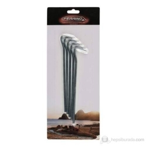

Ferrino’s 5mm thick, 20cm long steel tent stakes are suitable for those seeking stability on hard ground; however, they may not be the first choice for those carrying their tents in a backpack. I was very pleased with these stakes, which I ordered from Hepsiburada, considering my intended use.

## Key features

* 5 mm thick, 20 cm long, consisting of 5 pieces.
* It is made of steel.
* Because the material is steel, it can be used comfortably on hard surfaces.
* Do not forget that a pole made of steel in these dimensions will be heavy.
* If you tend to carry your tent constantly, with weight being a significant concern, I recommend choosing a lighter product.

## Who is it suitable for?

If you’re camping and are concerned about the weight of your equipment, but also about its durability, and you’re finding that standard stakes bend easily on hard ground, then these steel stakes are a sensible choice. They’re particularly useful when setting up tents that won’t stand on their own without being secured with stakes.

When undertaking long-distance hikes, it’s necessary to factor in the total weight of five steel anchors. If you’re carrying the tent and other equipment on your back, consider lighter aluminum options – you may not need the extra durability of steel if the ground is soft.

## Short verdict

My assessment is clear: a reliable, simple, and durable product, suitable for hard ground. If weight isn’t a major concern, it’s worth considering; however, a lighter peg set would be more appropriate if you’re preparing for an ultralight camping trip. You can also check out the [Ferrino Lightent 2 camping tent review](/ferrino-lightent-2-kamp-cadiri/) to see the relationship between weight and ground in tent selection.
