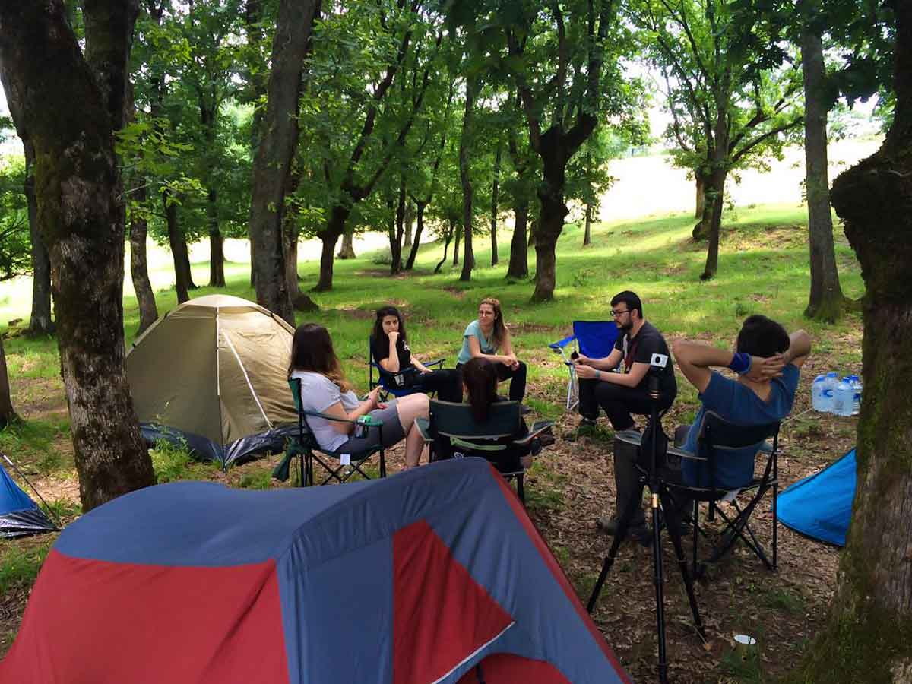

Information on how to reach Gebze Denizli Dam, camping facilities, and walking routes in the surrounding area is included in this guide. The field information is based on my observations in 2016; be sure to check current safety conditions before you go.

## Quick summary

- **Region:** Kocaeli, the area surrounding Gebze–Denizli Village
- **Camp:** A natural area that is unmanaged and lacks basic facilities.
- Routes: Four options, ranging from 11 km to 27 km.
- Field observation: June 2016

> Safety and update note: The route, camping, and safety observations in this text are not current. Before traveling to the area, check with local authorities’ announcements, weather and fire risks, accessibility, and current visitor reviews. Do not travel alone and in the dark.

You can fish and camp in this lake, which is very close to İstanbul. I must say that because it’s so close, it gets very crowded on weekends. To get to the Gebze Denizli Göleti, it would be much more ideal and enjoyable to choose one day during the week. 

In 2017, I had noted that I advised against visiting the region due to security concerns. Do not use this historical warning as the sole basis for current decision-making; verify it with up-to-date information from reliable local sources.

## Where is the Gebze Denizli Reservoir, and how do you get there?

While driving on the Tem Highway, after leaving Şekerpınar exit, you should continue towards Mollafenari. After passing this point, you will arrive in Denizli village. After approximately 1 km from Denizli village, the road will turn left and enter the forest. Following this road, you will reach the lake.

<iframe
  frameBorder='0'
  scrolling='no'
  src='https://tr.wikiloc.com/wikiloc/spatialArtifacts.do?event=view&id=13676650&measures=on&title=on&near=off&images=on&maptype=H'
  width='100%'
  height='600'
  style={{ borderRadius: '10px 10px' }}
></iframe>

 

## Gebze Denizli Reservoir Camping Area Information

### Available facilities

- You can pitch your tent on the flat areas around the lake or at the spots marked on the map. Remember that it gets very crowded, especially on Sundays.
- You can leave your car in the wide areas along the lake, or on the roadside. You can drive your car up to the camping area.
- You can pick up any missing camping gear from Mollafenari. There's everything you need, from the market to the local butcher.
- It’s a place frequented frequently by day-trippers due to its proximity.

### Facilities that are unavailable

- There isn't a specific, dedicated facility for camping.
- Shower and toilet are not available.
- Grocery shop
- Restaurant
- Hotel, Guesthouse

Note: This information dates back to June 2016.

## Gebze Denizli Dam Hiking Routes

### From Denizli Reservoir to Değirmençayırı Village (23.5 km)

<iframe
  frameBorder='0'
  scrolling='no'
  src='https://tr.wikiloc.com/wikiloc/spatialArtifacts.do?event=view&id=6080712&measures=on&title=on&near=off&images=on&maptype=H'
  width='100%'
  height='600'
  style={{ borderRadius: '10px 10px' }}
></iframe>

- A moderately challenging course consisting mainly of trails within a forest.
- If you haven’t been walking regularly, the 23.5 km distance could be tiring.
- It’s important to note that there are no water points.
- The route continues through thickets and among dense trees, sometimes following dirt roads.
- The last 4 kilometers could be strenuous.
- You can find a small, family-run establishment in the village of Değirmençayırı to eat after your walk, or to rest.

### From Denizli Reservoir to Değirmençayırı Village (18.5 km)

<iframe
  frameBorder='0'
  scrolling='no'
  src='https://tr.wikiloc.com/wikiloc/spatialArtifacts.do?event=view&id=9216680&measures=on&title=on&near=off&images=on&maptype=H'
  width='100%'
  height='600'
  style={{ borderRadius: '10px 10px' }}
></iframe>

- The route, starting from Denizli Gölet (lake), via a dirt road, is approximately 5km long and continues in this manner. Afterwards, it proceeds along the stream bank, using forest trails.
- This is a moderately difficult, but easier than the previous course.
- It’s important to note that there are no water points.
- You can find a small, family-run establishment in the village of Değirmençayırı to eat after your walk, or to rest.

### From Denizli Reservoir to Ballıkayalar Nature Park (11 km)

<iframe
  frameBorder='0'
  scrolling='no'
  src='https://tr.wikiloc.com/wikiloc/spatialArtifacts.do?event=view&id=4283340&measures=on&title=on&near=off&images=on&maptype=H'
  width='100%'
  height='600'
  style={{ borderRadius: '10px 10px' }}
></iframe>

- The route, starting in Denizli village, continues for approximately 2km on a road, then transitions to a trail. After a brief stop at a small waterfall and a beautiful view, the route reaches Ballı Kayalar Tabiat Parkı.
- This is a relatively easy course.
- You should take your water with you before setting off.

### From Denizli Pond to the villages of Ovacık and Akfırat (27 km)

<iframe
  frameBorder='0'
  scrolling='no'
  src='https://tr.wikiloc.com/wikiloc/spatialArtifacts.do?event=view&id=9361555&measures=on&title=on&near=off&images=on&maptype=H'
  width='100%'
  height='600'
  style={{ borderRadius: '10px 10px' }}
></iframe>

- The route begins at the Denizli lake and continues for 14km, following a mix of dirt paths and trails, eventually reaching the Ovacık village. Afterwards, the remaining 13km is traveled on an asphalt road, leading to the Akfırat village.
- It’s a relatively easy course. If it seems long, you can walk all the way to Ovacık village.
- You should take your water with you before setting off.
- Walking along the trails will be tiring.

## Nearby camping and preparation guides

- For another pond around İstanbul, see the guide for [Karacaköy Göleti](/karacakoy-goleti/).
- For highland camping and longer routes, see the [Acelle Highland guide](/acelle-yaylasi/).
- For a versatile layer against wind and sun, see [What Is a Buff and How Do You Use It?](/buff-nedir-ne-ise-yarar/).
