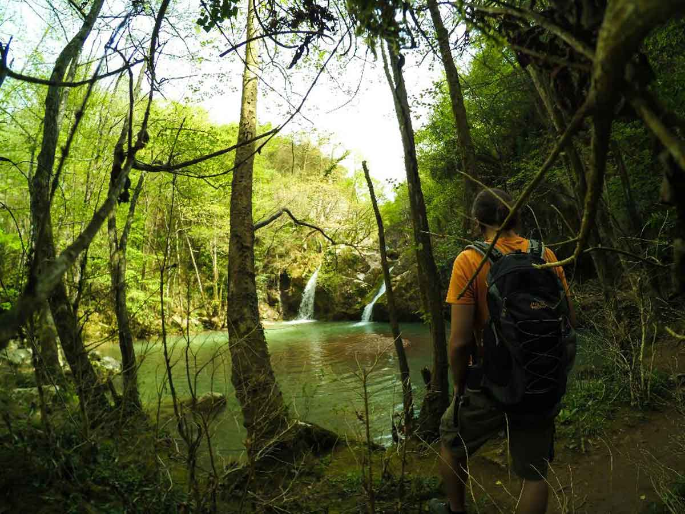
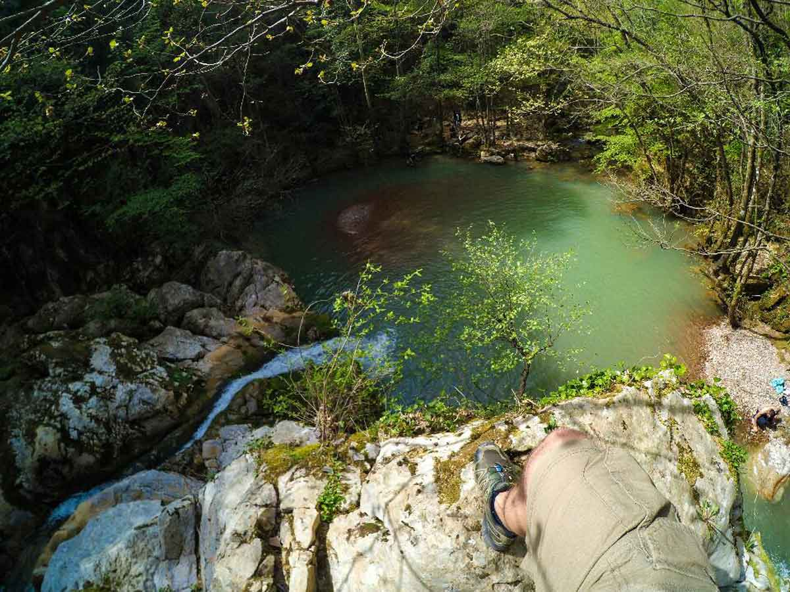

Are you looking for a campsite near İstanbul? Here’s the campsite and waterfalls in Hacıllı village.

### Where are the Hacılı Köyü waterfalls, and how do you get there?

You can arrive from İstanbul in two ways. The first is via Şile -> Ağva, and the second is via Şekerpınar/Gebze. It’s easier to arrive via Şile. Follow the route to Ağva. After passing Tekeköy, follow the sign for Hacıllı village on the right when heading to Ağva. The other route is via Gebze. The route arriving from Gebze is more convenient than the route arriving from Şile – it’s better maintained and therefore easier. Traveling from Şekerpınar -> Mollafenari -> Yağcılar -> Ahatlı to Hacıllı village will be easier. I’ve created a route on the map below, which you can follow.

<iframe
  frameBorder='0'
  scrolling='no'
  src='https://tr.wikiloc.com/wikiloc/spatialArtifacts.do?event=view&id=12880039&measures=on&title=on&near=off&images=on&maptype=H'
  width='100%'
  height='600'
  style={{ borderRadius: '10px 10px' }}
></iframe>

 

### Hacılı Village Waterfalls Camp Site Information

##### Available facilities

- You can set up your camp in the flat, expansive meadows that remain to the right and left of the area.
- You can park your car in the large area where the waterfalls begin.
- There isn't a specific, dedicated facility for camping.
- Don’t forget to get your water from Hacıllı köyü.
- It wouldn’t be ideal for camping during the summer months. This is because there are no shaded areas.
- Because it’s located near İstanbul, it has a high probability of being crowded on weekends.
- Because it’s crowded, you may find it difficult to gather wood to build a fire around.
- In the Hacıllı village, there is a local grocery store.

##### Facilities that are unavailable

- Mosque, toilet (located in Hacıllı village, a 15-20 minute walk)
- Restaurant
- Hotel, Guesthouse

Note: This information dates back to April 2016.

### Hacılı Village Waterfalls Hiking Routes

#### From the Hacı köyü campsite to the waterfalls (1.5 km)

<iframe
  frameBorder='0'
  scrolling='no'
  src='https://tr.wikiloc.com/wikiloc/spatialArtifacts.do?event=view&id=12880041&measures=on&title=on&near=off&images=on&maptype=H'
  width='100%'
  height='600'
  style={{ borderRadius: '10px 10px' }}
></iframe>

- A relatively easy 1.5 km trail.
- If the trip was made during rainy weather or after rain, the river’s water may have overflowed.
- Especially, the stones are becoming slippery after the rain.
- There are no water sources on the trail.
- To reach the waterfalls, simply follow the path.
- 1. Or you can set up a tent in site number 2.
- There are river crossings.

