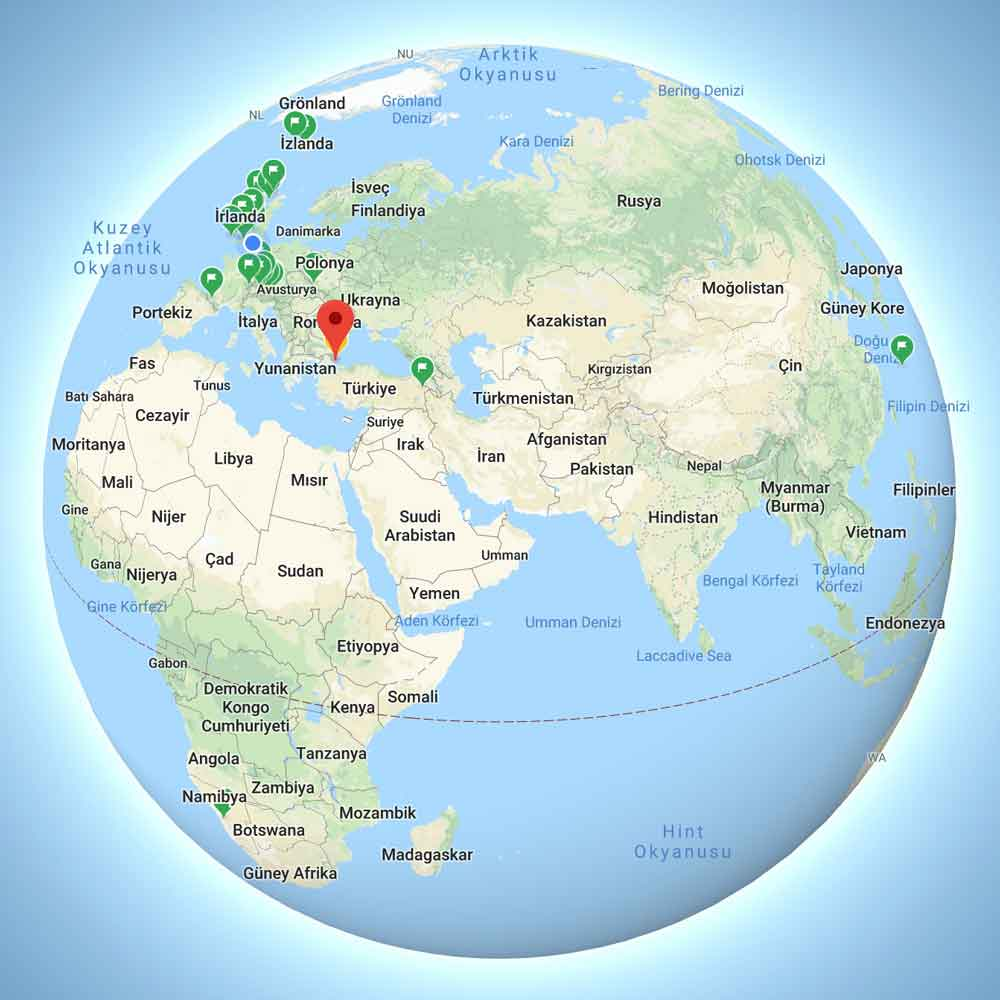

On a cold London evening in October 2018, I’m making a cup of tea – some prefer tea, others prefer wine – and then I randomly opened a Jazz music channel on Google. Probably later, I’ll call Müslüm baba. And I settled down to write. By the way, I know two “baba”s – Bob baba (Bob Dylan) and Müslüm baba, and strangely, I really love the songs that both of them tend to sing when they get older. 

### Where was I?

Honestly, I’ve been feeling really down and unproductive. I know it’s been a long time since I’ve written anything. I’ve always intended to, but I couldn’t figure out where or how to even begin. I kept all the planned writings – whether it was about a route, camping, or describing the products I use – all piled up, and as time went on, I couldn’t figure out where to start, which started to create a strange pressure on me. It felt like I was constantly being bullied by my boss. Of course, I always had my own excuses and kept putting off writing. Then I realized that I wasn’t prioritizing anything, and as a result, I was just drifting. I gave myself a couple of slaps, changed my priorities, and decided to start writing again, effective tonight. I’m going to start writing about whatever comes to mind first – let’s head to the village.

### I’ve been around for a while.

Actually, I have to admit that I’ve been feeling a bit tired lately, and 2-3 day hikes, weekend camping trips – they don’t bother me anymore. I need to plan new, exciting dreams, to find something to motivate me. I’m a dreamer, my friend. I live for my dreams, and I work to make them a reality. If you take away my dreams, there’s nothing left for me. Greetings to those who dream.

### Creating Big Dreams Again

I’ve started to again to dream of big things, according to my own way. If everything goes well in London, I’ll give my resignation next year – although, thankfully, the people at the company aren’t following me, and they don’t speak Turkish – and I’ll embark on a trip lasting about 2-3 months, perhaps by traveling. Right now, I just have 2-3 different plans. I keep going over the details of these plans in my mind, and I’m imagining them. It’s like I’m, for the first time in my life, falling in love with someone platonically, and I’m experiencing the same feelings. I love him/her from afar, constantly thinking about him/her, and occasionally looking at maps to see where I could go.

