On April 2014, one day. I’m aiming to go to the Lycian Way, approximately 4.5 months from now. For the past three months, I’ve been working on improving my fitness with body and cardio exercises. Now is the time to test myself. I decided to create a plan for a long route, in order to find out how far I can walk, how much uphill I can climb, whether the inclines will tire me out, and whether my feet will feel heavy. My mind came to Esenköy as a starting point, having previously gone to the Yalova area. I started planning to walk from Esenköy, passing through Delmece Valley, and reaching Armut’lu. My colleague, Emre, who is a passionate motorcyclist, enjoys camping, and loves nature, also wanted to come. This long route would be challenging for someone who hadn't done trekking before. He came wanting to take advantage of his previous hiking experiences and to experience trekking one last time in this fleeting life.

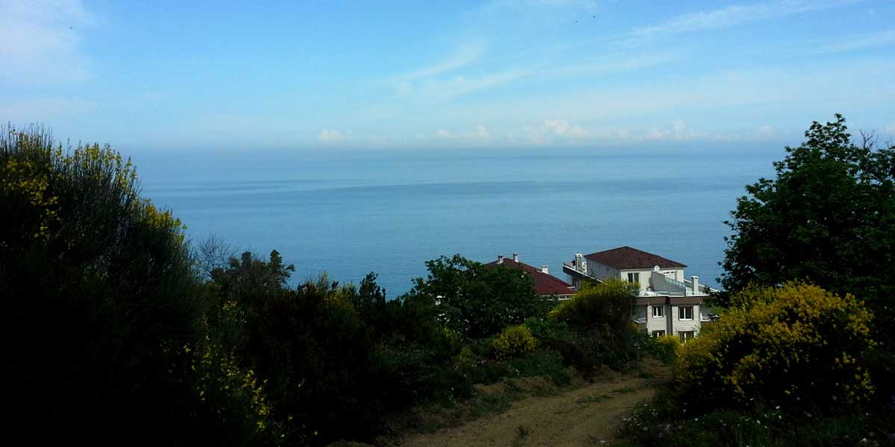

### Esenköy Transportation

On Saturday morning we took the ferry from Pendik to Yalova as usual. It was 8 in the morning and the first vehicle to Esenköy wasn’t due to leave until 10. I’d planned to come on Friday night but changed my mind because I might not find transport. Good thing I did. I wouldn’t have got to Esenköy that late even by hitchhiking. We got on the 8 o’clock service to Çınarcık and decided to hitch a ride to Esenköy from there. We couldn’t afford to lose time. In Çınarcık, a car stopped the moment I put out my hand. Ha! It was only the 2nd time I’d hitchhiked, and once again the very first car picked me up. Maybe I’m one of God’s favourites.

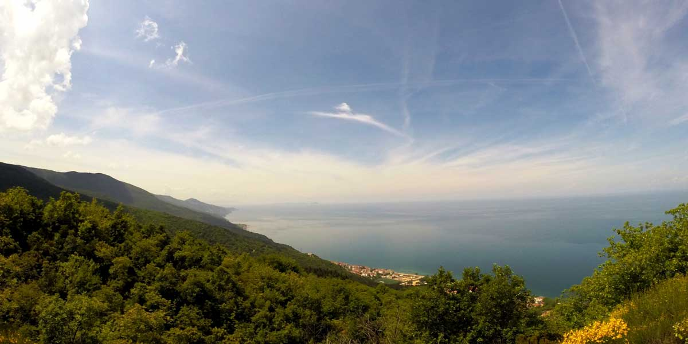

### Esenköy, with its magnificent views

We made a turn before reaching Esenköy, and when we saw the view, we were speechless. For a moment, I thought we were somewhere along the Aegean or Mediterranean. I wondered how we hadn't discovered this beautiful place, which has such stunning scenery and is so close to İstanbul. We started our walk after disembarking at Esenköy's central stop, intending to ascend from an altitude of zero meters to approximately 900 meters, and then return to sea level. We began our walk on a dirt path deep within the forest, on a path that used to be used by an old tractor, and as we ascended, we were completely amazed by the beauty of the scenery. Then, we ventured deep into the forest, and the view disappeared. While walking along the path, we came across a wolf track. It was a very exciting experience for us. Seeing this track, I silently hoped that we wouldn't encounter one.

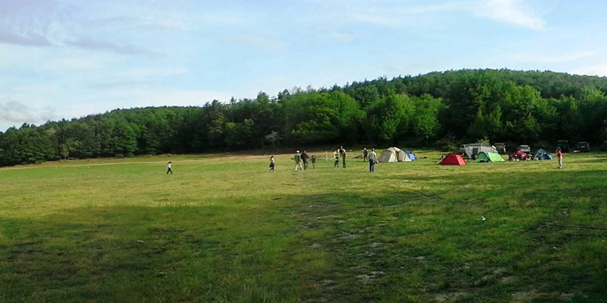

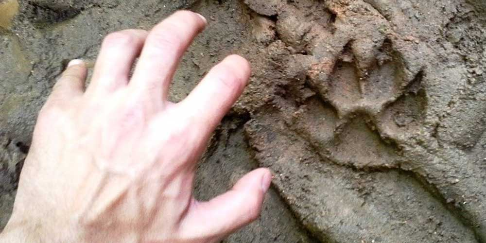

### Karlık and Delmece Valley

Reaching an altitude of 900 meters is tiring. However, I can clearly see the effects of exercising right now. My feet feel very comfortable, and there’s no pain in my ankles. It’s a very comfortable walk for me, but this steep climb did put Emre a bit of a challenge. But, even so, I’m putting in a pretty good effort compared to a normal person. And he’s also seeing the benefits of his walks. Then, suddenly, we find ourselves at Karlık meadow. We encounter a large group of 18 children who have come to camp within the forest. After a little conversation, we continue towards Delmece meadow. Because it has become green with spring, it feels really beautiful to us. In fact, I can say it’s even more beautiful than Delmece meadow. While we were thinking about spending a day camping here, we arrived at Delmece meadow. We find a suitable spot and set up our tent. We don’t spend time collecting wood for the campfire because we’re quite tired. After eating and drinking tea, we sit for a while and then go to sleep.

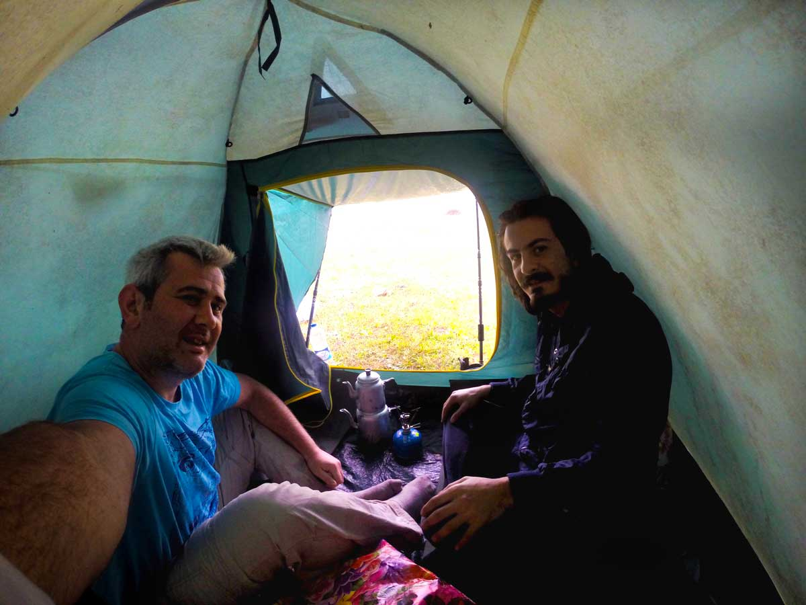

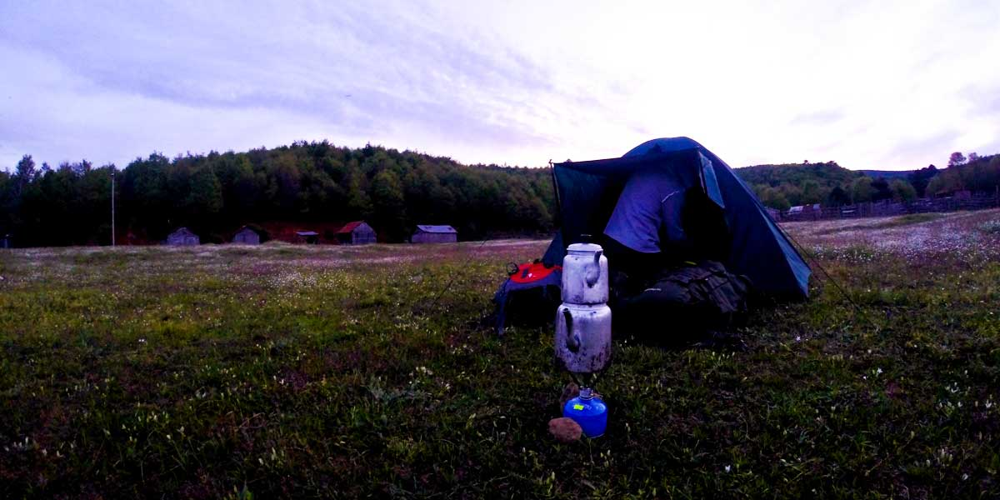

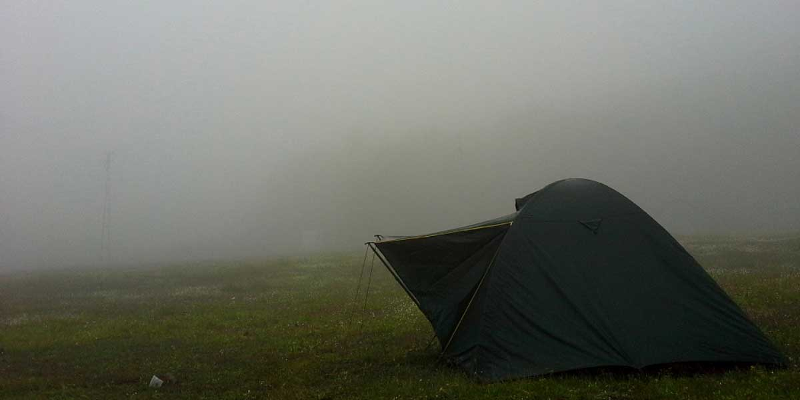

### Rain, rain.

When we woke up, we found ourselves in the midst of a beautiful rain. We had been prepared in case of rain, but it was still more pleasant to see the morning sun. After making breakfast in the tent, we quickly packed up, put on our rain gear, and set off. The rain intensified into a heavy downpour. But we were quite pleased with the situation. I really saw the benefit of using the Texapore boat here. My feet didn't get even one gram of water. In these types of hikes, it’s important for your feet to stay dry, comfortable, and warm, which allows you to walk much better. I told Emre to put a bag over his socks because his boots were letting water through, and then to put another bag over his socks as well. Because walking with wet feet would eventually wear him down. You can use a bag like this to keep your feet dry and warm while walking. The conversation was so good while we were walking, and we looked up, and we didn't know where or when it stopped.

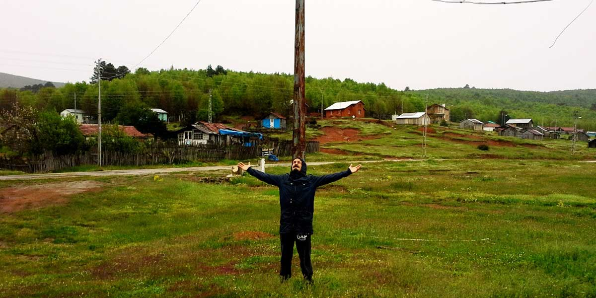

### Narlı

As we came down from Delmece Highland, we expected to end up near Armutlu, then realised we were closer to Narlı and decided to keep going that way. Another beautiful view greeted us when we emerged from the forest. Gemlik lay ahead, the Sea of Marmara in front and Uludağ behind. We took in the magnificent view as we reached Narlı. Having walked about 37 km gave me hope. I felt I could physically manage another 10–15 km. The exhaustion of a first hike was written all over Emre’s face. Covering 37 km was a real achievement for him too. On my first hikes I couldn’t even reach 30 km. I have to admit I hadn’t expected him to make it this far. Don’t let him hear that :)

We travel from Narlı to Gemlik by bus, first to Gemlik, and then to Yalova by car. Afterwards, we take a ferry and return to İstanbul. After spending so much time in nature alone, it’s becoming difficult to reintegrate into society.

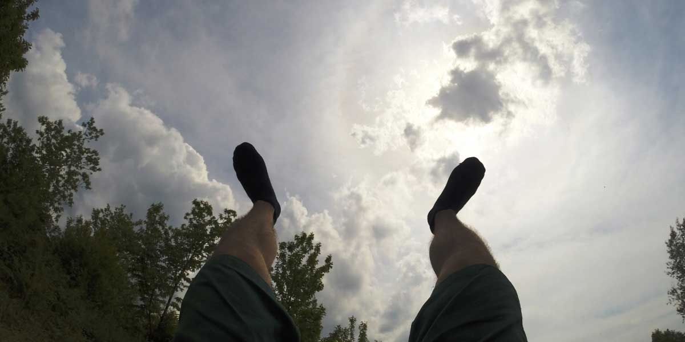

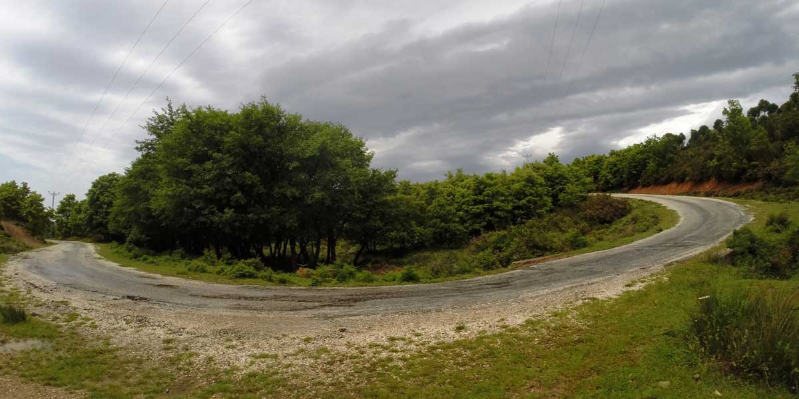

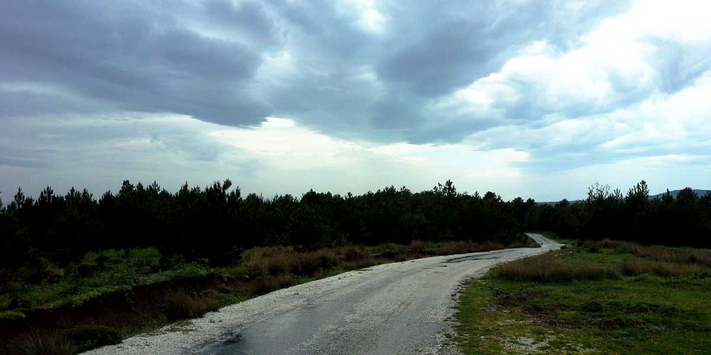

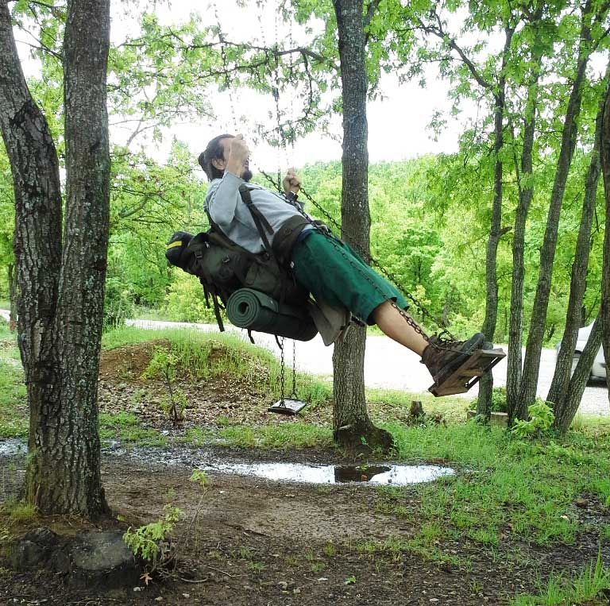

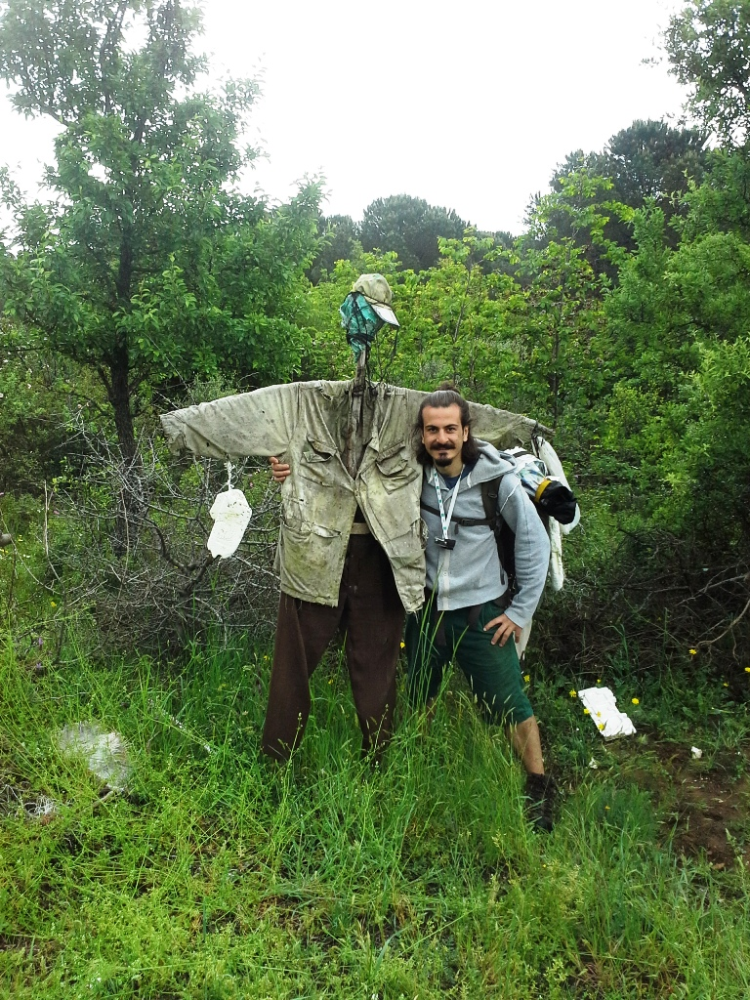