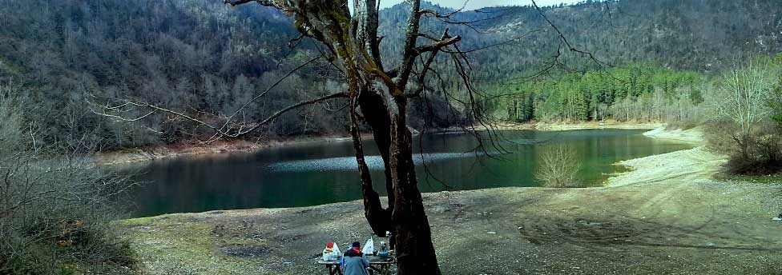
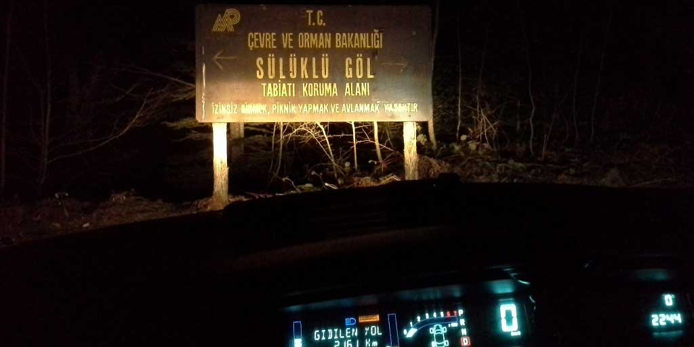
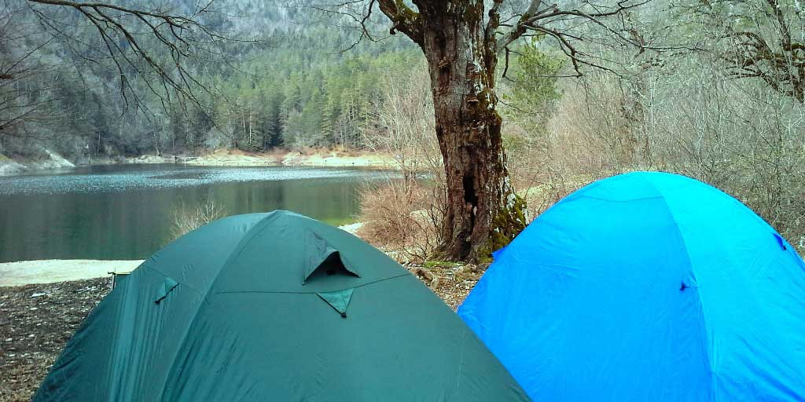
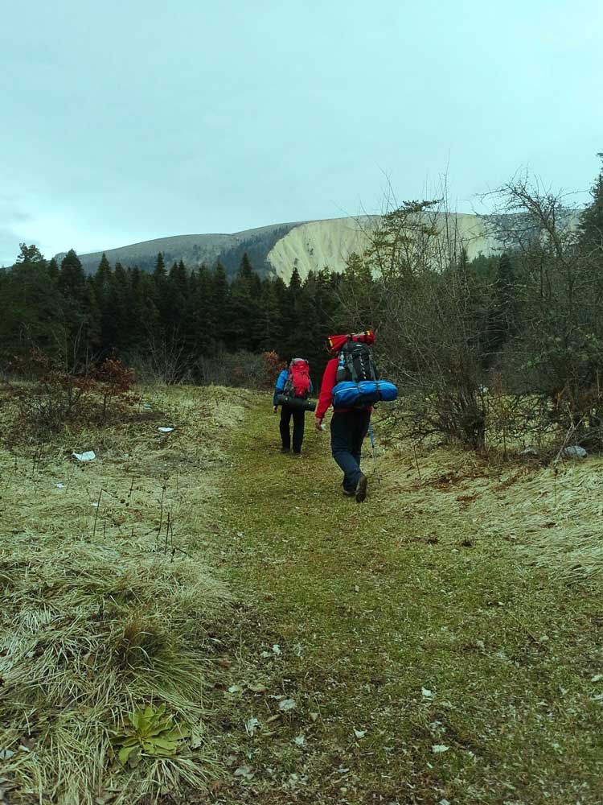
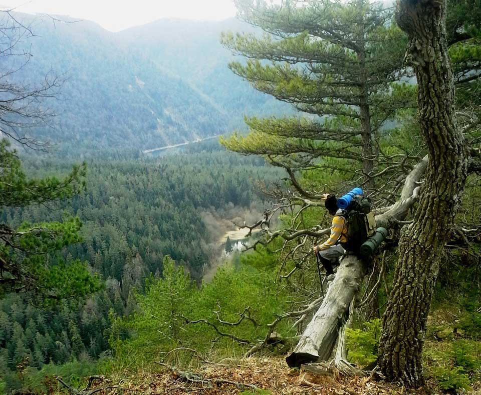
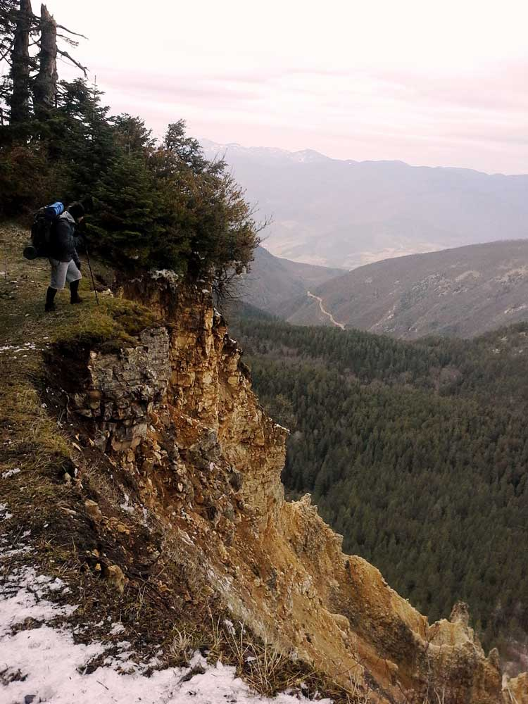
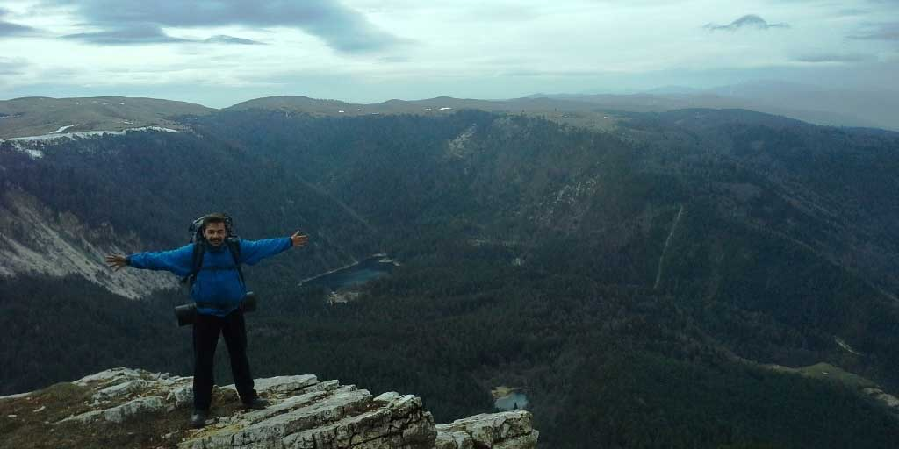

I believe it’s Sülüklü Lake’s turn now.

I’m planning to go with my brother Furkan on Friday evening. I feel like we’ll have a really long camping trip, considering it’s 2 nights and 2 days. And I’m also planning to start a morning hike on Saturday. Furkan also wanted to join us, and we decided to set off with a group of three, working well together.

Even if the workday ends, let's go.

There are always times when I set off on Friday evenings that go like this. Even after my shift is over, I leave. Because the daylight isn’t long, the air quickly darkens as we travel at night. The road becomes rough about 6km before reaching Sülüklü Lake, after we had been on a beautiful asphalt road up to this point. We slowly progress on this rough, forest road, which is mostly dirt and some rocks, and eventually arrive at Sülüklü Lake. We set up our tents in a flat area near the lake, accompanied by a flashlight, after we decided we were hungry and needed a meal. Everyone then heads to their tents, exhausted. Tomorrow, we aim to reach Çubuk Lake after approximately 12km of hiking.

Doğa is our home.

Today, we started our hike a bit later than planned. We began by walking through the forest, reaching the base of the hill. Then, we climbed a steep hill. This was quite tiring, because the altitude increased significantly over a short distance. After reaching a certain height, we could no longer see trees. Afterwards, we followed the hill that circles Sülüklü Lake. On our right, there was a cliff.

This dangerous trail gradually moves away from the lake, heading towards Çubuk Lake. There’s even snow on this hilltop. The group is getting tired quickly. Because this is a mountain path, and not a flat road or trail, it’s always more exhausting, especially for the ankles. With approximately 2 km to Çubuk Lake, Gürkan and Furkan are running out of energy. But we’re at the top of the mountain, and there’s no flat ground. So, we’re descending until we find a flat spot, and then we set up our tents and build a campfire. This is Gürkan’s first trek, and I’ve never seen him like this. This man, who is usually fit and energetic at camps, has no energy left. So we’ve decided to spend the night here, and tomorrow we’ll return to Çubuk Lake another time.

Tea is life.

As soon as we drink tea after eating, we feel relaxed. The weather has become much cooler, but our campfire is keeping us warm. Because we’re prepared for the cold, we’re not affected by it. After a long conversation by the fire, we retreat to our tents to sleep. We use our heated sleeping bags, which are really effective. They provide about 12 hours of warmth, ensuring a comfortable night.

You will not embark on a path you do not know.

Today, we are on the return journey. We will first climb a bit of elevation, then it will be entirely downhill, making for an easier walk than yesterday. When we reach the summit, Gürkan and Furkan want to descend because they spotted a shortcut from the valley they spotted at the very start of the path. I, however, don’t want to go onto an unknown trail, especially into a valley thick with trees. Even though I tell them it’s not worth taking that risk, they insist we dive into the adventure. And then, well, things got interesting. You can read the details in [How Death narrowly missed us at Sülüklü Göl](/suluklu-gol-azrail-teget-gecti/).

We are at the campsite.

Thank goodness, we managed to get off an unknown road and reach our campsite. This was a lesson for me – I won’t just say yes to anyone again. Because I’d rather have my heart broken than someone’s head broken. We managed to reach the campsite by walking approximately 20 km through the forest, along trails, down mountain slopes, and on dirt roads.

We are setting off on the journey home, filled with the joy of completing this course safely and of having emerged from that valley. Please, don’t venture down paths you don’t know!

