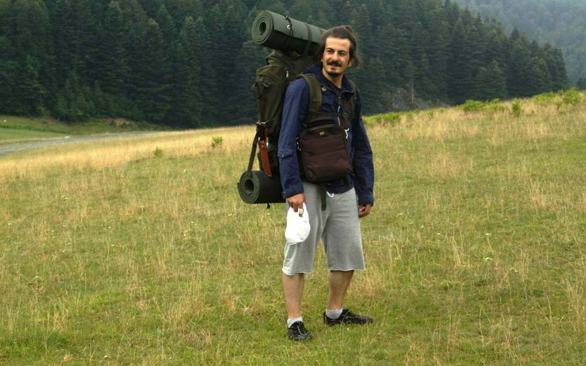
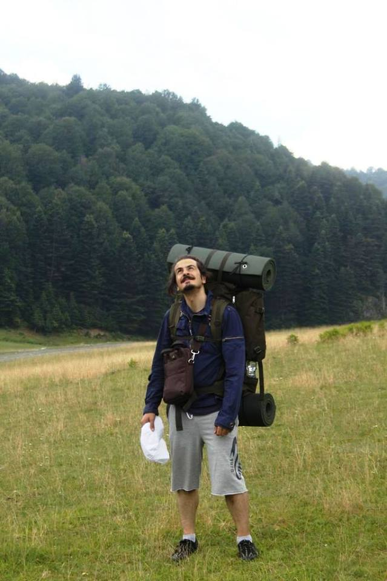

It was finally time for a trekking trip. Although we had done nature walks at the campsites we’d visited before, we had always just stayed in one place. This time, we wanted a different plan: we wanted to start on Friday and spend two nights in nature, with the first night in one place and the second night in a different location. The most suitable place for us was İnönü Highland (İnönü Highland). The next day, we planned to hike to Aytepe and stay there overnight. For the final day, we planned to return over the same route and set off.

It should start from Friday.

It was our first time visiting İnönü Highland. Because I had done my research so thoroughly, it felt like I had been there before. Four of us – we set off together after the end of the work shift on Friday. After a two-hour night journey, we arrived at İnönü Highland. The mountain road was completely dark. There was a special excitement to the night journey through the forest. When we arrived at İnönü Highland, we couldn't see much in the darkness, and we parked our car on the first flat area we saw and began setting up our tents. There was a lot of humidity that night, so we had brought fire starters instead of firewood. We lit the charcoal with these fire starters until our desire was satisfied. Afterwards, we didn't use any more fire starters, because it was useless on its own. With that one piece of charcoal, we lit both the grill and our campfire, but honestly, the humidity really challenged us. Without wasting much time on the fatigue, we went to sleep in our tents.

Journey to Aytepe

When we woke up, we realised the nicest part of the highland was a little farther on, where lots of other people had come to camp. After 2–3 km of walking, we took our first break at Ercuva Highland. Then we followed the dirt track through the forest and continued towards Aytepe via the Saman Mountains. With 4 km to go to Aytepe we were exhausted. We got there in the early evening and decided to pitch our tents in the open space right beside the forestry office. We loved the view of the gulf from the hill. That night, worn out again, we slept without waking.

Does anyone have chocolate?

We woke up to a chocolate crisis. We’d hardly brought anything sweet, so we went looking for a village shop in Aytepe. No luck. Just as we’d given up hope, we spotted chocolate wafers at a little tea garden. They were worth their weight in gold to us. We were going to need every bit of energy for the rest of the walk. After breakfast and a look around, we set off on the return leg.

Oops, did the car not work?

To ensure we wouldn't get lost, we returned along the same route and, after a roughly 32km walk, reached the place where we had left the car. When a light drizzle started, I turned the key and immediately realised the car wouldn't start. When I said, "Gentlemen, the car won't start because we're out of petrol," everyone thought I was joking, but inside me, a spring of water began to flow. Just as we were celebrating having completed a truly accident-free camp, we found ourselves stranded at the top of the mountain. Since the car is LPG-powered, the fuel gauge doesn't work correctly. In other words, when you run on gas, it acts as if you're running on petrol, and after a while it shows the tank empty; the gauge only resets when you buy petrol. How ridiculous, isn't it? When we asked a worker from the forest administration who was passing by for help, they said there might be some petrol in the truck coming from behind. Then, when they said, "You've parked the car on the side; let's level it out, maybe that's why you can't get petrol," we started praying inside that they were right. And indeed, it turned out that way. When we levelled the car, it started. Then, at the first petrol station, of course, we filled the tank. After that, we arrived in İstanbul without any further issues.

And so our first trek came to a quiet, happy end. I’ll admit it, though: 32 km in two days had worn us out. We weren’t exactly in training.

