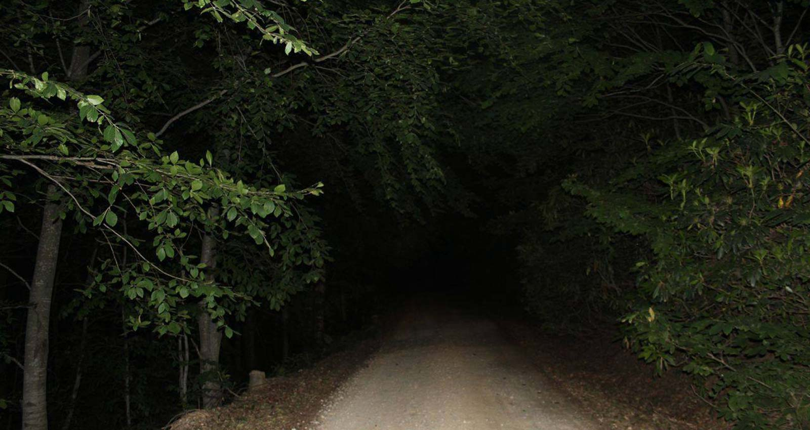
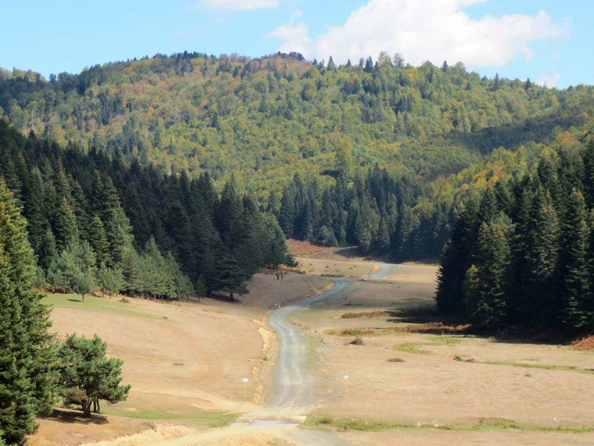
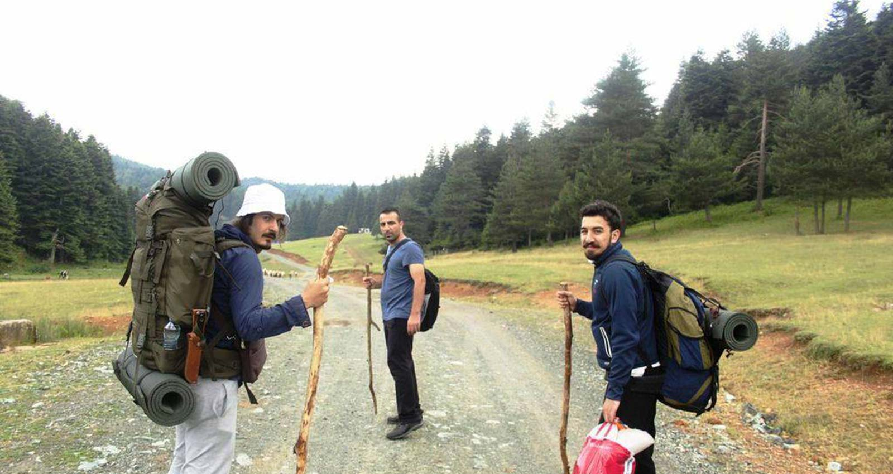
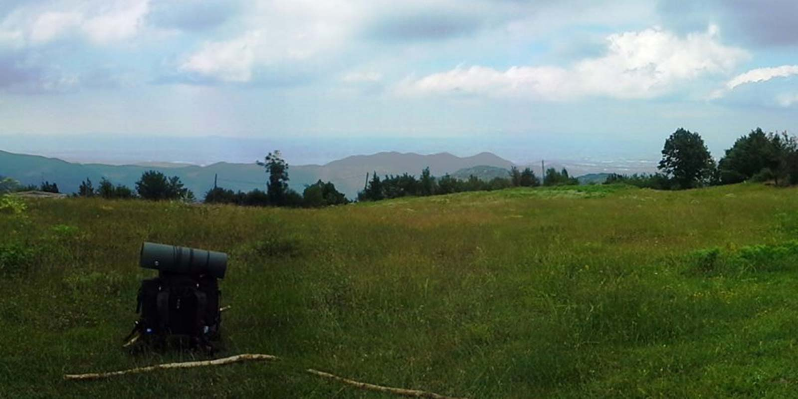
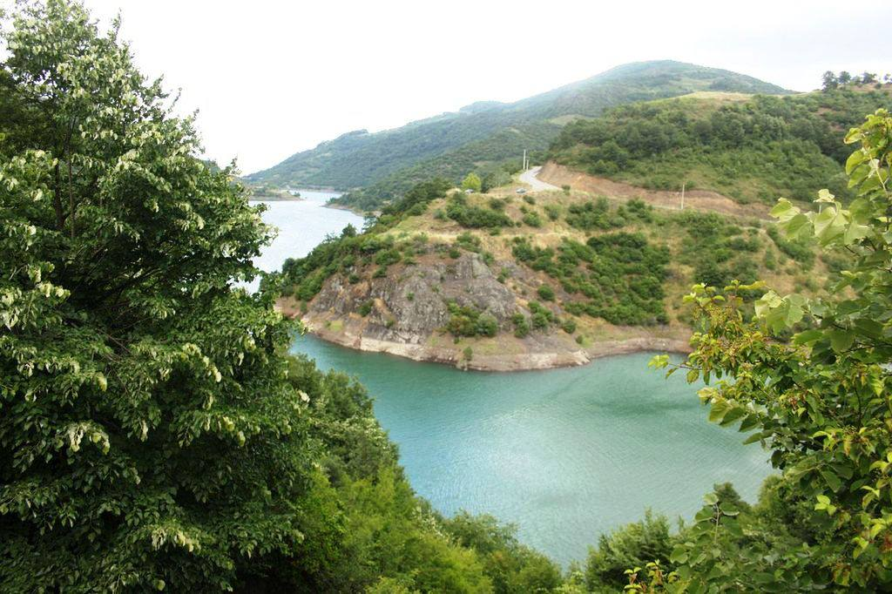

It was finally time for a trekking trip. Although we had done nature walks at the campsites we’d visited before, we had always just stayed in one place. This time, we wanted a different plan: we wanted to start on Friday and spend two nights in nature, with the first night in one place and the second night in a different location. The most suitable place for us was İnönü yaylası (Inönü plateau). The next day, we planned to hike to Aytepe and stay there overnight. For the final day, we planned to return over the same route and set off.

It should start from Friday.

It was our first time visiting İnönü plateau. Because I had done my research so thoroughly, it felt like I had been there before. Four of us – we set off together after the end of the work shift on Friday. After a two-hour night journey, we arrived at İnönü plateau. The mountain road was completely dark. There was a special excitement to the night journey through the forest. When we arrived at İnönü plateau, we couldn't see much in the darkness, and we parked our car on the first flat area we saw and began setting up our tents. There was a lot of humidity that night, so we had brought fire starters instead of firewood. We lit the charcoal with these fire starters until our desire was satisfied. Afterwards, we didn't use any more fire starters, because it was useless on its own. With that one piece of charcoal, we lit both the grill and our campfire, but honestly, the humidity really challenged us. Without wasting much time on the fatigue, we went to sleep in our tents.

Journey to Aytepe

When we woke up, we realised the nicest part of the highland was a little farther on, where lots of other people had come to camp. After 2–3 km of walking, we took our first break at Ercuva Highland. Then we followed the dirt track through the forest and continued towards Aytepe via the Saman Mountains. With 4 km to go to Aytepe we were exhausted. We got there in the early evening and decided to pitch our tents in the open space right beside the forestry office. We loved the view of the gulf from the hill. That night, worn out again, we slept without waking.

Does anyone have chocolate?

When we woke up, there was a chocolate dilemma. Yes, we didn’t have any sweet treats with us. We started exploring within Aytepe village, thinking about opening a grocery store there. But when we couldn’t find one, our dreams were completely shattered, until we found a small tea garden where we discovered chocolate gofret. This was worth more than gold to us. We were going to need a lot of energy for the rest of the journey. After breakfast and a little exploring around, we set off on our return trip.

Oops, did the car not work?

To ensure we wouldn't get lost, we retraced our steps and, after a roughly 32km walk, reached the place where we had left the car. When a light rain started, everyone assumed we were joking, but I felt a cold, like a stream of water running through me. We were so happy to have finished a truly accident-free camping trip, only to find ourselves stranded at the top of the mountain. Since the car runs on LPG, the fuel gauge doesn't work correctly, so after filling with gas, it shows an empty tank for a while, and it only resets when you buy gasoline. Isn't that ridiculous? When we asked a forest worker who was passing by for help, they suggested that there might be some gas in the truck coming from behind. Then, when we said we couldn't get gas because we had parked the car, we started praying that we were right. And it really did happen. When we straightened the car, it started. Afterwards, we of course filled up at the first gas station, and then we arrived safely in İstanbul.

Our first trekking trip turned out to be calm and enjoyable. I have to admit, it was a demanding 32km walk that really tired our bodies in two days.

