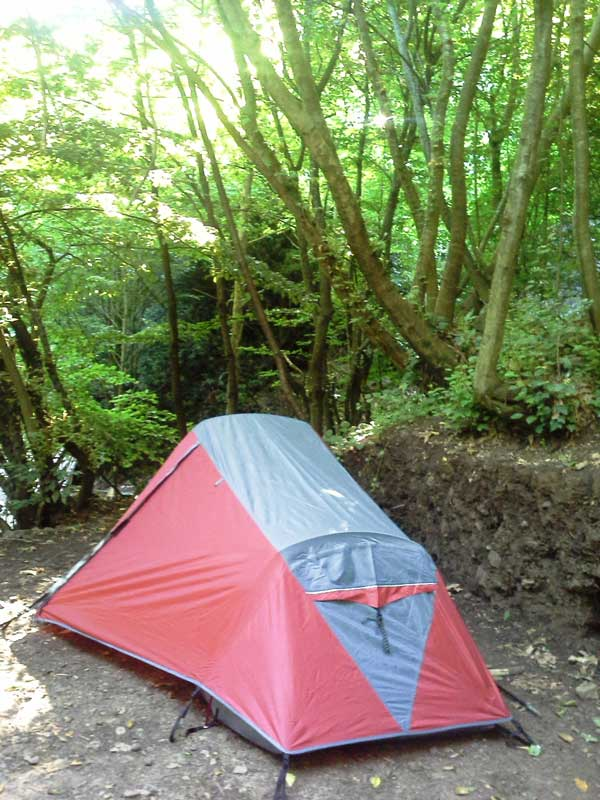
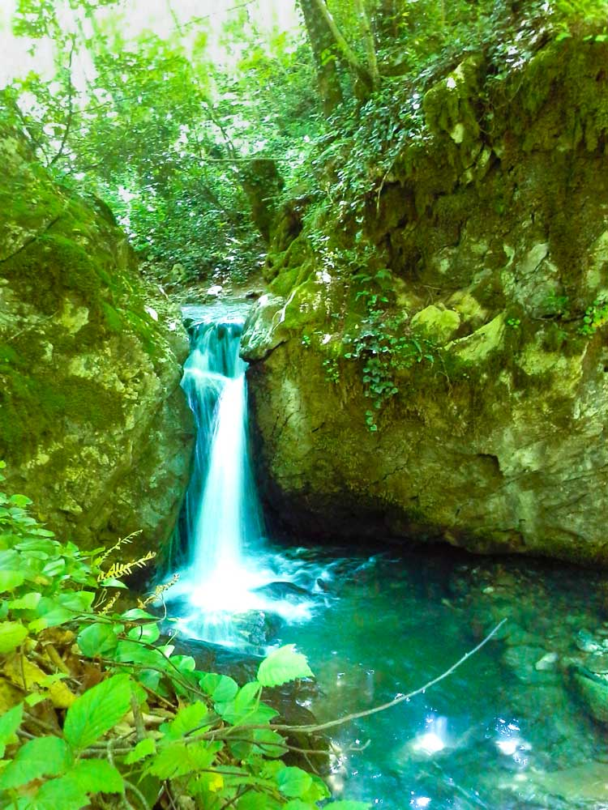
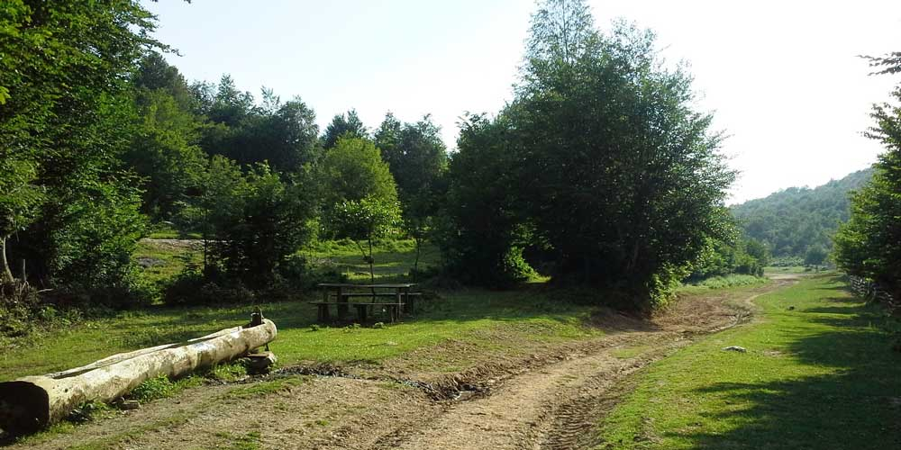
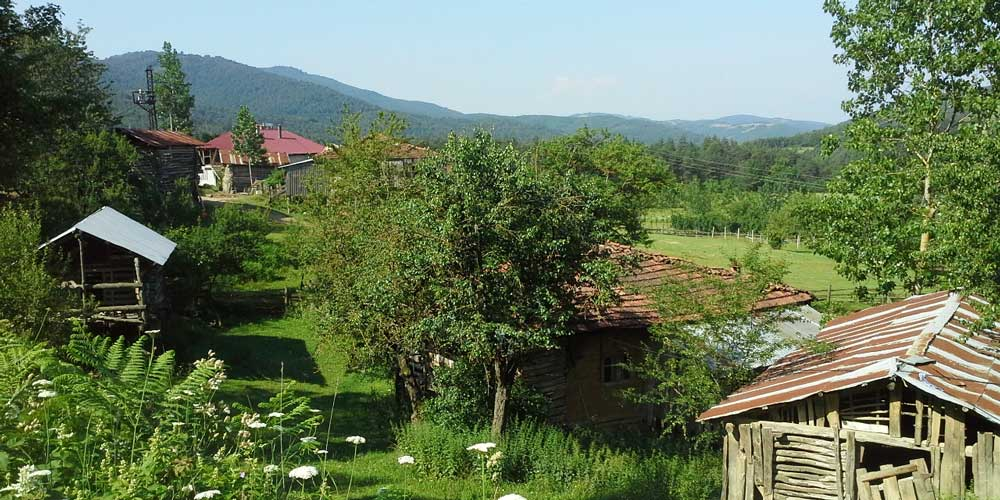
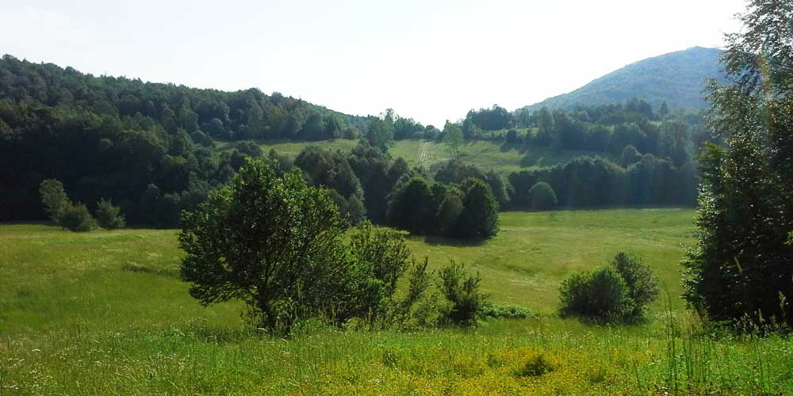

June 2014. Now is the time when I want to start testing myself. As I’m aiming to go on the Lycian road in September, I need to be able to walk an average of 30 km per day in order to complete the entire route in 21 days. While thinking about a long route, Kocaeli to Iznik just came to mind. If I were to use this route, driving wouldn’t work, because I would need to return to where I left the car. Cars always create this kind of problem. I’ve decided to travel by hitchhiking. I will start my journey by hitchhiking from the edge of the TEM highway, and aim to reach Iznik by walking approximately 60 km after reaching Yuvacık junction.

### **Time to Hitchhike**

As the workday ended, I started walking towards the TEM highway, hoping to get a ride from the Çamlıca bus stops. As soon as I raised my hand, a car stopped. But it wasn’t what I wanted, because it was going to Kartal. I was really excited thinking it would be so easy. I waited for about 15 minutes, asking the drivers coming to the truck weighing area on my left to pick me up. But most of them turned me down. Two of them seemed interested, but one was going to Gebze, and the other was planning to stop for a break later. Then, a panel van minibus came along and announced that it was going to Sakarya. “Oh, fantastic!” and I jumped on immediately. If this hadn't happened, I would have waited another 5 minutes and gone to metro tourism, then taken a bus to Kocaeli.

### Walk under the full moon.

Cem is on his way to Sakarya. He leaves the TEM motorway to drop me in Kocaeli city centre. I thank him for picking me up, bringing me all this way and taking me into town, then get a bus to the Yuvacık junction. I start walking from the junction at around 20:30. Within 1 hour it’s completely dark. A full moon is out, so I’m lucky. I walk about 13 km in moonlight without turning on my torch and reach the Karaaslan campsite. It’s 12 at night. I pitch my tent as soon as I get to the lovely campsite, have a snack and fall asleep.

Sleeping on the hard ground is becoming difficult. I was already tired, and waking up on hard ground left me feeling stiff all over. My first priority before the next camp is to get an inflatable mattress. Getting a good night’s sleep is extremely important on long hiking routes – it really affects your performance the next day. While I’m having breakfast, I’m also charging my phone. This is really helpful. Otherwise, I wouldn’t have had enough charge. I also woke up late to set off. Just as I was about to start the hike at 10 am, my adorable dog, whom I’d been playing with the previous night, suddenly appeared in the middle of the road, as if to stop me. But I said goodbye and walked past him. After a while, he appeared in front of me and accompanied me for 11 km. He’s a really great hiking companion.

While walking and chatting, we’re playing a game. I’m hopping and jumping around, turning in circles. We take breaks together and eat chocolate. This adorable dog has gotten very used to everything. When we arrived at theçay ocağı in Aytepe Soğukpinard after 11km, it saw the girls who loved it and immediately tried to sell me. In a way, it was good because it didn’t go too far away, but on the other hand, it was bad because I had become very accustomed to my travel companion.

### Papaz Çayırı

I’m reaching Papazçayır with a trail through the forest, using paths from the cold springs. I’ve walked approximately 16km, so I’m planning a 2-hour break here. Papazçayır is one of the places I love most in this region.

We are speaking with a local resident who raises cattle here. I’m asking if the cattle disappear or get lost, whether they ever stray from the herd. He looks at me and says, “If you don’t keep an eye on them, they will.” He’s trying to scare me by saying there are wolves nearby, that they would attack the herd if we weren’t here. Then, he walks away, saying, “Let me just take a look at this.” After a while, he returns, counting the cattle, and tells me that one has gone missing and wandered into the forest. I recover and continue on my way.

### Sansarak Köyü

I had planned to go to Çerkesli lake and spend the night there, before moving on to İznik the next day. Later, I decided against that and decided to head towards Sansarak village, where Sansarak canyon is located. I started to think about perhaps returning to the canyon again after a year. Of course, if I had the time. There were plenty of fountains along the road, so I didn’t have any water problems. While passing through the village, I greeted an elderly woman and asked about her well-being. After she thoroughly questioned me, I realized I didn’t recognize her:). With 9 km to Sansarak village, the sky was already darkening, so I found a flat spot and set up my tent, and lit a campfire. The sky was closed off tonight. I went to my tent to sleep without being able to watch the sky.

### There is no time to enter the canyon.

Yesterday, I walked approximately 25 km, and because I slept on a soft surface last night, I woke up feeling very refreshed. When I arrived at Sansarak canyon, I decided to give up on entering the canyon because I didn't have enough time.

I had a 18km journey ahead of me, and since I needed to find transport to get to Istanbul afterward, I didn’t have much time. Otherwise, since I had come this far, it wouldn’t be right to go without going into the canyon. Sometimes I’m on the main road, sometimes on a tractor track, and sometimes I’m going through the slopes, heading towards Iznik. A few cars passing by on the road are offering to take me. I’m expressing my sincere thanks. Isn’t it wonderful? Even though I wasn’t hitchhiking, people offering to take me to my destination makes me very happy. Actually, someone picked me up in Istanbul after about 20 minutes.

### Arrival at the Target

Approximately 24 km after, I arrived in İznik. And I’m experiencing the pride and joy of having achieved my goal. I walked approximately 62 km in two days, and I feel physically very well. Psychologically, I’m absolutely thrilled :)

I’ll try more long routes like this before I set off on the Lycian Way. I’m starting to feel physically ready. The real question is whether I can walk this far for 21 days in a row. We’ll see. It feels like it might happen.