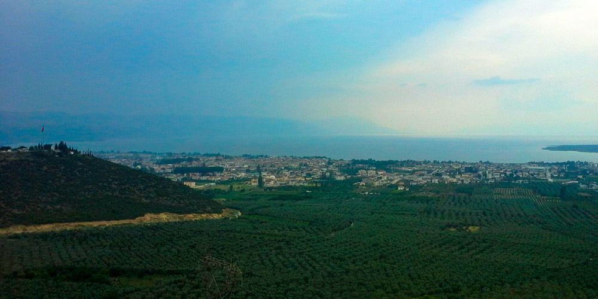
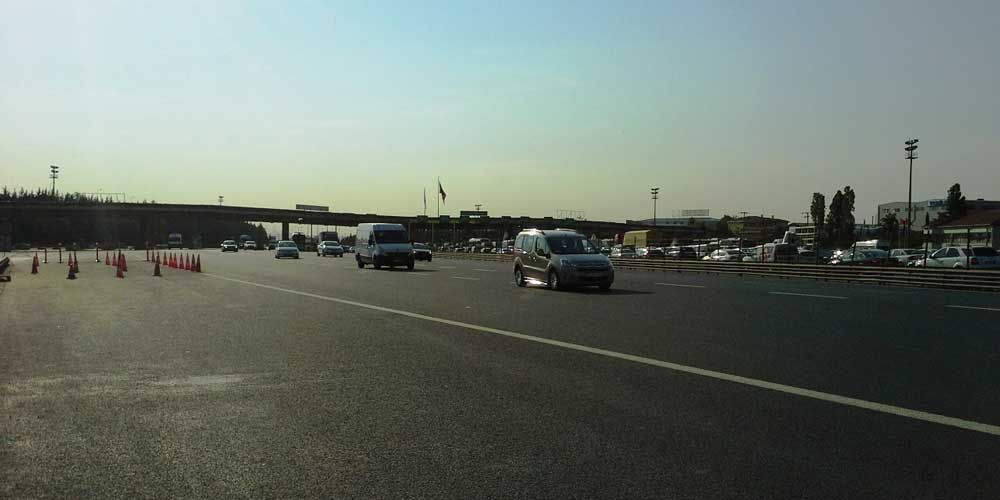
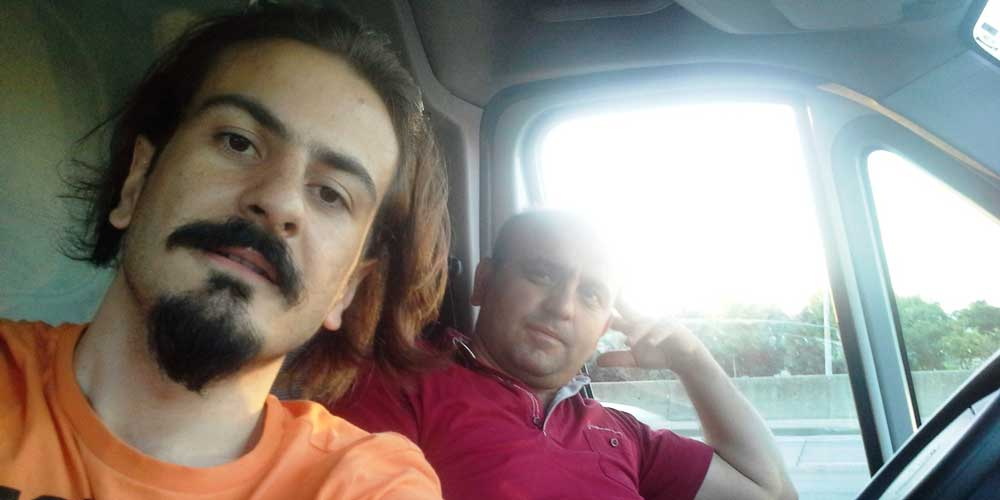
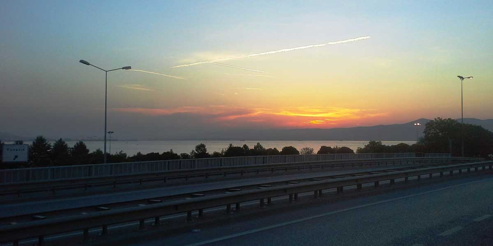
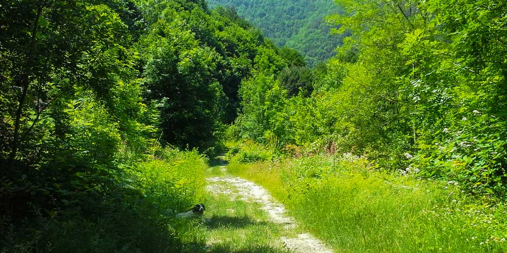
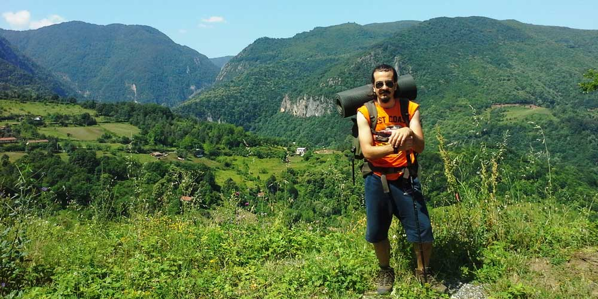
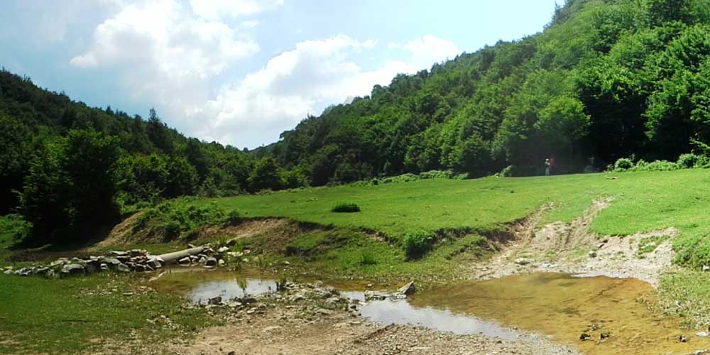
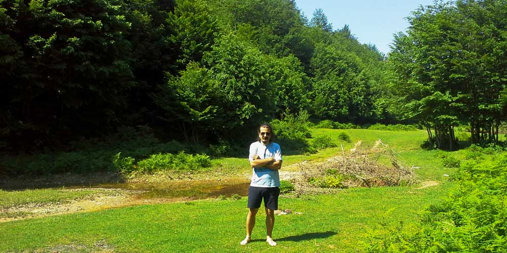
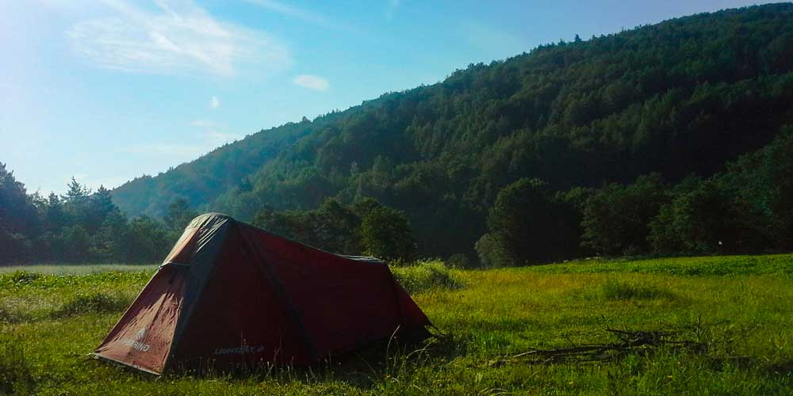
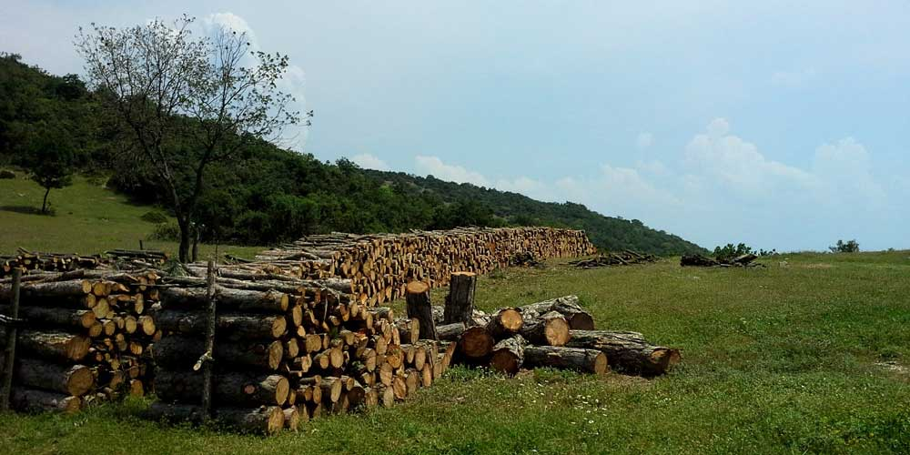

June 2014. It was time to test myself. As I’m aiming to hike the Lycian Way in September and want to complete it in 21 days, I need to be able to walk an average of 30 km per day. So, while thinking about a long route, it suddenly occurred to me: Kocaeli to Iznik. If I were to use this route, I couldn’t drive, because I’d need to return to where I left the car. Cars always create this kind of problem. I decided to hitchhike. I’ll start my journey hitchhiking from the TEM motorway, and aim to reach Iznik by walking about 60 km after reaching the Yuvacık junction.

### **Time to Hitchhike**

As the workday ended, I walked to the TEM highway and started hitchhiking from the Çamlıca toll booths. No sooner had I raised my hand than a car stopped. But it wasn't for me, as it was going to Kartal. I'd been so excited thinking it would be this easy. I hitched for about 15 minutes, asking the drivers coming to the truck weigh station on my left to take me. But most turned me down. Two of them seemed keen, but one was going to Gebze and the other was planning to stop later. Then a panel van minibus came along, saying it was going to Sakarya. "Oh, fantastic!" I thought, and jumped on immediately. If that hadn't happened, I'd have waited another five minutes, gone to Metro Tourism, and taken a bus to Kocaeli.

### Walk under the full moon.

Cem is on his way to Sakarya. He leaves the TEM motorway to drop me in Kocaeli city centre. I thank him for picking me up, bringing me all this way and taking me into town, then get a bus to the Yuvacık junction. I start walking from the junction at around 20:30. Within 1 hour it’s completely dark. A full moon is out, so I’m lucky. I walk about 13 km in moonlight without turning on my torch and reach the Karaaslan campsite. It’s 12 at night. I pitch my tent as soon as I get to the lovely campsite, have a snack and fall asleep.

Sleeping on the hard ground is becoming difficult. I was already tired, and waking up on hard ground left me feeling stiff all over. My first priority before the next camp is to get an inflatable mattress. Getting a good night’s sleep is extremely important on long hiking routes – it really affects your performance the next day. While I’m having breakfast, I’m also charging my phone. This is really helpful. Otherwise, I wouldn’t have had enough charge. I also woke up late to set off. Just as I was about to start the hike at 10 am, my adorable dog, whom I’d been playing with the previous night, suddenly appeared in the middle of the road, as if to stop me. But I said goodbye and walked past him. After a while, he appeared in front of me and accompanied me for 11 km. He’s a really great hiking companion.

We chat and play as we walk, my new four-legged friend bouncing around me in circles. We stop for breaks and I have some chocolate. I’ve grown quite attached to this little mutt. Then, 11 km later, we get to the tea stall at Soğukpınar in Aytepe. A few girls make a fuss of the dog and I’m ditched on the spot. Probably for the best: my walking buddy won’t stray any further from home. Still, I miss the company.

### Papaz Çayırı

I take the forest path from Soğukpınar and climb steeply to Papaz Çayırı. I’ve walked about 16 km, so I’m planning a two-hour break here. It’s one of my favourite spots in the area.

We’re chatting with a local who’s herding his cows here. I ask if the cows ever disappear or stray from the herd. He looks at me and says, “If you don’t watch them, they will.” Then he tries to scare me, saying there are wolves nearby, that they’re watching us, and that they’d attack the herd if we weren’t here. After that, he walks off, saying, “Let me just take a look at this.” He’s gone for a long time, and then I see him return, counting the cows. One has gone missing and wandered into the forest. I pull myself together and carry on.

### Sansarak Köyü

After visiting Çerkesli Lake and spending the night there, I had planned to move on to İznik the next day. Later, I changed my mind and decided to continue towards Sansarak village, where Sansarak Canyon is located. The thought of perhaps returning to the canyon after a year began to circulate in my mind. Of course, if I had the time. Since there were plenty of fountains along the road, I never had any water problems. Passing through the village, I greeted an elderly man and asked about his well-being. After she thoroughly questioned me, he replied, "I can't recognize you, who are you?" I guess he thought I was an acquaintance:). With 9 km to Sansarak village, the sky was already darkening, so I found a flat spot, set up my tent, and lit a campfire. The sky was overcast tonight. Unable to watch the sky, I went into my tent to sleep.

### There is no time to enter the canyon.

Yesterday, I walked approximately 25 km, and because I slept on a soft surface last night, I woke up feeling very refreshed. When I arrived at Sansarak canyon, I decided to give up on entering the canyon because I didn't have enough time.

I reckon I don’t have much time, since I’ve got an 18km journey ahead and need to find transport to get to Istanbul afterwards. Otherwise, having come this far, it wouldn’t do to leave without going into the canyon. Sometimes I’m on the main road, sometimes on a tractor track, and sometimes cutting across the slopes, heading towards Iznik. A few cars passing by stop to offer me a lift. I politely decline. How nice is that? Even though I wasn’t hitchhiking, people offering to take me to my destination makes me very happy. In Istanbul, though, it took about 20 minutes before someone actually picked me up.

### Arrival at the Destination

Approximately 24 km after, I arrived in İznik. And I’m experiencing the pride and joy of having achieved my goal. I walked approximately 62 km in two days, and I feel physically very well. Psychologically, I’m absolutely thrilled :)

I’ll try more long routes like this before I set off on the Lycian Way. I’m starting to feel physically ready. The real question is whether I can walk this far for 21 days in a row. We’ll see. It feels like it might happen.