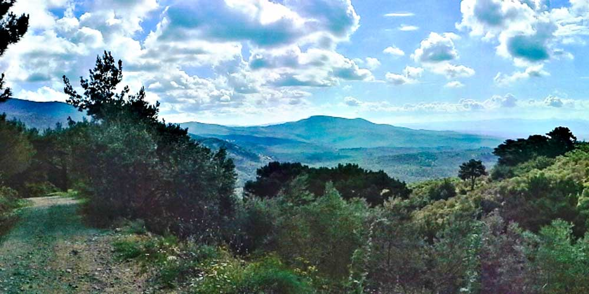
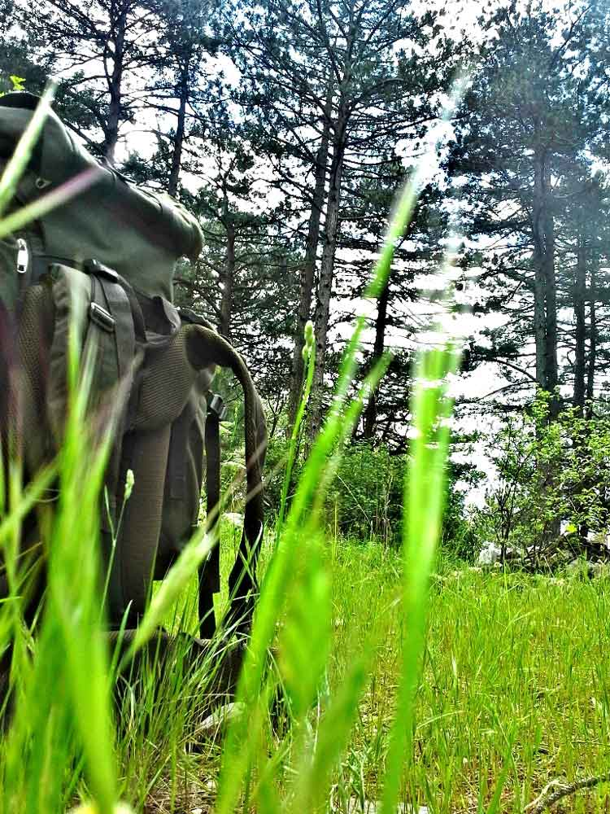
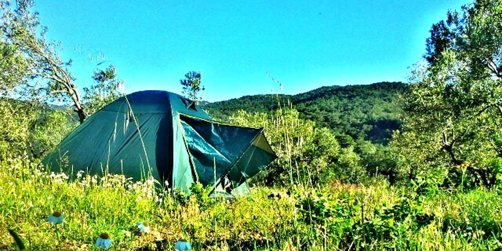
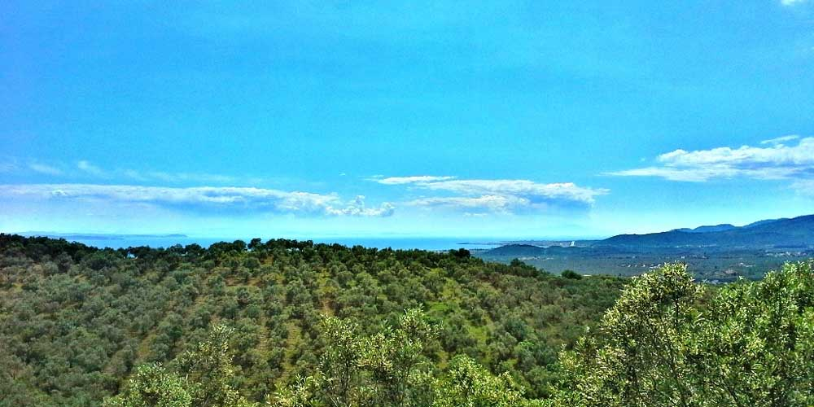
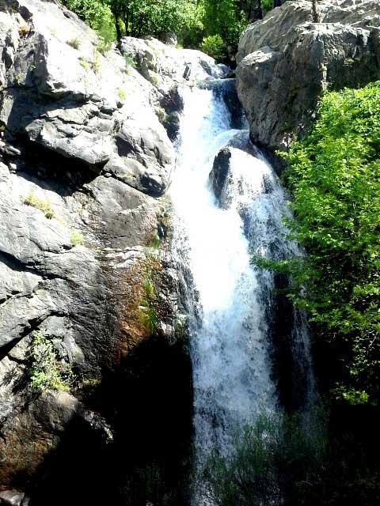
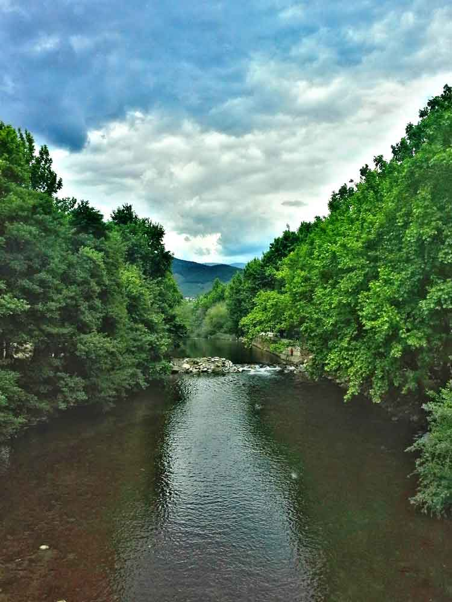
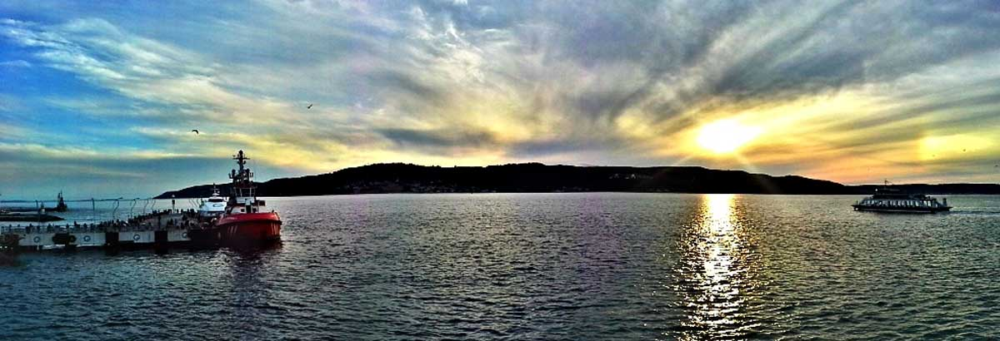

### 3 Day Holiday – Target: **Kaz Dağları**

In 2014 the 19 May holiday ran into the weekend, giving me 3 days off. It was a good opportunity to visit the Kaz Mountains, somewhere I’d been thinking about for ages. It was my first time there, so I did plenty of research. The first snag was finding out that entry to the national park without a guide wasn’t allowed. The stated reason was to protect the forest and its wildlife, though I didn’t see any work being done to that end. Having a guide is a good idea, but I don’t think it should be mandatory for people who are suitably experienced and informed. Can a guide cover the same distance as me? What will they eat and drink? Where will they stay? Those questions come up. My impression was that they made it mandatory for the money because it’s a tourist area. I hadn’t seen that practice in other national parks.

### Plans were made.

Based on the information provided by someone who had experienced the same problem before – someone who had illegally entered through a forest road and accessed the Kaz Dağları – I decided to use that information. I was planning to illegally enter, and I was worried that they would simply kick me out :-). I’ve removed the route, completed all preparations, and now I was just waiting for the end of the shift to set off.

### Time to Set Off

I was going to Edremit with my colleague Cem to stay with his family, and in the morning he’d let me loose in the outdoors. Even though we set off at 17:30, İstanbul traffic had ground to a halt. They’d closed the TEM motorway around Gebze and were diverting traffic onto the E5. After a gruelling 9-hour trip we got home at 2 in the morning.

## Day 1 – Seeing Kaz Dağları filled me with excitement. 

I had planned to be on the road by 6am. But, having fallen asleep at 3am, I pushed it back to 8. Then, it was 9, and Cem saw me off at the starting point. I know that entering the Kaz Mountains without a guide is prohibited. But where am I going to carry the guide? :) Besides, I’m the kind of person who does things on a whim. So, I set off on a forest dirt track from a place no one knows. The weather looked a bit cloudy as I headed towards the summit. I prepared the rainfly for my tent, because I hadn’t brought a raincoat. In situations like this, your tent’s rainfly or large trash bags you carry with you can be very useful.

### Aegean Skies

As I climbed higher, the scenery grew more beautiful and I began to see the Aegean Sea. The sky, cradling the clouds it had embraced, merged with the Aegean; there was no horizon left. I was walking along this beautiful landscape, through the forest, on a dirt track. Then the dirt track ended and turned into an old tractor path. It was so overgrown with grass that the whole road was covered, a very broken path. Of course, for hikers, it was very nice. There were plenty of water wells along the path. In fact, I was a little uneasy, comparing the sound coming from them to the sound of pigs. But after listening for a while, I realized there was a rhythm to it. Water flowing at a certain rate has a rhythm. Listen for a bit and you can catch it.

### The road ended. What should be done? Answer: Enter the forest.

After 10 km I reached a place called Gölcük, where water flowed abundantly, and the road ended. Yes, the road ended. Since I’d aimed to cross without getting too wet, getting through this spot took some effort. Then I continued climbing on woodland paths and slopes. I’d reached the deepest part of the forest and was steadily gaining height, but that slope really wore me out. At about 14:00, at 1,300 metres, I decided to take a break. The last 5 km of uphill had tired me out. It was cool at 1,300 metres, and since I thought it would get colder in the evening, I gave up on staying higher. I could have reached the summit in another 7–8 km, but I’d really liked a hill lower down with a view of the sea, and since I wanted to spend the night there even more, I decided to sort out food and rest and turn back. I took the same route back, except for the slope. I’d gone so deep into the forest that I was certain I’d encounter an animal. But unfortunately, I saw nothing but birds.

### My Campsite with a View of the Sea

I was at the place I intended to camp at about 8 that evening. Sleeping on this hard ground, which offered a magnificent Aegean view amongst the olive groves, proved difficult – certainly not easy. Around 10 that night, the distant cries of jackals came to me, prompting me to respond with a whistle. Then, the sounds ceased. I did not wish to bring the remainder of my food into the tent, as its scent would be dispersed outside and could direct animals straight to my tent. Therefore, I carried it to a slightly more distant spot and discarded it. Having walked 32 km on the first day, I succumbed to the fatigue and fell asleep. My shoulders were the most painful. I had indeed seen the benefits of regular exercise; my feet were better than ever before.

## **Day 2: Night Visitors**

I woke around 7 as the morning sun hit the tent, and the heat sent me straight outside. That beautiful view was waiting for me again. I hadn’t slept well on the hard ground, but the weather and the view lifted my spirits to the ceiling. I woke 2 or 3 times during the night to boar grunts. I think they came to visit me. When I called “Hooop, boss!” from inside the tent, I heard it run off. After packing up, I decided to have breakfast at the fountain by the road, since it was in the shade and I’d run out of water.

After breakfast I walked 2 km to Hasanboğuldu (Sütüven) Waterfall. I’d come this far and wasn’t about to miss it. Tour companies bring nature lovers here in safari jeeps. I passed two jeeps and greeted the people inside. Saying hello to people who share your interests or smile at you along the way is something I really enjoy. There’s an admission fee. You can picnic, sit at tables in the stream, use the café or buy deli products from local people. I don’t remember the exact prices, but they were something like 8 TL for a car, 16 TL for a bus and 2 TL per person. Under the excuse of charging my phone, I spent about 2 hours in the café, then set off towards Zeytinli.

### A Nice Coincidence

As I was walking, I enjoyed the curious glances of the people in the cars passing by. Then, one car passed by and I saw it looking at me from head to toe. I was continuing on my way with a slight smile when I looked and saw that car had stopped on the right, and my university friend Zafer was coming towards me, just as surprised as I was.

After a bit of chit-chat, everyone continued on their way. My aim was to head to Yaşyer village that evening, spend the night on this high hilltop with a beautiful view, and then the next day wander around the area before returning. I took a rest stop at a coffee shop in Ortaoba village. After greeting the villagers, I sat at a table and charged my phone. Following a pleasant chat with the coffee shop patrons, I began to approach Dereli village, travelling sometimes on a dirt road and sometimes on a tractor road. There was about an hour left before the sky darkened, and I was already feeling tired. Suddenly, a car approached and pulled up beside me. After a brief chat, the driver offered to let me pitch a tent by his house. I said I might take him up on it after stopping in Dereli and then left. Shortly after, before reaching Dereli, I spotted a charming restaurant perched by the water's edge. After strolling a short distance and surveying the surroundings, I met Ömer abi, the owner of this place, which I greatly admired. When I mentioned looking for a spot to pitch a tent, Ömer abi pointed out a lovely area at the back of his restaurant. Upon being told I could charge my phone and access the internet wirelessly, my eyes lit up :). Ömer abi, who runs this delightful restaurant in Dereli village, is a hospitable, wanderlust-filled, inquisitive, industrious, and productive individual. Indeed, he has crafted many items himself within the restaurant and is currently in the process of constructing treehouses atop the large pine trees in the rear garden. In the evening, following a pleasant and enjoyable conversation with Ömer abi, I requested permission to retire around 23:00 and went to bed.

To reach Ömer abim’s restaurant, which is 7.7 km from Edremit, use [Google Maps Directions](https://www.google.com/maps/dir/39.594441,27.01635/39.6468298,27.0348537/@39.6205281,26.9942142,11895m/data=!3m2!1e3!4b1!4m4!4m3!1m0!1m0!3e0).

##  **Day 3: The Way Back**

After a peaceful sleep accompanied by the sound of water and birds, I woke up in the morning to find that there was no one around. Ömer abi had told me that he wouldn't be around, so we had said goodbye in the evening. Perhaps we will meet again someday with my wonderful brother. After breakfast, my route was clear: Yaşyer village. Yes, I hadn't reached there yesterday, but today I was going there, and after that, I would go to Edremit and take the 16:00 bus to İstanbul.

### Kids playing with bottle caps

I really enjoy chatting with the children I meet on the road. I answered their questions, such as “Are you a climber, where do you stay, where do you come from, where are you going – what if a snake bites you?” I was talking with the children, and when I asked the children we met in Dereli village why they weren’t playing football, they showed me their cardboard boxes and said, “We’re playing with these,” and I suddenly remembered my own childhood. I thought to myself, “There are still children playing with cardboard boxes, so.” After walking approximately 2-3 km, I felt a sense of regret. I thought to myself, “I wish I had bought a football from the shop in that village and given it to the children.” Because I had to catch a bus I was going to, I turned back and continued on my way to Yaşyer village. I find the children who grew up in the village to be particularly sympathetic and lovable. I think this is because these children know how to be happy simply by playing with cardboard boxes, as they don’t have any other toys besides cardboard boxes.

### The hose was simply lying on the road.

I had about 3 km left to reach Yaşyer village when I spotted a thick water hose moving along the road on its own. I walked quite a distance, initially thinking someone was pulling it from the other side. But the hose kept coming with me, even as I turned the corners. What was going on? I moved forward in a state of shock, and then the road suddenly leveled out. About 40 meters ahead, I saw someone trying to carry the hose on their back. At first, he would stop occasionally. Then I thought, "I'll give him a hand," and we started carrying the hose together, without him knowing. After a while, the man in front suddenly stopped and looked back. "I'm saying, why is this so easy?" he asked. I shouted back, "Don't stop, keep going!" After about 2 km, our paths diverged. He waved to me from a distance and thanked me. Shortly after, I was in Yaşyer village. After a short break and some rest, I continued towards my final stop, Edremit, and arrived there at around 14:20.

I felt quietly proud and happy. I’d walked 67 km in about three days. I’d never done a route this long before and I wanted to see how I’d get on. It was really a practice run for the Lycian Way in September: 509 km in 21 days, if all went to plan. Cem, who’d dropped me at the start, met me again in Edremit. We swapped stories and had a catch-up, then he saw me onto the bus back to Istanbul.

After 2 hours on the bus, I realised we were going back via Çanakkale. In a way that was good, as I got to see that side of the country. On the other hand, I had to be at work at 9 the next morning :). I got home at 04:00.

This was a wonderful trip, taking me back to my childhood, where I made new friends and chatted with many unfamiliar people. I ventured deep into the forest, enjoyed beautiful scenery, and even saw the Yörük people. Should I go back to the Kaz Mountains? Why not! :)