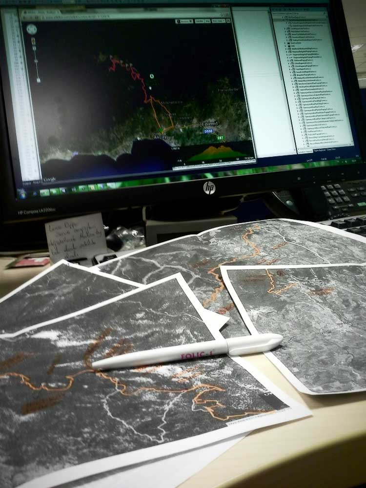
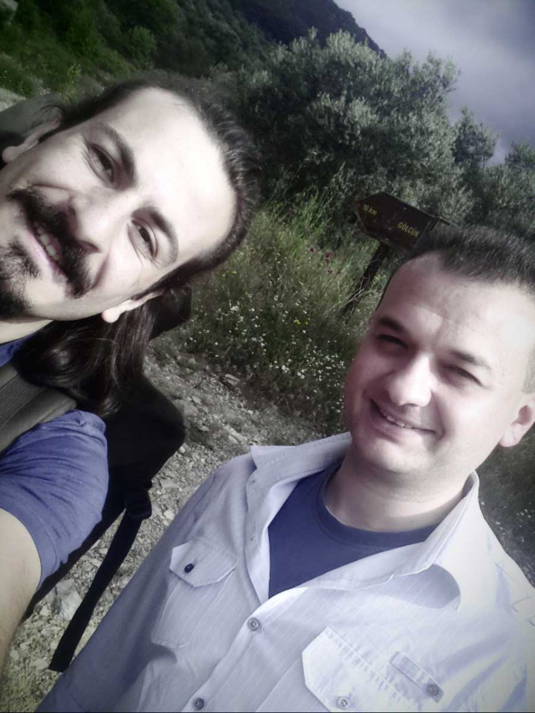
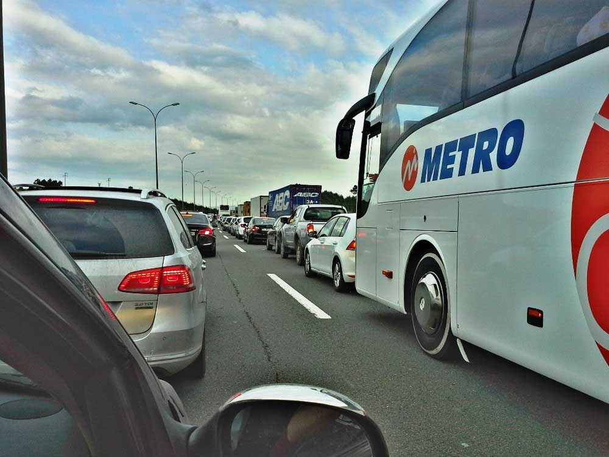
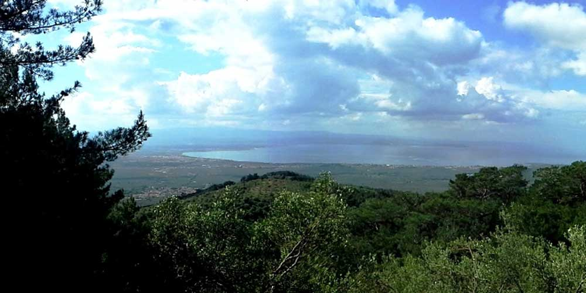
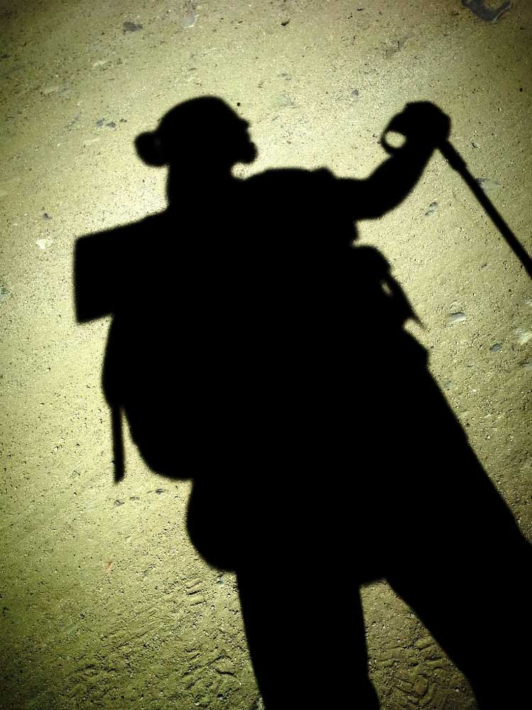
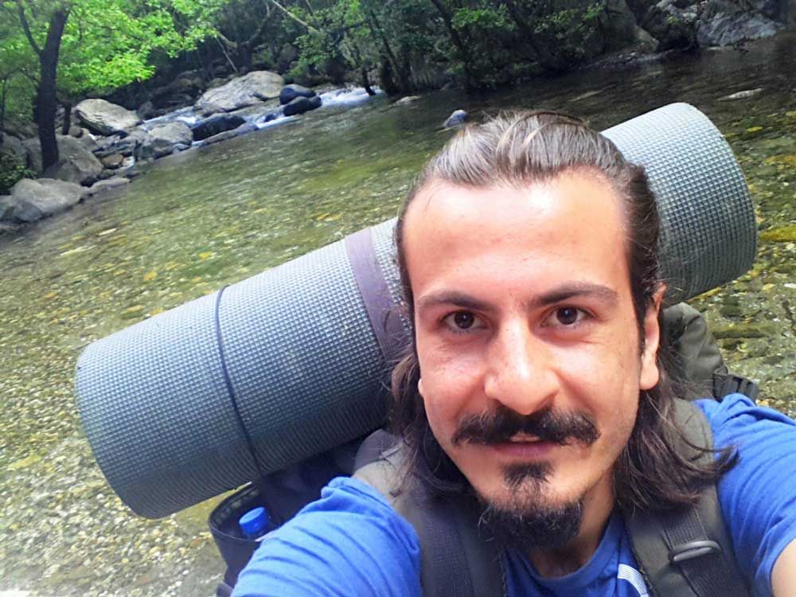
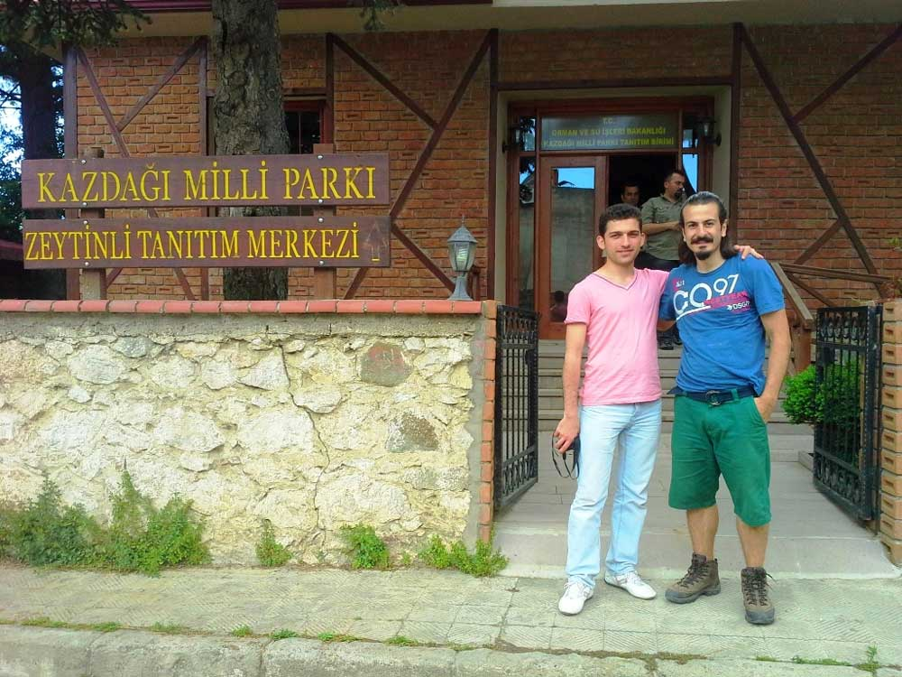
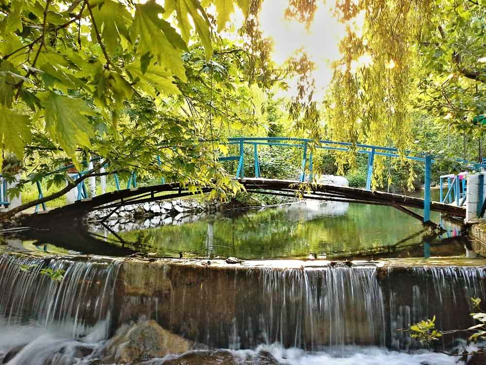
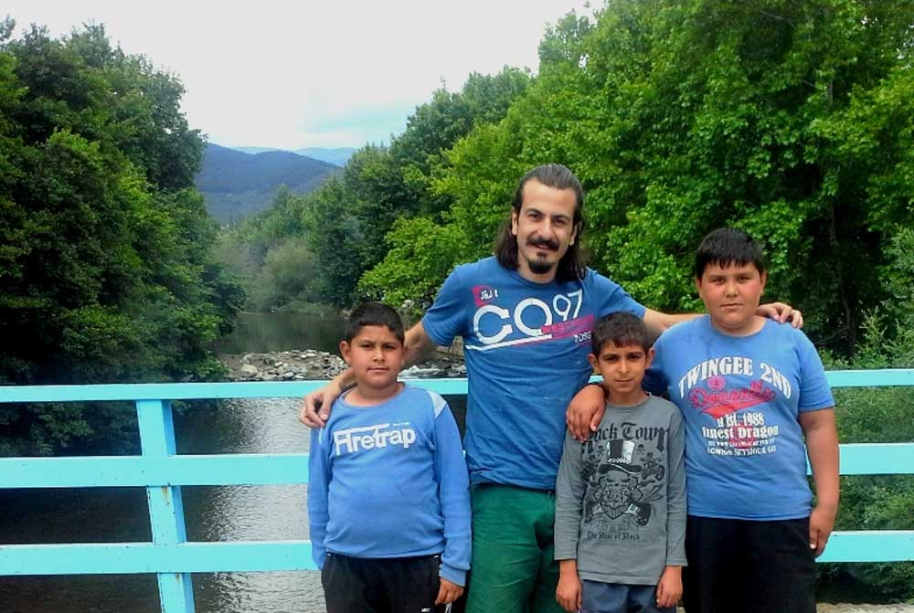

### 3 Day Holiday – Target: **Kaz Dağları**

In 2014 the 19 May holiday ran into the weekend, giving me 3 days off. It was a good opportunity to visit the Kaz Mountains, somewhere I’d been thinking about for ages. It was my first time there, so I did plenty of research. The first snag was finding out that entry to the national park without a guide wasn’t allowed. The stated reason was to protect the forest and its wildlife, though I didn’t see any work being done to that end. Having a guide is a good idea, but I don’t think it should be mandatory for people who are suitably experienced and informed. Can a guide cover the same distance as me? What will they eat and drink? Where will they stay? Those questions come up. My impression was that they made it mandatory for the money because it’s a tourist area. I hadn’t seen that practice in other national parks.

### Plans were made.

Based on the information provided by someone who had experienced the same problem before – someone who had illegally entered through a forest road and accessed the Kaz Dağları – I decided to use that information. I was planning to illegally enter, and I was worried that they would simply kick me out :-). I’ve removed the route, completed all preparations, and now I was just waiting for the end of the shift to set off.

### Departure Time

I was going to Edremit with my colleague Cem to stay with his family, and in the morning he’d let me loose in the outdoors. Even though we set off at 17:30, İstanbul traffic had ground to a halt. They’d closed the TEM motorway around Gebze and were diverting traffic onto the E5. After a gruelling 9-hour trip we got home at 2 in the morning.

## Day 1 – Seeing Kaz Dağları filled me with excitement. 

I had planned to leave at 6 in the morning. But, because I fell asleep at 3 in the morning, I postponed it to 8. Then, it was 9, and Cem greeted me at the starting point. I know that entering Kaz Dağları without a guide is prohibited. But, where am I going to put the guide? (laughs), especially since I’m a person who does things on a whim. So, I started a forest dirt walk from a place that no one knows. The weather looked a bit cloudy as I headed towards the summit. I prepared the rain cover for my tent, because I hadn’t brought a raincoat with me. Things like the rain cover for your tent or large-sized trash bags can be very useful in these situations.

### Aegean Skies

As I climbed higher, I began to see the increasing beauty of the scenery and the beauty of the Aegean Sea. The Aegean Sea merged with the sky, and the horizon disappeared. I was walking along a beautiful landscape and within the forest, on a dirt road. Then, the dirt road ended and turned into an old tractor path – it was a road completely covered in grass and a very worn path. However, it was a very pleasant path for hikers. There were plenty of wells along the path. I was even a little uneasy, comparing the sound of the water coming from these wells to the sound of pigs. But after listening for a while, I realized there was a rhythm to it. You can catch this rhythm when you listen to the water flowing at a certain rate.

### The road ended. What should be done? Answer: Enter the forest.

After 10 km I reached a place called Gölcük with plenty of flowing water, and the road ended. It really did. I didn’t want to get too wet, so finding a way across took a bit of work. Then I kept climbing on woodland paths and hillsides. I’d reached the deepest part of the forest and was getting higher, but that hillside wore me out. At about 14:00, at 1,300 metres, I decided to stop. The last 5 km uphill had tired me out. It was cool at 1,300 metres and I decided against staying high because I thought it would get colder in the evening. I might have reached the summit in another 7–8 km. But I’d loved a hill lower down with a view of the sea and would rather spend the night there, so I ate, rested and turned back. I took the same route back apart from the hillside. I’d gone so deep into the forest that I was sure I’d see an animal. As it turned out, I saw only birds.

### Seaside Camping Spot

I was at the place I intended to camp at about 8 that evening. Sleeping on this hard ground, which offered a magnificent Aegean view amongst the olive groves, proved difficult – certainly not easy. Around 10 that night, the distant cries of jackals came to me, prompting me to respond with a whistle. Then, the sounds ceased. I did not wish to bring the remainder of my food into the tent, as its scent would be dispersed outside and could direct animals straight to my tent. Therefore, I carried it to a slightly more distant spot and discarded it. Having walked 32 km on the first day, I succumbed to the fatigue and fell asleep. My shoulders were the most painful. I had indeed seen the benefits of regular exercise; my feet were better than ever before.

## **Day 2: Night Visitors**

I woke around 7 as the morning sun hit the tent, and the heat sent me straight outside. That beautiful view was waiting for me again. I hadn’t slept well on the hard ground, but the weather and the view lifted my spirits. I woke 2 or 3 times during the night to boar grunts. I think they came to visit me. When I called “Oi, boss!” from inside the tent, I heard it run off. I packed up and decided to have breakfast at the roadside fountain. It was in the shade and I’d run out of water.

After breakfast I walked 2 km to Hasanboğuldu (Sütüven) Waterfall. I’d come this far and wasn’t about to miss it. Tour companies bring nature lovers here in safari jeeps. I passed two jeeps and greeted the people inside. Saying hello to people who share your interests or smile at you along the way is something I really enjoy. There’s an admission fee. You can picnic, sit at tables in the stream, use the café or buy deli products from local people. I don’t remember the exact prices, but they were something like 8 TL for a car, 16 TL for a bus and 2 TL per person. Under the excuse of charging my phone, I spent about 2 hours in the café, then set off towards Zeytinli.

### Beautiful Coincidence

As I was driving, I enjoyed the curious glances of the cars passing by. Then, one car passed by and I saw it looked at me from head to toe. I was continuing on my way with a slight smile, when I looked again and saw that car had stopped on the right, and my university friend, Zafer, was coming towards me, just as surprised as I was.

After a bit of chit-chat, everyone continued on their way. My aim was to head to Yaşyer village that evening, spend the night on this high hilltop with a beautiful view, and then the next day take a short trip there before returning. I took a rest stop at a coffee shop in Ortaoba village. After greeting the villagers, I sat at a table and charged my phone. Following a pleasant chat with the coffee shop patrons, I began to approach Dereli village, travelling sometimes on a dirt road and sometimes on a tractor road. There was about an hour left before the sky darkened, and I was already feeling tired. Suddenly, a car approached and pulled up beside me. After a brief chat, the driver offered to let me pitch a tent by his house. I said I might take him up on it after stopping in Dereli. Shortly after, before reaching Dereli, I spotted a charming restaurant perched by the water's edge. After strolling a short distance and surveying the surroundings, I met Ömer abi, the owner of this place, which I greatly admired. When I mentioned looking for a spot to pitch a tent, Ömer abi pointed out a lovely area at the back of his restaurant. Upon being told I could charge my phone and access the internet wirelessly, my eyes lit up :). Ömer abi, who runs this delightful restaurant in Dereli village, is a hospitable, wanderlust-filled, inquisitive, industrious, and productive individual. Indeed, he has crafted many items himself within the restaurant and is currently in the process of constructing treehouses atop the large pine trees in the rear garden. In the evening, following a pleasant and enjoyable conversation with Ömer abi, I requested permission to retire around 23:00 and went to bed.

To reach Ömer abim’s restaurant, which is 7.7 km from Edremit, use [Google Maps Directions](https://www.google.com/maps/dir/39.594441,27.01635/39.6468298,27.0348537/@39.6205281,26.9942142,11895m/data=!3m2!1e3!4b1!4m4!4m3!1m0!1m0!3e0).

##  **Day 3: The Way Back**

After a peaceful sleep accompanied by the sound of water and birds, I woke up in the morning to find that there was no one around. Ömer abi had told me that he wouldn't be around, so we had said goodbye in the evening. Perhaps we will meet again someday with my wonderful brother. After breakfast, my route was clear: Yaşyer village. Yes, I hadn't reached there yesterday, but today I was going there, and after that, I would go to Edremit and take the 16:00 bus to İstanbul.

### Children playing on the cover.

I really enjoy chatting with the children I meet on the road. I answered their questions, such as “Are you a climber, where do you stay, where do you come from, where are you going – what if a snake bites you?” I was talking with the children, and when I asked the children we met in Dereli village why they weren’t playing football, they showed me their cardboard boxes and said, “We’re playing with these,” and I suddenly remembered my own childhood. I thought to myself, “There are still children playing with cardboard boxes, so.” After walking approximately 2-3 km, I felt a sense of regret. I thought to myself, “I wish I had bought a football from the shop in that village and given it to the children.” Because I had to catch a bus I was going to, I turned back and continued on my way to Yaşyer village. I find the children who grew up in the village to be particularly sympathetic and lovable. I think this is because these children know how to be happy simply by playing with cardboard boxes, as they don’t have any other toys besides cardboard boxes.

### The hose was simply lying on the road.

There were about 3 km left to reach Yaşyer village when I saw a thick water hose suddenly appear on the road. I walked quite a distance, initially thinking someone was pulling it from the other side. But the hose kept coming with me, even as I turned the corners. While moving in a state of shock, the road suddenly leveled out, and I saw someone trying to carry the hose about 40 meters ahead. At first, he would stop sporadically. Then, I decided to intervene, and we started carrying the hose together, without him knowing. After a long time, he suddenly stopped and looked back, saying, “I’m wondering, why is this so easy?” I told him to keep going. After about 2 km, the roads separated, and we waved to each other from a distance, thanking me. Shortly after, I was in Yaşyer village. After a short break and rest, I continued towards Edremit, arriving at approximately 14:20.

I was experiencing a sense of pride and joy from having completed approximately 67km on foot in about 3 days. This was actually the first time I had attempted such a long route, which I had planned beforehand for “21 days, 509km” of the Lycian Way. Cem, who had dropped me off at my starting point, greeted me again in Edremit. After sharing our travel memories and enjoying a little chat, he took me to İstanbul on a bus.

After 2 hours on the bus, I realised we were going back via Çanakkale. In a way that was good, as I got to see that side of the country. On the other hand, I had to be at work at 9 the next morning :). I got home at 04:00.

This was a wonderful trip, taking me back to my childhood, where I made new friends and talked with many unfamiliar people. I ventured deep into the forest, enjoyed beautiful scenery, and even saw the Yörük people. Should I go back to the Taurus Mountains? Why not! :)