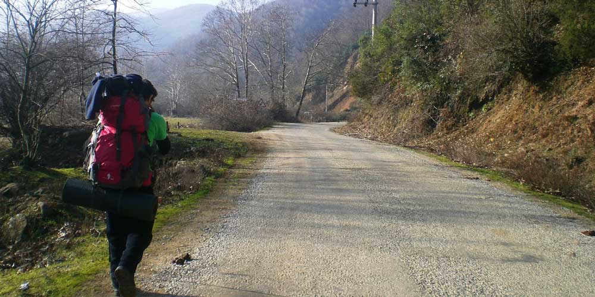
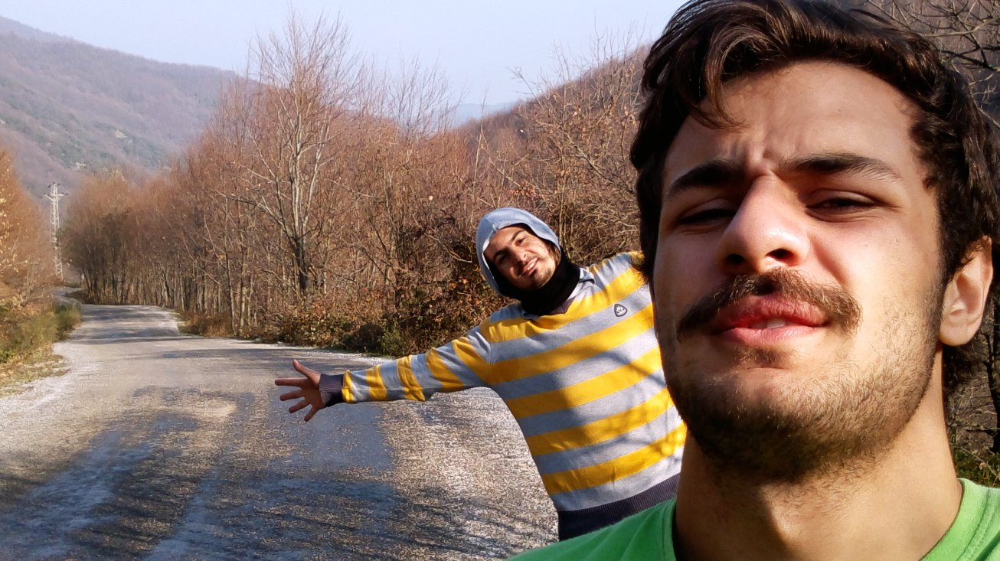

It’s been two months since January 2014 that I’ve been anywhere. I’m so bored I want to run away and go somewhere. Because I miss nature. It’s winter, but there’s no serious snow yet, and the weather is quite mild for a winter day. I make a plan straight away. I look into Erikli Highland, a place I’ve heard about a lot.

### Back on the trail

On Saturday morning, we took a minibus from Yalova to Çınarcık. After sorting out our missing items in Çınarcık centre, we set off for a walk at around 9 am. We planned to follow the vehicle road to Erikli Highland, then head to the twin waterfalls and the bottomless lake. We’d decide where to camp once we got there. We reached Teşvikiye village from Çınarcık, then carried on towards Erikli Highland. About 4 or 5 km after passing Teşvikiye, a steep climb began. It did wear us out a bit, but we made it to Erikli Highland. The weather was sunny but cool. Because we were walking, we didn’t feel cold. In fact, we were sweating. We really saw the benefits of thermal underwear: since it doesn’t hold the sweat, it stopped us from getting chilled by the wind.

### Twin Waterfalls

After taking a look at Erikli Highland, we continue towards the Çifte şelaleler, which are a bit further on. There are cafes, a picnic area, a mosque, a children’s playground, toilets, and a fountain at the location of the waterfalls. However, it’s winter, and there’s no one else here. We set up our tent in the area before climbing the steps leading to the waterfalls. Since the sky is darkening, we plan to go to the deep, bottomless lake another time. First, we explore the waterfalls, and then our first task is to build a campfire. The waterfalls are so beautiful that we sigh, wishing we could have gone in if the weather were warmer. If I come back here, my first thing to do will be to go to the waterfalls. This place, located within the valley, doesn’t get much sun, so it cools down more quickly. A campfire is a lifesaver; it’s essential. To avoid attracting any wild animals around, we’ve only brought canned food. We heat these up over the fire, eat them, then drink our tea and pull ourselves together.

### Dozing by the Fire

It’s only about 19:00, but we’ve been in the dark for about 2 hours. It gets dark early in winter. The fire keeps us so warm that we feel just how cold it is the moment we step away. Furkan and I sit by it until 20:30, dozing off now and then. We could easily fall asleep right there. Even though it’s early, we decide to go back to the tent. With the sound of the water around us on a quiet night, we stick heat pads to our feet and lower backs, get into our sleeping bags and drift off.

### No sign of humidity

Self-adhesive heaters have really proven their worth. We slept for approximately 13 hours. Honestly, I don't think we slept that much at all. And, we woke up feeling really refreshed. But the weather is cool, so the first thing we’re doing is lighting a fire. In my research before coming here, I had read that there was a lot of humidity. Because it’s winter, there was no humidity at all in the morning. People should pay attention to humidity in the summer – don’t leave anything out, so that when you wake up in the morning, it’s not damp :)

### Return

It was a very calm and peaceful camping trip. After breakfast, we regrouped and set off again. On the return journey, we met two cyclists. We chatted for a while. They told us that we could descend to Teşvikiye via a forest path. Since we hadn’t walked that route and had already passed the junction, we decided to use it another time and returned the way we came. Nature was fast asleep. Even if spring arrives and nature becomes active, it still felt that way. We walked the same route back, with approximately 16 kg of gear, covering 32 km.

