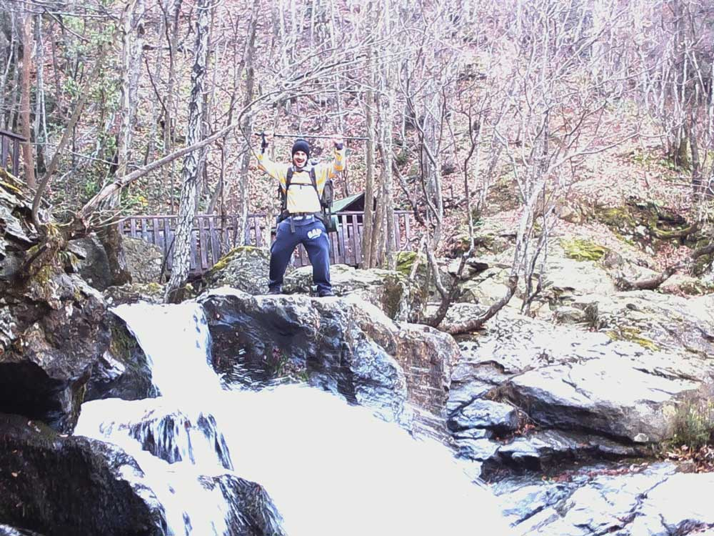
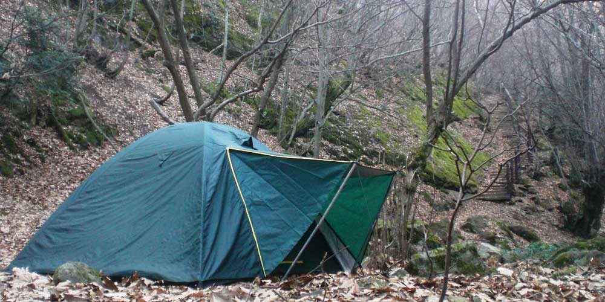
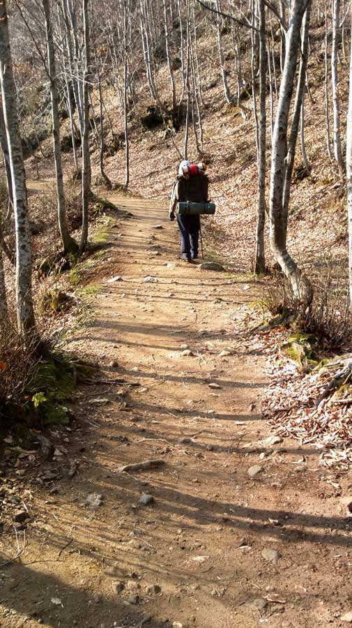
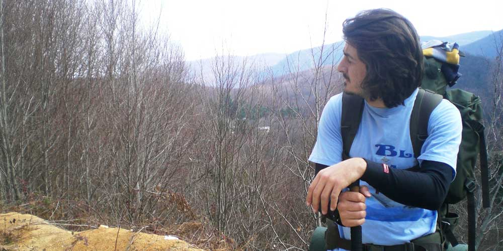

It has been 2014 January and two months since I’ve gone anywhere. I’ve become so bored that I really want to escape and go somewhere. Because I miss nature. It’s winter, but there isn’t yet a significant amount of snow, and the weather is quite mild for a winter day. I’m immediately making a plan. I’m researching Erikli yaylası, a place I’ve heard mentioned a lot.

### We are still on the road.

On Saturday morning, we traveled from Yalova by minibus to Çınarcık. After completing our supplies in Çınarcık town, we planned to begin a walk at 9 am. We intended to follow the road and reach Erikli valley, with the aim of visiting the double waterfalls and the deep lake. We planned to determine exactly where we would set up camp when we arrived. After arriving in Çınarcık, we continued to Teşvikiye village, and then further towards Erikli valley. After passing Teşvikiye village, a steep incline began approximately 4, 5 km later. Although this was a challenging climb, we reached Erikli valley. The weather is sunny but cool. Because we are walking, we are not cold. In fact, we are sweating quite a bit. We are really seeing the benefits of thermal underwear, which prevents us from getting cold with the wind as it doesn't hold our sweat.

### Twin Waterfalls

After taking a look at Erikli yaylası, we are continuing towards the Çifte şelaleler, which are a bit further on. There are cafes, a picnic area, a mosque, a children’s playground, toilets, and a fountain at the location of the waterfalls. However, it’s winter, and there’s no one else here. We are setting up our tent in the area before climbing the steps leading to the waterfalls. Since the sky is darkening, we plan to go to the deep, bottomless lake another time. First, we are exploring the waterfalls, and then our first task is to build a campfire. The waterfalls are so beautiful that we are wishing we could have gone in if the weather were warmer. If I come back here, my first thing to do will be to go to the waterfalls. This place, located within the valley, doesn’t get much sun, so it cools down more quickly. A campfire is wonderful; it’s essential. We’ve only brought canned food to avoid encountering any wild animals around. We heat these up over the fire and then eat them, before enjoying a cup of tea and relaxing.

### Sleeping by the Fire

It’s only about 19:00, but we’ve been in the dark for about 2 hours. It gets dark early in winter. The fire keeps us so warm that we feel just how cold it is the moment we step away. Furkan and I sit by it until 20:30, dozing off now and then. We could easily fall asleep right there. Even though it’s early, we decide to go back to the tent. With the sound of the water around us on a quiet night, we stick heat pads to our feet and lower backs, get into our sleeping bags and drift off.

### No results from humidity.

Self-adhesive heaters have really proven their worth. We slept for approximately 13 hours. Honestly, I don't think we slept that much at all. And, we woke up feeling really refreshed. But the weather is cool, so the first thing we’re doing is lighting a fire. In my research before coming here, I had read that there was a lot of humidity. Because it’s winter, there was no humidity at all in the morning. People should pay attention to humidity in the summer – don’t leave anything out, so that when you wake up in the morning, it’s not damp :)

### Return

It’s a very calm and peaceful camping trip. After breakfast, we regroup and set off again. We encounter two cyclists on the return journey. We chat for a while. Someone tells us that we could reach Teşvikiye via a forest path. We decide to return on the path we’re currently on, as we hadn’t walked that other route and passed that junction. Nature feels like it’s completely at rest. Even if spring arrives, nature feels like it’s becoming active. We walked the same route back, with approximately 16 kg of gear, covering 32 km.

