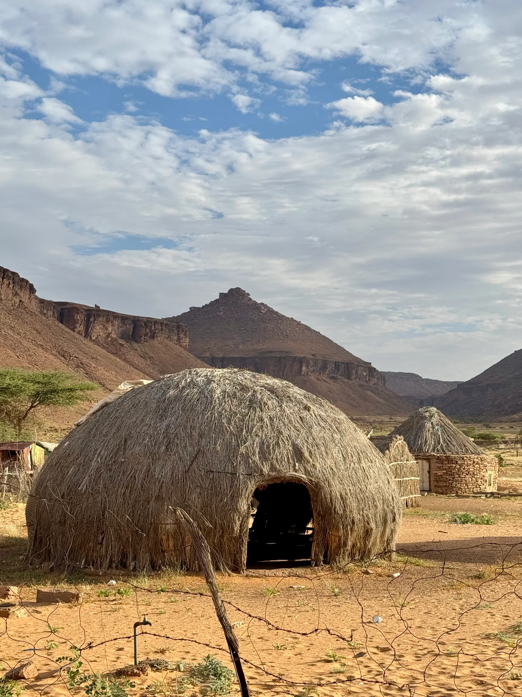

Today, we are encountering commonplace items such as tents weighing less than two kilograms, stoves that fit in the palm of your hand, and sleeping bags with temperature readings measured in a laboratory. However, the history of camping equipment began not with a product on a store shelf, but with the need to carry one’s ability to stay dry, a warm place to sleep, and a shelter.

Only the materials have changed. The fundamental questions remain the same:

- Where will we spend the night?
- How can we protect ourselves from the rain and the wind?
- How can we reduce the load we are carrying?
- How do we wake up without feeling stiff?

In the past, these questions were answered using animal skin, felt, wool, and wood. Today, we use nylon fabric, aluminum poles, inflatable mats, and technical fillings. So, what we call “camping equipment” is the result of a long-standing “Can’t we make it lighter?” search – a quest that has lasted for thousands of years.

Even though camping equipment changed, the need for shelter, warmth, and portability remained the same.

## Why has the camping equipment been changing so frequently?

The initial shelters weren't created for a pleasant weekend; rather, people needed them to ensure a safe night while traveling, hunting, or relocating. These shelters were primarily tools for survival, not for comfort.

This photo I took in Mauritania reminds me to look at camping equipment differently. Gear we use for a hobby, and spend ages discussing in terms of weight and packed size, may represent a living space that some people would consider a luxury. The structures made of reeds and branches in the photo are part of everyday life, not shelters for a few nights of camping.

_This photo I took in Mauritania reminds me that the shelter technology we use for camping can mean something very different in other people’s lives._

I’m not saying this to romanticize poverty. Quite the opposite – when discussing the evolution of camping equipment, we need to remember that access to safe shelter and technology isn’t the same everywhere. While we’re calculating the cost of a few grams in a catalog, someone else is building a permanent living space using local materials.

Over time, new expectations were added to alongside the existing needs:

- Faster setup
- Lower weight
- Protection against rain and wind.
- Smaller package volume
- Suitable for different seasons
- More predictable performance

The camp’s transformation into a leisure and exploration trip also necessitated a change in equipment. We no longer just want to spend a night. We want to be able to relax, organize our belongings, set up the tent in just a few minutes, and transport everything without struggling.

Once a person experiences comfort, they are not particularly eager to return to a simple, makeshift shelter made of straw.

## How did a tent transform into a mobile home?

It’s not easy to say exactly when and where the first tent appeared. Archaeological records are incomplete because the materials used – such as leather, wood, and plants – have deteriorated over time. However, we know that people have been building temporary shelters using materials like leather, bone, branches, and similar items for a very long time.

The nomadic communities’ yurts and similar structures represented a significant change. These weren’t just shelters; they were portable living spaces that could be disassembled and rebuilt in a new location. Wooden frames provided strength, while felt and leather coverings offered protection and insulation against the elements.

The fundamental idea hasn't changed today: build a solid framework, add a layer to block outside air, and leave a livable space inside.

In 1856, the conical tent patent taken in the name of Henry Hopkins Sibley described a structure that utilized a single central pole instead of multiple carriers. This design made it easier to create a large area with fewer parts. Similar tent designs, developed for military use, can still be seen today in campsites and even glamping facilities.

Over time, canvas and wood were replaced by synthetic fabrics and lightweight metal supports.

## When did the trip turn into a spontaneous activity?

People, of course, used to stay in nature much earlier. However, the increasing popularity of camping, driven by modern leisure and exploration, accelerated particularly in the late 19th and early 20th centuries.

Thomas Hiram Holding, who is considered one of the pioneers of light camping in England, published articles about bicycles and camping trips. The bicycle camping community, established in 1901, demonstrated that camping was not just for explorers, soldiers, or those undertaking long journeys.

As people began to set out for camping trips, their equipment also needed to change. It’s unlikely that carrying a heavy canvas tent and wooden poles on a bicycle or on your back would be practical. Lighter fabrics, foldable poles, and compact packages are no longer a convenience – they’ve become a necessity.

> The significant change in camping equipment isn't due to the changes in nature; it stems from people wanting to access nature more easily.

## What was the key change that made the modern tent possible?

The spread of synthetic fabrics and lightweight metal poles in the mid-20th century changed tent design considerably.

The canvas tents were durable and quite comfortable under suitable conditions. However, they were heavy, and became even heavier when wet, requiring careful drying before being set up. Even though the wooden poles were sturdy, they added to the weight when being transported.

Using synthetic fabrics and aluminum poles:

- The weight and packed volume of the tents have decreased.
- The wet fabric is drying more easily.
- Pole systems have been developed that can withstand wind.
- The inner tent and the outer tent could be distinguished from each other.
- Ventilation and condensation are now being managed more effectively.
- It was possible to produce tents specifically designed for different uses.

Today, there’s a wide range of tents available for family camping, trekking, bike trips, high-altitude excursions, or quick setups – tents that are completely different from each other. However, the use of modern materials doesn’t necessarily mean that each tent is suitable for every condition.

A lightweight trekking tent can lighten your bag, but it won’t provide the living space of a larger family tent. Inflatable poles can make setup easier, but they can also increase the packed weight. Thin fabrics save on weight, but they may require more care during use.

It’s nice to know the history of a tent; however, what’s truly important during the purchase process is how you intend to use it. For this, you can use the guide “[how to choose the right tent](/cadir-alirken-nelere-dikkat-edilmeli/)" and consider factors such as capacity, weight, ground, and season.

## Before sleeping in a sleeping bag, how did people sleep?

The history of sleep equipment could be older than tents. In excavations at Border Cave in South Africa, layers of plant material dating back approximately 200,000 years ago were found. It is believed that these plants were used to create more comfortable surfaces for people to sleep and work.

There were also layers of ash on the ground. Researchers suggest that the ash may have helped to keep the ground clean and reduce the number of insects. While it might seem modest when placed alongside today’s inflatable mattress, the logic remains the same: a warmer, more comfortable surface for sleeping.

It is being considered that the layer of organic matter provides comfort while also potentially helping to protect against insects beneath it.

Today that’s the job of the camping mat. As well as making stones and roots less noticeable, it adds insulation between your body and the cold ground. See my article on [R-values for sleeping mats](/r-degeri-nedir/) for more on comparing that insulation.

## How did the sleep sack achieve its current appearance?

People have used materials they could access – such as leather, wool, straw, grass, and blankets – to stay warm at night for centuries. Commercial designs resembling today’s sleep sacks, which can wrap around a person, emerged in the 19th century.

In 1876, Euklisia Rug, patented by Pryce Pryce-Jones, was known as a wool and foldable sleeping system. It wasn’t exactly like the modern mummy-shaped blankets; instead, it was a blanket that people could wrap around themselves and fasten. Nevertheless, it brought to light the idea of a portable, personal, and closable sleeping equipment.

Subsequently, down feathers and various plant-based fillings were used in later designs. With the widespread use of synthetic insulation in the 20th century, sleeping bags reached a wider audience.

Today, the primary selection is still being made between two types of filling:

- Down: It provides high warmth relative to its weight and can be compressed into a small volume. When expanded, its insulation performance may decrease, and it can take a long time to dry.
- Synthetic filler: It can better maintain its performance in humid conditions, dries faster, and is generally more affordable. When compared to down feathers at similar temperatures, it can be heavier and bulkier.

Modern sleeping bag, an evolved version of the portable insulation concept, in terms of material and form.

Form is just as important as the material itself. Rectangular overalls offer ample space for movement, while mummy-shaped overalls reduce the space that needs to be heated. Today, many overalls produced for adults are evaluated using standard testing methods for temperature performance. However, the number on the label does not guarantee a comfortable night; it depends on the material, clothing, humidity, wind, and individual cold sensitivity.

I also cover the difference between comfort, limit and extreme temperature ratings in my guide to [using a sleeping bag](/uyku-tulumu-nasil-kullanilir/).

## Is new camping equipment always better?

New equipment is often lighter, smaller, and more technically advanced. However, “new” and “suitable for me” are not the same thing.

An ultralight tent offers a significant advantage for someone who hikes for miles. For a family camping in a car, a slightly heavier, but spacious, upright tent with a large entrance might be more practical.

This applies to the same situation with sleeping bags as well. If you are planning to walk long distances in dry and cold conditions, the weight advantage of down can be valuable. If you are camping in a humid area and transporting the load with a car, a synthetic sleeping bag drying faster might be more important for you.

The most valuable lesson we’ve learned from the equipment’s dates is this: every advancement comes with a new choice, while simultaneously resolving a previous problem.

As comfort increases, durability may decrease. As comfort increases, the size of the package may grow. When technical material performance is enhanced, maintenance needs and costs can also increase. Therefore, the right equipment shouldn’t be the one with the highest price in the catalog; instead, it should be the one that causes the fewest problems based on your usage.

## What’s on the horizon for camping equipment?

The next major shift in outdoor equipment may not just be about lighter products. There’s a growing emphasis on recycled fabrics, parts that are easier to repair, interchangeable pole sections, and longer product lifecycles.

There’s a small contradiction here: we don’t want the equipment we get to see nature to end up in the trash quickly. Simply buying flimsy products because they’re a few grams lighter, or replacing working equipment with every new model, isn’t really practical.

If the future equipment is mine, we should tackle these three tasks together.

- It should be easy to carry and use.
- When it was designed, it should operate reliably.
- It should be maintained and used for a long period.

In future camping equipment, durability and repairability will also be important, in addition to lightness.

## How does this date help us choose the right equipment today?

Looking at the thousands of years of development of camping equipment, the method of decision-making remains remarkably simple, even though the products themselves change.

First, determine your basic needs:

1. In which season will you use it?
2. Are you going to carry the equipment on your back, or in a vehicle?
3. What will be the temperature of the rain, wind, and night?
4. Is weight more important than living space?
5. Do you have the ability to dry, clean, and repair this product?

Then, consider each component not on its own, but as part of a system. The tent provides protection from rain, the sleeping bag maintains body heat by reducing heat loss from the ground. Even if one component is missing, it doesn't completely compensate for the lack of the other.

If you are setting up your first camping arrangement, you can begin with needs related to shelter, sleep, water, and safety, as listed in “[essential equipment for your first camping trip](/ilk-kamp-icin-gerekli-malzemeler/) – without filling up your entire bag.

Camping equipment has changed dramatically. Our expectations have changed too. However, during the night, when rain was drumming on the tent, what we still wanted was the same as it had been thousands of years ago: to be dry, warm, and, if possible, comfortable.

What is your oldest camping equipment that you are still using? If you could share its approximate age, the conditions in which you’ve used it, and why you haven’t switched to newer models, we could create a wonderful archive about the equipment’s actual lifespan.

## What are the sources for this text?

- [Henry Hopkins Sibley's 1856 conical tent patent — Google Patents](https://patents.google.com/patent/US14740A/en)
- [Thomas Hiram Holding and Association of Cycle Campers — The Camping and Caravanning Club](https://www.campingandcaravanningclub.co.uk/about-us/club-history/)
- [Research on 200,000-Year-Old Moss and Ash Deposits in Border Cave – Science](https://doi.org/10.1126/science.abc7239)
- [Pryce Pryce-Jones and Euklisia Rug — Newtown Textile Museum](https://newtowntextilemuseum.co.uk/the-collection/)
