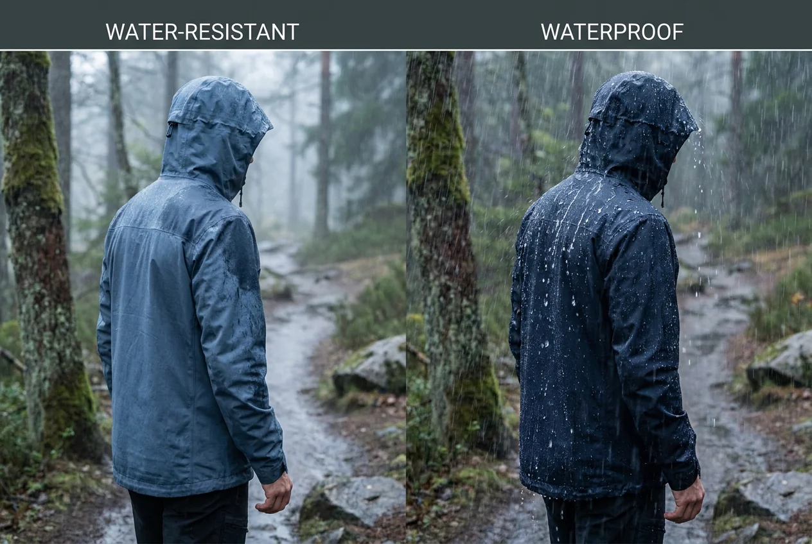
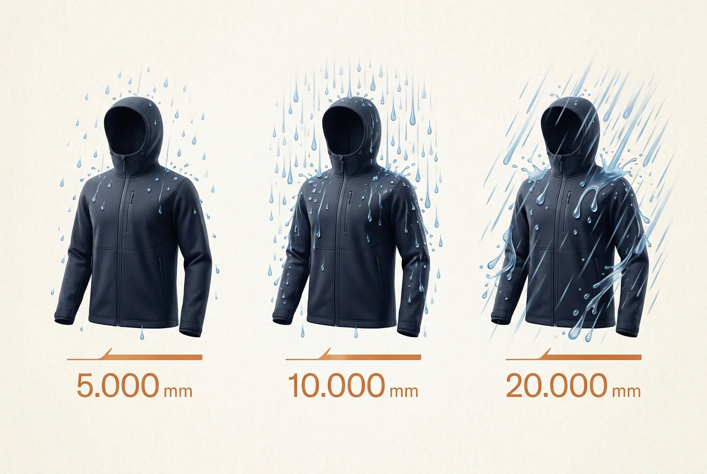
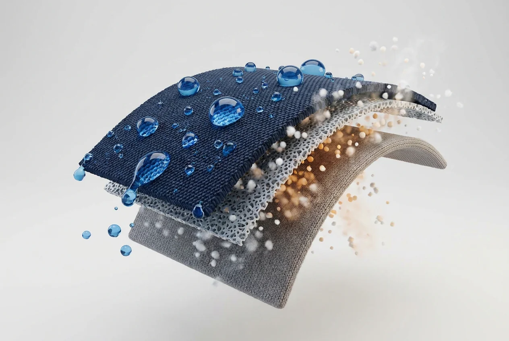
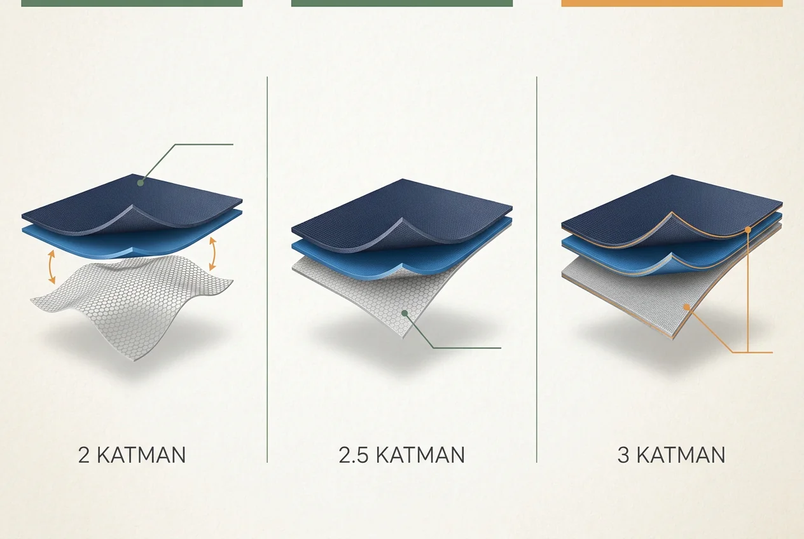

In 2022 I rode my motorbike from London to Nordkapp, at the northern tip of Norway. I was freezing on that 51-day trip. I mean properly freezing. A patch of sunshine would cheer me up, then the rain would come back. As soon as it stopped, the wind would pick up. Jacket on, jacket off, jacket back on. I spent more of the trip wrestling with the weather than with the ride itself.

I kept getting caught in the rain. Sometimes I still had to ride, sometimes I had to walk, and sometimes I had to put up the tent. Thanks to my gear my upper body stayed dry. I didn’t get ill, and I could keep going whatever the weather threw at me.

One thing that trip taught me was how much a good waterproof matters. When it rains, your jacket can make the difference between carrying on and calling it a day.

So how do you choose one? Is the word “waterproof” on the label enough? Pull a plastic bag over yourself and that’ll keep the rain out too. Five minutes later you’ll be cooking in your own steam.

## What should you look for in a waterproof jacket?

Here’s what I look for in a waterproof jacket.

* Enough waterproofing for the conditions I’ll use it in.
* Fabric that lets moisture from sweat escape.
* Fully taped seams.
* A hood I can adjust to fit.
* Cuffs, zip and hem that keep the rain out.
* Room underneath for the layers I’ll wear.
* The right balance of weight and durability for the activity.

You don’t need the highest number on every label. I wouldn’t choose the same jacket to walk the dog in İstanbul as I would for a 51-day motorbike trip through the Norwegian rain.

First, you should determine where and for how long you will use it.

If you're evaluating a rain jacket alongside other essential gear, you might also want to check out the article "[essential equipment for nature walks](/doga-yuruyusleri-icin-gerekli-ekipmanlar/)".

## Are “waterproof” and “water-resistant” the same thing?

A water-resistant jacket can see you through drizzle or a short, light shower. If the rain gets heavier or keeps coming, water will eventually get through.

Waterproof jackets are produced by using a membrane or coating to ensure they can withstand rain for a longer period. However, not all waterproof jackets provide the same level of protection.

Waterproof and water-resistant jackets are not produced for the same weather conditions.

That’s where waterproof ratings such as 5,000, 10,000 and 20,000 mm come in.

## What do waterproof ratings of 5,000, 10,000 and 20,000 mm mean?

These values indicate how much water pressure the fabric can withstand. As the number increases, the fabric’s resistance to water generally increases.

* 5,000 mm: Light and brief showers
* 10,000 mm: For hiking, camping, and daily outdoor use.
* **20,000 mm and above:** Prolonged heavy rain, harsh weather, and demanding activities

*The water resistance value increases as the fabric’s ability to withstand water pressure also increases.*

If you’re planning a short nature walk on the weekend, 10,000 mm waterproofness may be sufficient for most conditions. However, if you’re planning a long trekking or motorcycle trip that could involve being exposed to rain for several days, it makes sense to look for models with higher protection.

If you’re carrying a backpack, be sure to factor in the pressure on your shoulders and lower back. The backpack will put more strain on your jacket at the points where it’s pressing against the fabric.

I’ve rarely had the chance to simply wait for the rain to stop on my Nordkapp journey and continue driving. There were hundreds of kilometers to cover, so it was important for the raincoat to provide protection for more than just the first half hour.

## Why is breathability important?

Waterproofness protects you from outside rain, while breathability protects you from sweat that forms inside.

While walking, when setting up a camp, or when moving with motorcycling equipment, your body temperature increases. If the jacket doesn’t let sweat out, moisture begins to accumulate inside. Even if the rain doesn’t enter from the outside, you will become damp due to your own sweat.

Then you start grumbling, “This jacket leaks, mate.” Maybe it doesn’t. That steam room inside? You’re the one running it.

Breathability ratings are usually given in grams per square metre over 24 hours (`g/m²/24 h`).

* 5,000–10,000: Daily use and low-intensity activities
* 10,000–20,000: Nature walks and active outdoor activities
* 20,000 and above: Long-term and highly demanding activities

*A breathable membrane keeps rain out while letting moisture from your body escape.*

Because the testing methods used by brands can change, products may not show exactly the same performance in two different models, even if they use the same number. Nevertheless, they can be helpful as a reference when evaluating products.

If you sweat a lot, look for underarm zips. Sometimes opening a zip and letting the hot air out does more than the cleverest fabric in the world.

## Will the raincoat keep you warm?

A waterproof shell keeps the rain and wind out. The layers you wear underneath provide the warmth.

On the Nordkapp route, my upper body was dry, but I was still freezing. Because being dry and being warm are not the same thing. You need to wear an appropriate inner layer, suitable for the weather conditions, under a raincoat, and an additional layer like a polar fleece or similar.

Your waterproof jacket should have enough room to layer clothing underneath. However, the jacket shouldn’t be too baggy and puff up like a balloon in the wind. For more information about layering, you can read the article “[How to Dress for a Hike](/doga-yuruyuslerinde-nasil-giyinilmelidir/)”.

## What do two, two and a half, and three layers mean in a waterproof jacket?

The number refers to the construction of the waterproof fabric itself. You can still wear whatever layers you need underneath.

### 2-layer waterproof jacket

The outer fabric is joined with a waterproof membrane. An additional inner lining is included to protect the membrane.

In everyday use, it’s comfortable and generally quieter. However, it can be heavy and bulky compared to other options. It’s suitable for city use, camping, and low-intensity walks.

### 2.5-layer waterproof jacket

The outer fabric and membrane have a thin protective print on the inside. The chief advantages are low weight and a small packed size.

It’s suitable for running, cycling, and day hikes. However, it may be less durable than three-layer models. Some models can feel sticky against the skin as you move, giving a slight plastic-like sensation.

### 3-layer waterproof jacket

The waterproof membrane is placed between the outer fabric and the inner protective layer. This is generally the most durable option.

Three-layer jackets suit long treks, mountaineering and days of rough weather. They cost more, too. No need to put on a mountaineering shell just to pop to the shops.

As the number of layers increases, durability generally rises; however, weight, intended use, and price should also be considered.

## Do the seams and zippers resist water?

The fabric’s 20,000 mm rating alone isn’t sufficient. If water is getting through the seams, it means you have an expensive, but ultimately holey, jacket.

For a truly waterproof jacket, the seams must be sealed from the inside. Look for the phrases “fully taped seams” or “all seams are sealed” in the product description.

It is also important that the main zipper is waterproof, or that there is a protective cover to prevent rain from entering.

Try the pockets with your pack on. If fastening the hip belt means you can’t get into them, you and that jacket are going to fall out. On a long trip I want pockets I can reach that keep water out.

## How should the hood and jacket fit?

The hood should move with you as you turn your head. If the hood continues to look in the opposite direction when you are looking to the right, it’s not very practical.

Front and rear adjusters help keep the hood in place when the wind picks up. A stiff peak keeps some of the rain off your face.

When you try the jacket on:

1. Normally, wear the layers you usually use.
2. Raise your arms upwards and extend them forward.
3. Put on your hood and turn your head to the right and left.
4. If possible, try it with a backpack.
5. Check the wrist and waist adjustments.

*Seam taping, secure zippers, and properly adjusted hoods directly impact the overall performance of the jacket.*

You should be able to move freely without the jacket hanging loose. For trekking, a slightly longer cut gives your lower back more cover. For running or cycling, a lighter, closer-fitting jacket that packs down small may work better.

## What is DWR coating?

DWR is a water-repellent coating applied to the outer surface of fabric. It prevents rainwater from soaking into the fabric, causing it to bead and roll off the surface.

DWR does a different job from the waterproof membrane. Dirt, sweat and wear gradually reduce its effectiveness. When the outer fabric starts absorbing water, the jacket gets heavier and colder, and moisture finds it harder to escape.

A soaked outer fabric can make the jacket feel as though it’s leaking even when the membrane is still keeping the rain out.

If the raindrops are no longer running off your jacket, it might be time for maintenance. Please read the product’s washing instructions and use cleaning products suitable for technical garments. Do not soak the jacket in regular detergent and then question why it’s not working as before.

## What kind of raincoat should be purchased for what purpose?

**City and Short Walks:**\ 5,000–10,000 mm protection, comfortable cuts, and a two-layer construction are often sufficient.

Day hikes: Waterproofness of at least 10,000 mm, taped seams, good breathability, and an adjustable hood are desirable.

Long trekking and camping trips: 10,000–20,000 mm or higher protection, durable fabric, high breathability, and pockets suitable for use with a backpack are important.

Running and cycling: Lightness, breathability, and ventilation are key. Lightweight, 2.5-layer models that are easy to pack can be useful.

**Motorcycle trips:** Look for lasting protection from wind and rain, fully taped seams and cuffs you can adjust with gloves on. The jacket should let you move comfortably in your riding position.

Mountaineering and harsh weather: Technical models with three layers, durable, and high water resistance values should be preferred.

## So, which waterproof jacket should I get?

The most suitable raincoat for you isn’t the one with the highest number, but rather the one that’s appropriate for the task you’re undertaking.

I’m looking for a jacket with at least 10,000 mm of waterproofness, good breathability, fully sealed seams, an adjustable hood, and ventilation zippers – all for long nature walks and multi-day trips. If there’s a high chance of being in the rain for extended periods, I would opt for models with 20,000 mm or higher.

Rain wore me out on that 51-day trip to Nordkapp, but it never stopped me. I owe a lot of that to the kit that kept my upper body dry. I froze, I grumbled, I wondered where the hell all that rain had come from. But I kept going without falling ill or giving up.

A good waterproof can’t stop the rain. It lets you keep going in it.

## What’s your raincoat experience like?

Have you put a waterproof jacket to the test in real rain? Tell me the make, model, waterproof rating and the conditions you tried it in.

Did the water come from outside, or did you get wet from your own sweat? I’m particularly interested in hearing about your experiences on long journeys, with motorbikes, camping, and trekking. Perhaps your comments will prevent the next person needing a rain cover from getting wet :)
