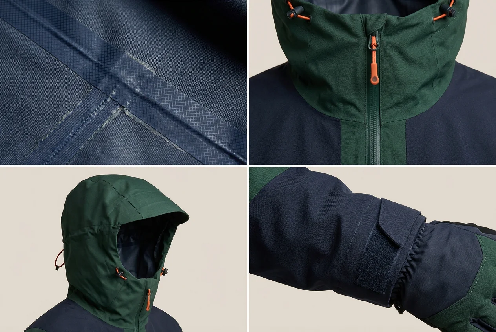

In 2022, I set off on a motorcycle from London and traveled to Nordkapp, the northernmost point of Norway. This 51-day journey was incredibly challenging; I actually froze. After a brief period of sunshine, the rain started, then the wind picked up. I spent the entire journey constantly taking my jacket on and off, battling against the constantly changing weather.

I’ve repeatedly found myself caught in the rain on the road. At times, I had to continue riding my motorcycle, at other times, I had to walk, and sometimes, I had to set up camp while being in the rain. Despite this, thanks to good equipment, my upper body remained dry, and I was able to continue my journey, no matter how challenging the weather conditions were.

During my trip to Nordkapp, I learned very clearly: a good raincoat isn’t just about comfort. It determines whether you can continue with any activity while it’s raining.

Okay, how do you choose a raincoat? Is it enough if it says “waterproof”? Certainly not. If you put the bag around yourself, it’s also waterproof, but within five minutes, you’ll start to steam from your own body.

## When buying a raincoat, what should you pay attention to?

A good raincoat:

* The level of water resistance it will be used with must be at the appropriate level.
* You should be able to release the moisture that has formed in your body.
* The seams must be completely sealed with tape.
* The hood should be adjustable to fit your head.
* Do not let any water leak from your wrists, from the zipper, or from your waist.
* It should be comfortable enough for you to layer clothes on.
* The activity you intend to undertake should be sufficiently light and durable.

You don’t necessarily need to use the highest value of all things. The jacket you’ll use to ride a motorcycle in Norway, battling the rain for 51 days while walking your dog in İstanbul, won’t be the same jacket.

First, you should determine where and for how long you will use it.

You can also take a look at the article “[essential equipment for nature walks](/doga-yuruyusleri-icin-gerekli-ekipmanlar/)” when considering rain gear along with the other basic materials.

## Is “waterproof” and “water-resistant” the same thing?

A waterproof jacket can protect you from brief showers and light rain. If the rain intensifies or continues for a long time, it eventually begins to let water in.

Waterproof jackets are produced by using a membrane or coating to ensure they can withstand rain for a longer period. However, not all waterproof jackets provide the same level of protection.

Waterproof and water-resistant jackets are not produced for the same weather conditions.

Here, we see impermeability values such as 5,000, 10,000, and 20,000 mm.

## What do waterproof ratings of 5,000, 10,000 and 20,000 mm mean?

These values indicate how much water pressure the fabric can withstand. As the number increases, the fabric’s resistance to water generally increases.

* 5,000 mm: Light and brief showers
* 10,000 mm: For hiking, camping, and daily outdoor use.
* **20,000 mm and above:** Prolonged heavy rain, harsh weather, and demanding activities

*The water resistance value increases as the fabric’s ability to withstand water pressure also increases.*

If you’re planning a short nature walk on the weekend, 10,000 mm waterproofness may be sufficient for most conditions. However, if you’re planning a long trekking or motorcycle trip that could involve being exposed to rain for several days, it makes sense to look for models with higher protection.

If you’re carrying a backpack, be sure to factor in the pressure on your shoulders and lower back. The backpack will put more strain on your jacket at the points where it’s pressing against the fabric.

I’ve rarely had the chance to simply wait for the rain to stop on my Nordkapp journey and continue driving. There were hundreds of kilometers to cover, so it was important for the raincoat to provide protection for more than just the first half hour.

## Why is breathing ability important?

Waterproofness protects you from outside rain, while breathability protects you from sweat that forms inside.

While walking, when setting up a camp, or when moving with motorcycling equipment, your body temperature increases. If the jacket doesn’t let sweat out, moisture begins to accumulate inside. Even if the rain doesn’t enter from the outside, you will become damp due to your own sweat.

Then you say, “This coat is waterproof, you know.” Perhaps it isn’t; you are the owner of the bath inside.

Nifedex values are typically shown in the format `g/m²/24 saat`.

* 5,000–10,000: Daily use and low-intensity activities
* 10,000–20,000: Nature walks and active outdoor activities
* 20,000 and above: Long-term and highly demanding activities

The membranes, which allow breathing, help to keep the moisture that forms in the body from escaping outside, as it prevents rain from falling outside.

Because the testing methods used by brands can change, products may not show exactly the same performance in two different models, even if they use the same number. Nevertheless, they can be helpful as a reference when evaluating products.

If you tend to sweat a lot, take a look at models with zipper openings under the armrests. Sometimes, a more effective solution than the world’s most technologically advanced fabrics is simply opening the zipper and letting the warm air escape.

## Will the raincoat keep you warm?

A raincoat and a winter coat are not the same thing. A technical raincoat’s primary function is to block rain and wind, while a winter coat provides the layers you wear underneath to keep you warm.

On the Nordkapp route, my upper body was dry, but I was still freezing. Because being dry and being warm are not the same thing. You need to wear an appropriate inner layer, suitable for the weather conditions, under a raincoat, and an additional layer like a polar fleece or similar.

Your waterproof jacket should have enough room to layer clothing underneath. However, the jacket shouldn’t be too baggy and puff up like a balloon in the wind. For more information about layering, you can read the article “[How to Dress for a Hike](/doga-yuruyuslerinde-nasil-giyinilmelidir/)”.

## What is a 2, 2.5, and 3-layer raincoat?

This describes how waterproof fabric is produced, not how many layers you wear under a coat depending on how many clothes you put underneath.

### 2-layer waterproof jacket

The outer fabric is joined with a waterproof membrane. An additional inner lining is included to protect the membrane.

In everyday use, it’s comfortable and generally quieter. However, it can be heavy and bulky compared to other options. It’s suitable for city use, camping, and low-intensity walks.

### 2.5-layered raincoat

The inner layer consists of a fine, protective print that shields the outer fabric, membrane, and membrane. Its lightweight and easy-packability are its greatest advantages.

It’s suitable for running, cycling, and day hikes. However, it may be less durable than three-layer models. Some models can feel sticky against the skin as you move, giving a slight plastic-like sensation.

### 3-layer waterproof jacket

The waterproof membrane is placed between the outer fabric and the inner protective layer. This is generally the most durable option.

Long trekking routes are more suitable for those involved in mountaineering and long, challenging journeys. However, they are also more expensive. You don’t necessarily need to wear a three-layer mountaineering jacket when going to the market.

As the number of layers increases, durability generally rises; however, weight, intended use, and price should also be considered.

## Do the seams and zippers resist water?

The fabric’s 20,000 mm rating alone isn’t sufficient. If water is getting through the seams, it means you have an expensive, but ultimately holey, jacket.

For a truly waterproof jacket, the seams must be sealed from the inside. Look for the phrases “fully taped seams” or “all seams are sealed” in the product description.

It is also important that the main zipper is waterproof, or that there is a protective cover to prevent rain from entering.

Pay close attention to the placement of the pockets. If the pockets close when you attach your backpack to your belt, a minor issue may arise during long journeys. Pockets that are easily accessible and don't require water are truly helpful.

## What should be the cut of your hooded jacket and coat?

The hood should move with you as you turn your head. If the hood continues to look in the opposite direction when you are looking to the right, it’s not very practical.

The strings for adjusting the front and back should help prevent the hood from coming undone in the wind. And the firm flap on the front will also reduce rain from running onto your face.

Trying Montu:

1. Normally, wear the layers you usually use.
2. Raise your arms upwards and extend them forward.
3. Put on your hood and turn your head to the right and left.
4. If possible, try it with a backpack.
5. Check the wrist and back settings.

*Seam taping, secure zippers, and properly adjusted hoods directly impact the overall performance of the jacket.*

You should avoid excessive movement, but it shouldn’t completely restrict it. For trekking, models that extend slightly towards the hips can provide better support. For running and cycling, lighter, close-fitting, and easily packable models may be more practical.

## What is DWR coating?

DWR is a water-repellent coating applied to the outer surface of fabric. It prevents rainwater from soaking into the fabric, causing it to bead and roll off the surface.

However, a waterproof membrane with DWR is not the same thing. This coating gradually loses its effectiveness over time due to dirt, sweat, and use. When the outer fabric begins to absorb water, the jacket becomes heavier, retains moisture, and it becomes difficult for it to breathe.

The inner membrane may still be stopping the water, but you might feel like the jacket is feeling like it’s leaking, due to the wet outer fabric.

If the raindrops are no longer running off your jacket, it might be time for maintenance. Please read the product’s washing instructions and use cleaning products suitable for technical garments. Do not soak the jacket in regular detergent and then question why it’s not working as before.

## What kind of raincoat should be purchased for what purpose?

**City and Short Walks:**\ 5,000–10,000 mm protection, comfortable cuts, and a two-layer structure are often sufficient.

Day hikes: Waterproofness of at least 10,000 mm, taped seams, good breathability, and an adjustable hood are desirable.

Long trekking and camping trips: 10,000–20,000 mm or higher protection, durable fabric, high breathability, and pockets suitable for use with a backpack are important.

Running and cycling: Lightness, breathability, and ventilation are key. Lightweight, 2.5-layer models that are easy to pack can be useful.

Motorcycle trips: Long-term resistance to rain, wind protection, completely sealed seams, and wrists adjustable with gloves are important. The jacket should not restrict your stomach position while riding.

Mountaineering and harsh weather: Technical models with three layers, durable, and high water resistance values should be preferred.

## What raincoat should I buy in summary?

The most suitable raincoat for you isn’t the one with the highest number, but rather the one that’s appropriate for the task you’re undertaking.

I’m looking for a jacket with at least 10,000 mm of waterproofness, good breathability, fully sealed seams, an adjustable hood, and ventilation zippers – all for long nature walks and multi-day trips. If there’s a high chance of being in the rain for extended periods, I would opt for models with 20,000 mm or higher.

During a 51-day journey to Nordkapp, the rain was taking a heavy toll on me, but I couldn’t stop it. A significant part of this was due to the gear keeping my upper body dry. I was freezing, and I said, “Where did this rain come from, man?” but I continued my journey without getting ill and without giving up.

A good raincoat doesn't stop the rain; it allows you to stand in it continuously.

## What’s your raincoat experience like?

Do you actually have a raincoat that you can really use in the rain? You can share your brand and model, its waterproof rating, and the conditions you tested it in in the comments.

Did the water come from outside, or did you get wet from your own sweat? I’m particularly interested in hearing about your experiences on long journeys, with motorbikes, camping, and trekking. Perhaps your comments will prevent the next person needing a rain cover from getting wet :)
