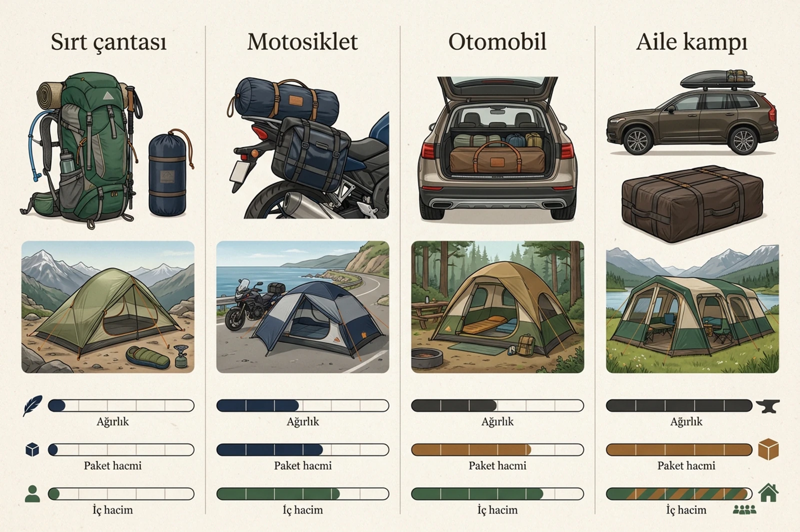
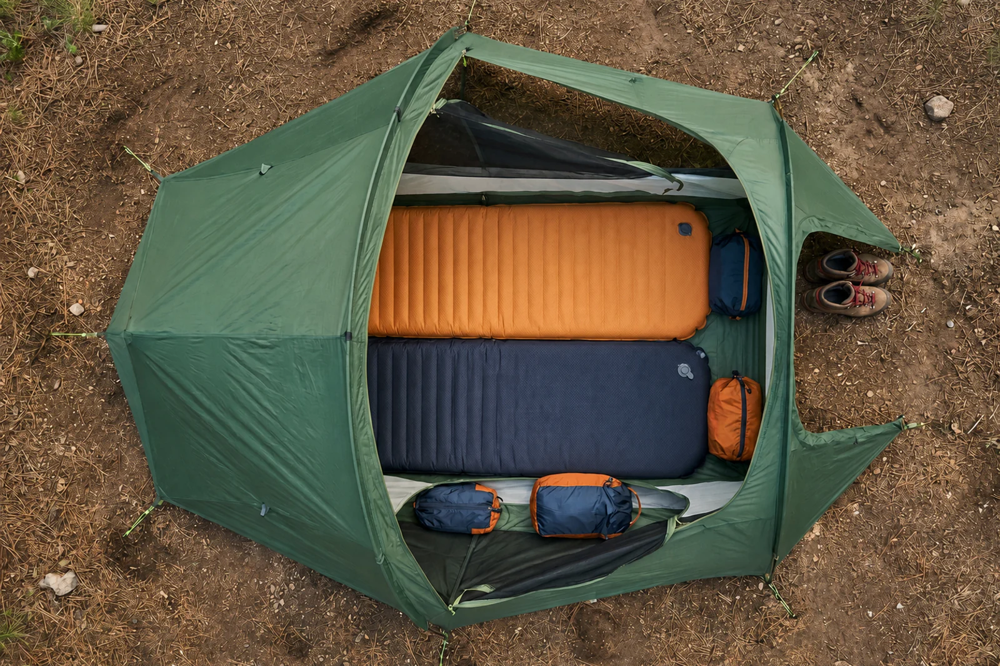
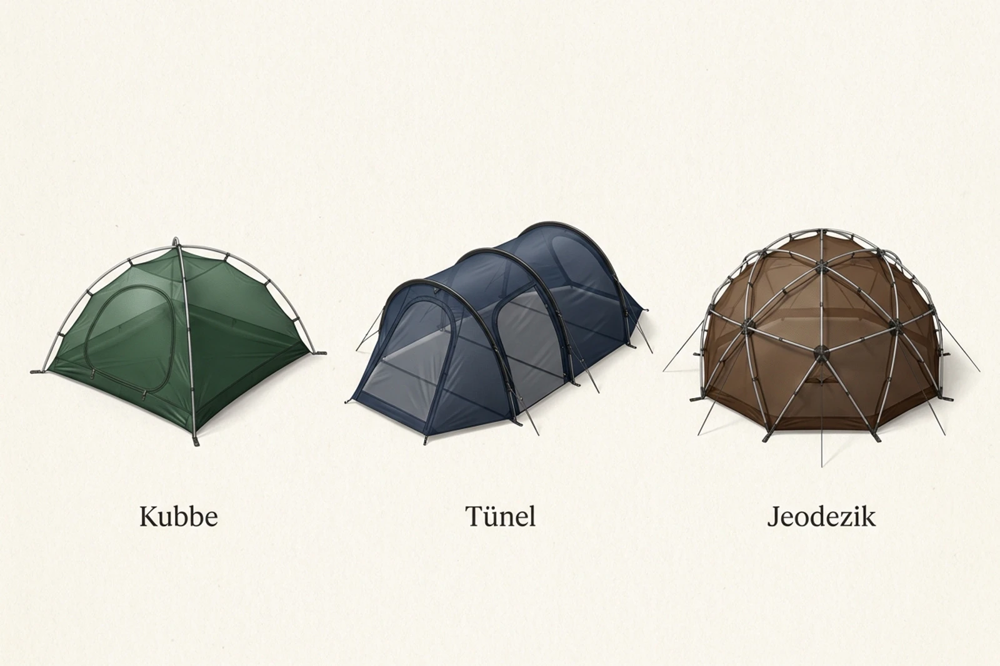
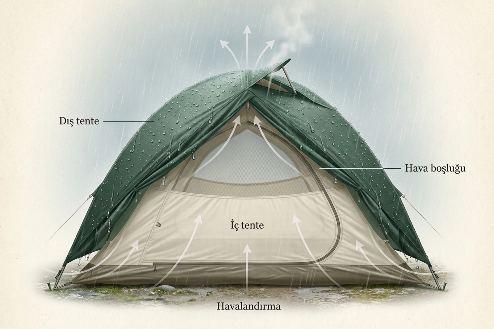
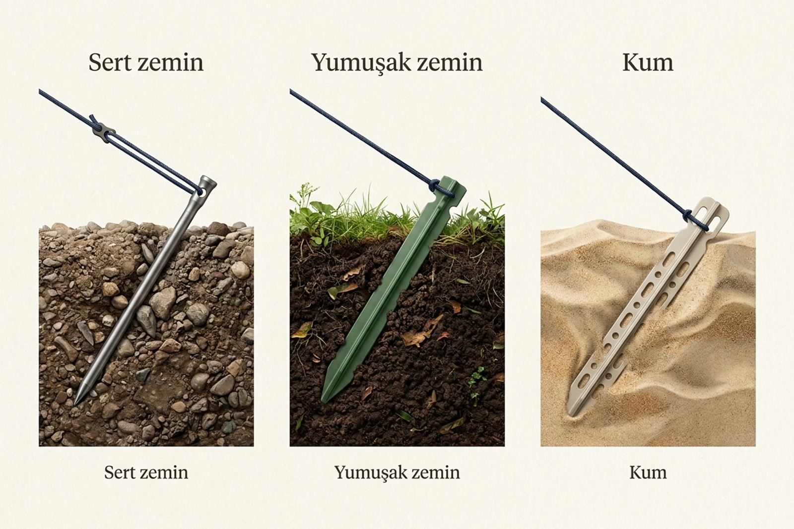

One of the questions I get asked most often is: “What should I pay attention to when buying a tent, and what kind of tent should I get?”

The short answer is: There isn’t one single tent that’s suitable for everyone. It’s not really logical for someone who wants to camp for two nights next to a vehicle to choose the same tent they’d use to carry all their gear on their back.

First, determine where you will set up the tent, with whom, and how you will transport it. Then, compare weight, package volume, interior space, weather conditions, ventilation, and setup method. After that, begin your search for brands and models.

> A good tent isn’t necessarily the one with the most features in the store; it’s the tent that causes the fewest problems in your camping experience.

## What should you pay attention to when buying a tent?

The first question you should ask isn’t “How many people should I buy a tent for?” but rather, “How should I use this tent?”

If the tent is going to be transported in the car’s trunk, a few extra kilograms aren’t the end of the world. A large trunk space, a living area where you can stand, and easy access are actually more important.

When a motorcycle, bicycle, or backpack comes into play, the calculation changes. This time, you need to consider not just the weight, but also the folded length and volume of the tent. A large package, even if lightweight, won’t work because it can’t be attached to the bag or motorcycle.

First, determine the method of transport; the correct weight and volume calculations will follow.

| Type of trip | What to prioritise | Acceptable compromise |
|---|---|---|
| Car camping | Interior volume, boot space, ceiling height | Extra weight and volume |
| Motorcycle or bicycle | Package size, ease of securing it to the bike, weight | More limited living space |
| Trekking | Total weight, small packed size, weather resistance | Less internal space |
| Family camping | Separate sections, ventilation, wide entrance | Long installation time |
| Winter and open terrain | A robust frame, solid fastening, wind and snow resistance | Higher weight and price |

## How many people should you buy a tent for?

The number of people written on the tent usually indicates how many people can sleep side by side. However, this does not guarantee that your bags, boots, and other equipment can comfortably reside inside.

If you’re planning to hike alone and keep your weight to a minimum, a solo tent might be a good option. However, if you’re planning to stay for a longer period, want to store your equipment, or simply desire a bit more space, a two-person model would likely be more comfortable.

When I was buying the Ben Ferrino Lightent, I initially considered the single-person model. There was about a 300-gram difference between the single-person and two-person models. In the end, I bought the [Ferrino Lightent 2](/ferrino-lightent-2-kamp-cadiri/), and I was glad I had done so. When I was traveling alone, it gave me extra space for my belongings; and when two of us went, we didn't need to carry a second tent.

This isn’t about suggesting that everyone should buy a two-person tent when camping alone. You need to decide whether the extra space’s weight is worth considering.

Don't compare the number of people listed on the label; instead, compare the actual usable space.

Regarding the product dimensions, please refer to the following:

- The width and length of the sleeping area as well as the total floor area
- Whether or not the mats you will use fit together side by side.
- How steeply the roof slopes down at the head and foot ends
- Whether the bags will be kept inside, or in the vestibule.
- Whether the door can be used at night without disturbing the other person.

## Why are weight and package volume important separately?

The first tent I used weighed approximately 4 kilograms. When I simply went to a place for camping, this weight wasn’t a major problem. However, when it came to trekking, the same tent became a significant burden on my back.

Initially, I was thinking, “I’m carrying an extra two kilograms, what will happen?” As experience increased, I began to realize that even 100 grams could feel significant by the end of the day. It became clear that some things had to be learned through experience.

However, simply looking at the weight listed in the catalog isn't enough. You should also check the following:

- Does this value only cover the tent body, or also the poles, stakes, and transport bag?
- What is the length and diameter of the folded tent?
- Does it fit in your pack or carrying bag?
- Can the poles be securely attached to a motorcycle or bicycle?
- Can the weight be shared between two people?

The setup of the [2 Seconds Easy 3 camping tent](/2-seconds-easy-3-kamp-cadiri/) I examined was easy, and its interior volume was spacious. However, in its folded state, it wasn’t suitable for transporting on a motorcycle. For someone who doesn’t have a problem with space in their vehicle’s trunk, this might not be an issue.

So, “light tent” and “easy-to-carry tent” are not always the same thing.

## Which tent type is suitable for you?

The shape of the tent not only affects its appearance, but also how it’s set up, the usable space it provides, and how it behaves in the wind.

The shape of the tent also determines how much of the ground you’ll be able to cover when setting it up.

### Dome tent

The poles are typically crossed in the center. Many dome tents can stand alone and are easy to set up. They are practical for general camping use and for those who frequently move their setup.

Maintaining that it doesn’t mean it needs to be anchored; you don’t want to chase an unsecured tent in the campsite when the wind picks up.

### Tunnel tent

Thanks to its structure made of parallel beams, it offers a large interior volume relative to its weight. It is frequently seen in family tents and among those seeking a long-term living space.

It needs to be properly stretched and firmly anchored. Fixation points must be considered from the outset on hard or rocky ground.

### Geodesic and semi-geodesic tents

Multiple beams intersecting at different points distribute the load on the structure. It is preferred in open areas, when strong winds are possible, and in more challenging conditions.

This increased strength typically comes with more poles, higher weight, longer setup times, and a higher price.

## Three seasons, or four seasons?

The phrase “dört mevsim” does not necessarily mean a better tent for every camping trip. This classification refers to the weather conditions that are expected throughout the year, rather than the type of tent needed.

Tents designed for use during the spring, summer, and autumn seasons are typically created for use when heavy snowfall is not anticipated. They often have a larger mesh area, with an emphasis on lightness and ventilation.

Four-season tents are produced with stronger frames, taking into account strong winds, snow load, and harsh winter conditions. This comes at a cost – typically increased weight, reduced ventilation, and a higher price.

If you’re not planning on going on winter camping, simply carrying a tent for all four seasons might be unnecessary. On the other hand, relying solely on a “three-season” label is not correct on terrains that are high, open, and experience rapid changes in weather. Be sure to carefully examine the structure, attachment points, and the manufacturer’s specified usage conditions.

## What does the tent's waterproof rating indicate?

The water resistance values you see on tent fabrics, such as 2,000 mm, 3,000 mm, or 5,000 mm, indicate the hydrostatic water pressure test result. The amount of water the fabric allows to pass through is measured in a laboratory environment.

The value of 3,000 mm indicates that the fabric was tested against a pressure equivalent to approximately three meters of water column. However, this figure does not guarantee that you will remain dry within the tent under all conditions.

For general use across three seasons, a range of 2,000–3,000 mm is a reasonable starting point. If there is prolonged rainfall, rain being dragged by wind, or if the camping area is more exposed, it is advisable to consider higher values. Regarding the base fabric, it is normal to encounter higher values due to the pressure exerted by the body and equipment.

But also check the following alongside the numbers:

- Are all of the seams sealed with tape?
- Is it rising high enough to prevent the bottom edges from being flooded by the water?
- Is the outer tent close enough to the ground?
- Does rain come straight in when you open the door?
- Can the fabric’s coating and seam tapes be easily repaired?
- Does the manufacturer give separate ratings for the flysheet, inner tent and groundsheet?

A tent with a high water impermeability rating on paper, but which is poorly constructed and has worn seams, can still absorb water. A tent with a lower rating, but which is properly tensioned, well-maintained, and well-designed, might be a better fit for your usage scenario.

## Is it single-layered, or double-layered?

Single-layer tents are simpler, lighter, and quicker to set up. However, due to moisture forming inside, condensation can be more difficult to manage, as it tends to condense directly on the surface.

In double-layered tents, there’s a separate inner space where you sleep, and a separate outer canopy that protects you from the rain. The air gap between the two layers helps to keep moisture within the sleeping area away from the sleeping space.

*The space between the inside and outside tent fabric helps to keep condensation away from the sleeping area.*

In my experience, tents with separate inner and outer layers are more practical in terms of ventilation. However, having two layers doesn't completely eliminate condensation. If you close the ventilation openings, pack wet clothes inside, and allow the outer layer to sag just enough to touch the inner layer, you may still encounter condensation in the morning.

> The tent might be perfectly waterproof. That steam room inside? You might have made it yourself.

## What is the importance of the installation method and the ground conditions?

Some tents stand upright when their poles are secured. However, others need to be anchored to the ground and tensioned in order to take their proper shape.

The most important thing I encountered with the Ferrino Lightent 2 was that it needed to be set up by first securing it with pegs. It wasn’t a problem on soft ground; however, setting it up on hard ground where the stakes couldn’t be hammered was a significant challenge.

Therefore, before purchasing the tent, find the answer to this question:

Can I still set up this tent if I can’t drive the stakes in?

*The size of the stakes used to secure it to the ground should also be carefully chosen, just as important as the tent itself.*

More robust stakes may be needed on hard, rocky ground. The stakes I’m using – [Ferrino steel tent pegs](/ferrino-cadir-kazigi/) – gave me confidence on this type of ground, but because they were steel, they weren’t suitable for carrying in a backpack. For sandy and loose ground, wider models are needed rather than thinner stakes.

Don’t expect the stakes that come with the tents to fit every surface. Sometimes, exchanging the stake set according to where you’re setting up the tent is more practical than exchanging the tent itself.

## What small details make a big difference at the campsite?

### Gear storage

The area between the outer tent and the interior provides a sheltered space where you can store muddy boots and wet equipment without exposing them to the sleeping area. Even a small bag offers significant comfort in wet weather.

However, this is not a place for using a stove. Using a stove, grill, or campfire inside the tent, through the entrance, or in the enclosed vestibule carries a risk of fire and carbon monoxide poisoning. Use the stove outdoors, at a safe distance from the tent.

### Number of doors

In a small tent accommodating two people, featuring two doors, it allows you to exit without passing each other at night. The second door and vestibule increase the weight, but can significantly improve comfort during long camping trips.

### Ventilation openings

Look for ventilation systems that can be kept open even when it’s raining. A tent that’s only ventilated by opening the door might force you to choose between being exposed to bad weather.

### Setup order

Some models are initially set up as an inner tent, followed by an outer tent structure. When setting up in rainy weather, consider whether the inner tent will get wet if done first. The outer tent provides an advantage if it is set up in front of or as a double layer.

### Spare parts and repair

Check that you can get replacement pole sections, connectors and fabric patches. A little repair tape can stop a tear spreading, and a splint can hold a broken pole together until you get home. Neither takes up much space in the tent bag.

### Groundsheet

A footprint sized appropriately for a tent can reduce wear and tear on a rocky surface. However, do not use a cover that is so large that it extends beyond the tent. Rainwater can accumulate on the cover and drip onto the bottom of the tent.

## What questions should you ask before buying a tent?

Before pressing the “purchase” button, please review the following list:

- Should I mostly carry the tent in the car, on the motorcycle, on the bicycle, or on my back?
- What is the actual total weight of the package, including poles, pegs, and carrying bag?
- Will it fit on or in whatever I’m using to carry it when packed?
- Will my mat and sleeping bag fit comfortably inside?
- Is there enough space inside or in the baggage compartment for the equipment?
- Can this tent be set up without stakes?
- What is the water resistance of the outer tent, the base, and the seams?
- Can the ventilation openings be used while it's raining?
- Is it possible to try the initial setup at home or in the garden?
- Can the damage to the poles and fabric be temporarily repaired on-site?

If possible, try to look like the tent is already set up before you buy it. Spread your mat or a similarly sized blanket inside. Sit, lie down, and check if your head touches the ceiling. The centimeters in the catalog become more meaningful when you are sitting inside the tent.

## Before the first camping trip, how can you practice setting up a tent?

Do not set up the tent for the first time in the camping area after dark. Set it up at home, in the garden, or in any designated area at least once. During this time, learn how the poles go through which channels, how the inner and outer tents are connected, where the stakes are hammered, and how the ropes are tensioned.

During testing, also check the following:

- Do the posts and connection points fit together?
- Is the inner tent, the outer tent, and the ground cover positioned correctly?
- Do the doors and ventilation openings open freely?
- Is there enough room inside the tent once your mat and sleeping bag are laid out?
- Is it possible to use an alternative method of fixing/securing on a very hard surface that I can’t drive a stake into?
- When you pack up the tent, do all the pieces fit back into the carrying bag?

Measure your setup time once. This isn’t a race; but knowing how long it takes you to set up the tent before sunset makes your first camping trip much more relaxed. If you have to pack the tent while it’s wet, make sure to dry it completely and store it when you return home.

## If I were, how would I choose a tent?

If I were going camping in a car, I would prioritize interior space over weight, followed by ventilation and a comfortable trunk area.

If I were traveling by motorcycle or bicycle, I would calculate the packing dimensions, the length of the poles, and how the tent would attach to the vehicle.

If I were planning a trek, I would aim to reduce my total weight, but I wouldn’t choose a tent that isn’t suitable for the ground it will be set up on and the expected weather conditions, even if it only saves a few hundred grams.

The most expensive, lightest, or fastest tent isn’t necessarily the right one. The right tent is the one that matches your preferred way of transporting it, the destination you’re going to, and the level of comfort you’re looking for.

Tell us where you use your tent the most, with how many people, and what method of transport you use; if you write about the weight of the model you use, its packed dimensions, and the feature that you find most comfortable or troublesome, you’ll give a good idea to someone looking for the same thing.
