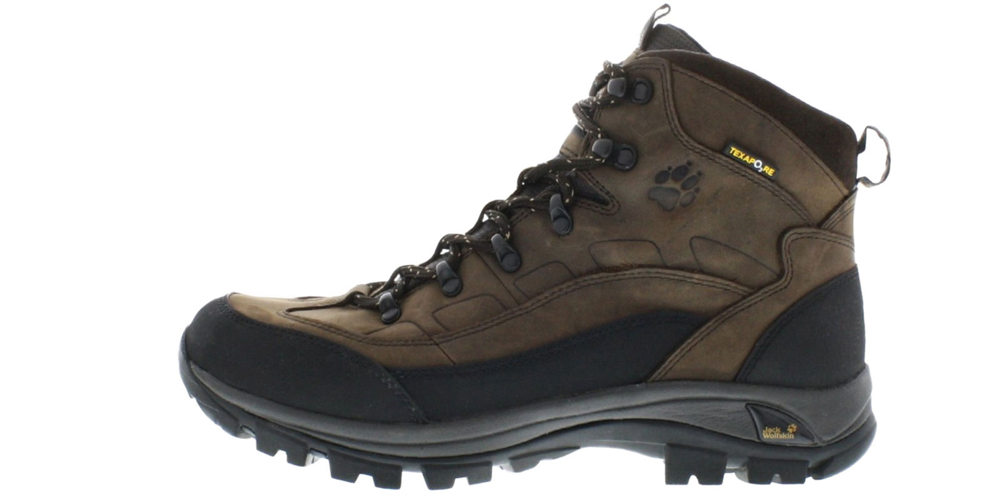

Here’s the question I’d ask instead.

## What kind of shoes should you wear for nature walks?

Whether your activity is called Trekking or Hiking, you can take my following views into account when choosing your footwear. You can also get more detailed information from the articles [What is Trekking?](/trekking-ne-demek/), [What is Hiking?](/hiking-ne-demek/) and even [What are the differences between Trekking and Hiking?](/trekking-ile-hiking-arasindaki-farklar-nelerdir/).

Anyway, back to the shoes.

You don’t really need to spend all that money on trekking boots. Yes, you heard me. Why blow your budget on boots that start at 300 TL? (It’s 2017 now and a decent pair of Gore-Tex boots costs around 600 TL. How’s that supposed to work? Beats me.) A decent pair of trainers will do you just fine.

“Now you’re talking, mate! Just the man I was looking for. There I was about to spend a fortune on boots, and you’ve let me off the hook. Keep talking. I like the sound of these cheap fixes.”

As someone who has done long-distance hikes with sports shoes, a comfortable winter boot, and trekking shoes, I can assure you that this kind of experience doesn't exist. Even sports shoes won't grip your ankles, and you’ll feel every stone on the ground, from the smallest to the largest and the most jagged ones. A comfortable winter boot, on the other hand, is designed for city use. While it will fit around your ankle, it will cause your feet to sweat within a non-ventilated boot, and it will soon collect water. Furthermore, because it won't firmly grip like a trekking boot, your foot will constantly slip. Additionally, it won’t cut off your contact with the ground, allowing you to feel some of the stones on the ground.

So, what will happen when you spend so much money on a trekking boot? You can be sure that your walks will be much more comfortable. If you choose a boot made of materials like Gore-tex or Texapore, your feet won’t get wet, and the inside of the boot will always be ventilated. This is because these fabrics allow air molecules to pass through, but not water molecules. How does this work? It’s very simple. Water molecules are bigger than air molecules, so they can’t get through. Another advantage is that your feet won’t immediately soak (you won’t be able to avoid this in very hot weather). Thanks to its thick sole, it will provide a comfortable walk by cutting off contact with the ground. If you choose a boot that wraps around your ankles, the risk of ankle sprains will be reduced. In addition, your ankles will be less tired.

Ultimately, you can enjoy many years of pleasant walks by investing in a really good trekking boot. It’s worth the money. You get what you pay for :)

For those curious, some extra info: The [Jack Wolfskin Solid Trail Texapore Men's Trekking Boots](/jack-wolfskin-erkek-trekking-botu/) you see in the photo have been retired after I used them for a while. These days, I'm using the [Lowa Zephyr Mid Gore Tex Hiking Boots](/lowa-zephyr-gtx-mid-bot-sage/) and the [Meindel Respond GTX](https://meindl.de/product/respond-gtx-en/?lang=en) hiking shoes. When choosing trekking boots, make sure they're half or a full size larger than your feet. My usual shoe size is 42, but I wear size 43 trekking boots. Your trekking socks will fill some of that space. Plus, your toes won't get jammed when going downhill, so you'll be much more comfortable.

Relaxing walks…
