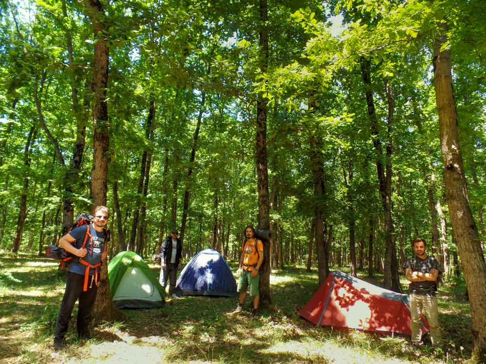
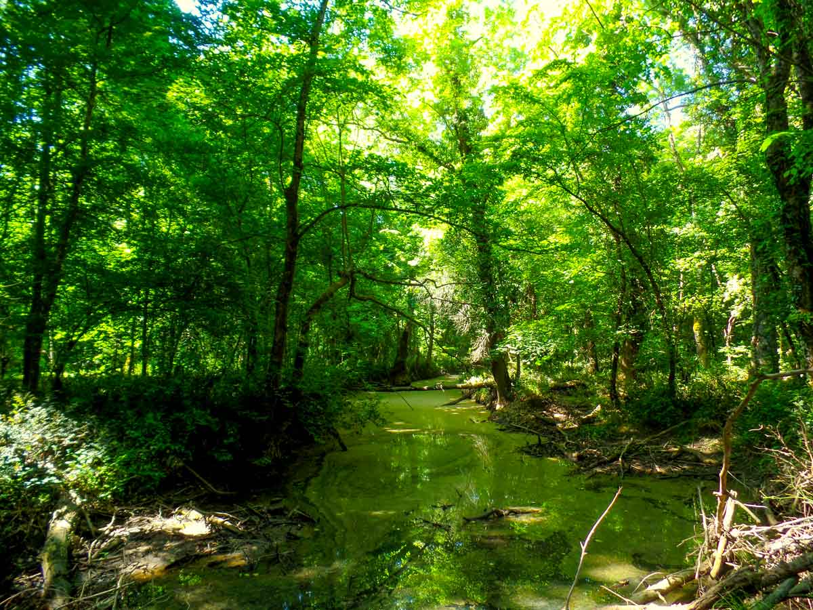

### Where are İğneada’s floodplain forests and how do you get there?

Set off from İstanbul using the TEM highway towards Lüleburgaz. When you arrive in Lüleburgaz, follow the road leading from the TEM towards Poyralı. Upon reaching Poyralı, you will reach İğneada via Demirköy. Another alternative route is Saray->Vize->Poyralı. However, I advise against using this route, as it is in poor condition. The easiest route is to go via Lüleburgaz.

<iframe
  class='mappingFrame'
  style={{ border: 0 }}
  src='https://www.google.com/maps/embed?pb=!1m26!1m12!1m3!1d381825.410174104!2d27.620637072355983!3d41.61227344687777!2m3!1f0!2f0!3f0!3m2!1i1024!2i768!4f13.1!4m11!3e0!4m3!3m2!1d41.4406439!2d27.4310512!4m5!1s0x40a0e8bc9dc279f1%3A0x77a6840403a3fb88!2zxLDEn25lYWRhLCBEZW1pcmvDtnksIFTDvHJraXll!3m2!1d41.8377154!2d27.948473399999997!5e0!3m2!1str!2s!4v1433954465404'
  width='300'
  height='150'
></iframe>

 

### İğneada Longozlar camping area information

##### Available facilities

- Campsite (privately run, on the beach).
- Clean water
- Toilets
- Grocery shop
- Restaurant
- Guesthouse

Note: This information dates back to June 2015.

### Trails through İğneada’s floodplain forest

#### From Kıyıköy to İğneada, then on to Beğendik Bay (50 km)

<iframe
  frameBorder='0'
  scrolling='no'
  src='https://tr.wikiloc.com/wikiloc/spatialArtifacts.do?event=view&id=6834583&measures=on&title=on&near=off&images=on&maptype=H'
  width='100%'
  height='600'
  style={{ borderRadius: '10px 10px' }}
></iframe>

- Starting from Kıyıköy beach, you will follow a dirt road within the Longoz forest and eventually reach İğneada. After İğneada, you will then proceed along another dirt road within the forest, leading you to Beğendik cove.
- Take your water before setting out. You can obtain additional water at the campsites and centers indicated on the route.
- It’s an easy course to follow. However, its length can be tiring, so you might prefer to do only a portion of it, rather than the entire course.
- You can also start this route at Beğendik Bay.

#### Mert Lake area (9 km)

<iframe
  frameBorder='0'
  scrolling='no'
  src='https://tr.wikiloc.com/wikiloc/spatialArtifacts.do?event=view&id=9818328&measures=on&title=on&near=off&images=on&maptype=H'
  width='100%'
  height='600'
  style={{ borderRadius: '10px 10px' }}
></iframe>

- In İğneada, you enter the forest from the starting point of the area where the houses have finished, directly into the forest itself.
- Wearing a long garment instead of shorts will protect your legs from being scratched.
- During the spring months, water levels are rising, which could make crossing the stream difficult.
- Take water before you set off. There is no clean water along the route.
- It might appear like an easy trail at first glance. However, the bushes and stream crossings within the forest will tire you out. Since it’s not a clearly marked hiking trail, searching for a path within the forest can be exhausting.
